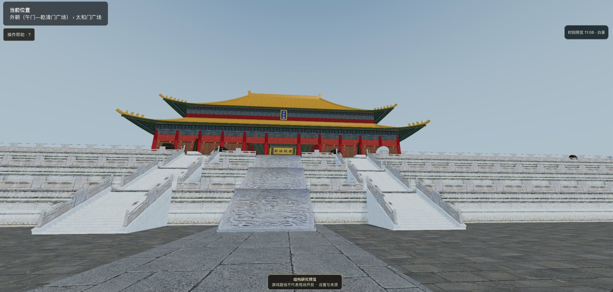
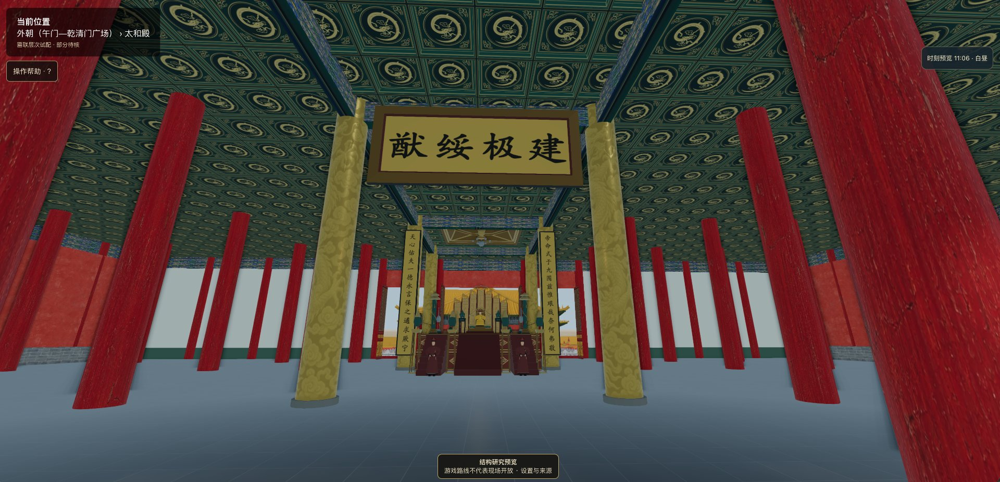
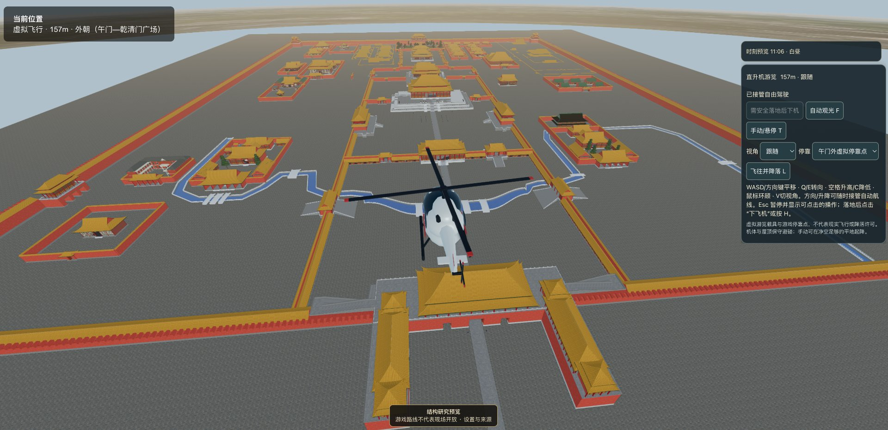
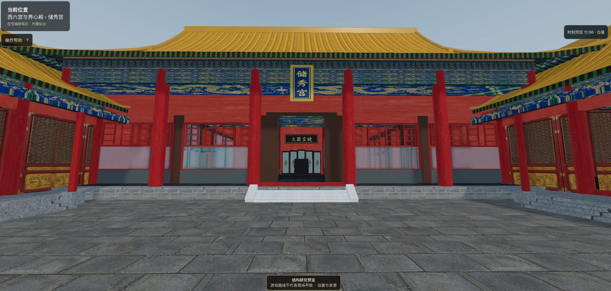
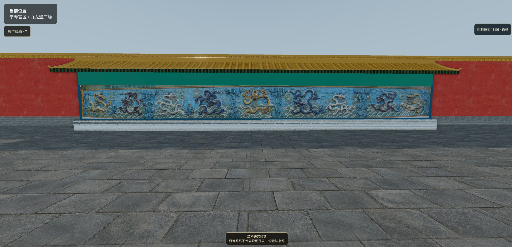
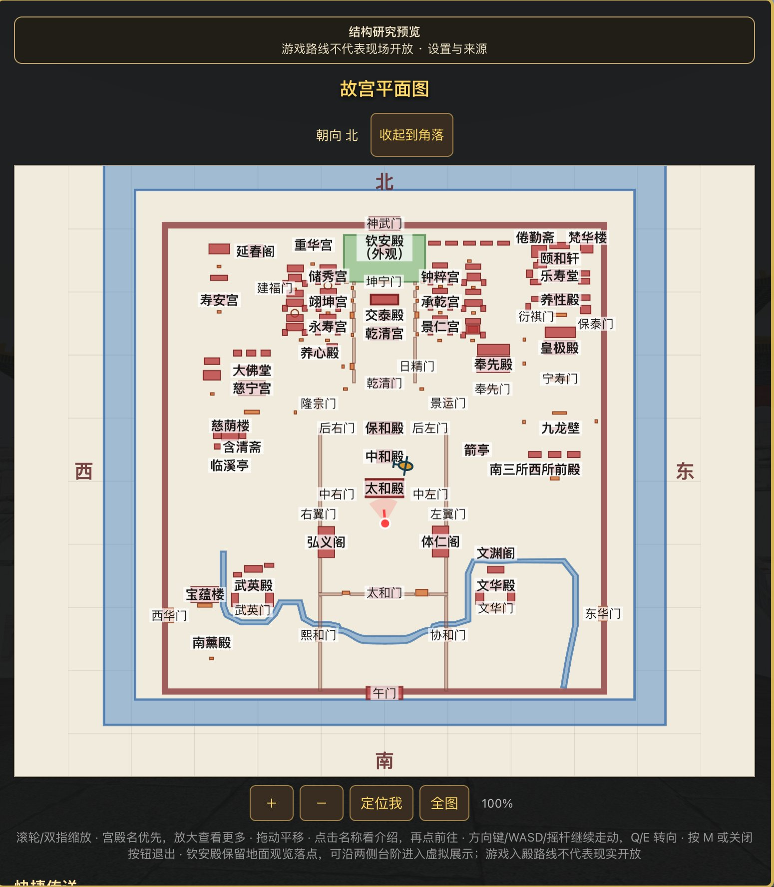

# 3D 故宫 · R164累计后继：同步构建步骤定位

在5030抑斋累计候选上，保持同一调用栈及原构建顺序，增加每区有界步骤计时；没有分帧、移动/碰撞改动或异步加载开关。它帮助定位长任务，不代表已经加速或修好储秀宫现场崩溃。

- 真实西六宫前后完整几何、3223接触/138面、地图及默认32MiB缓存拒绝保持；本机冷重建仍约0.9–1.1秒，崇敬殿单步约0.24秒。冷热单样本不能用于宣称提速。
- 同步构造返回、原错误身份与清理、gate-first及全部钩子顺序已验证；真实宁寿20落点与抑斋/三友/玉粹等累计路线保持。本轮953不同用例950过/3旧红，独审24通过，不冒称全套全绿。
- builder本地记录最多8个最慢步骤，仅固定枚举/数字；现有F3、首错复制摘要和皇帝端点行为不变。没有对外发送诊断。
- 5030及以前候选保留回滚，不改main、不部署。完整World、浏览器/GPU/手机、Node20、Mac温度未验，397项与实际加载缓解仍继续。

[本轮结果](docs/current-state/r165-synchronous-build-steps/RESULT.md) · [验证记录](docs/current-state/r165-synchronous-build-steps/VERIFICATION.json) · [固定步骤映射](docs/current-state/r165-synchronous-build-steps/STEP-MAP.json) · [原三项旧红](docs/current-state/r165-yizhai-main-shell/PREEXISTING-TEST-FAILURES.md)

## 5030及更早历史记录

# 3D 故宫 · R164累计后继：抑斋主体与前后廊

从c080分区加载计量候选继续J21，新增抑斋南向非对称主体、前后廊与两处错位浅阶。官源支持主要形制，坐标、尺度、后门位置和简化门窗为有标注的游戏拟合；未知内景闭合，不造暗道或新增传送，不计整项完成。

- 保留首错本地可复制诊断、皇帝端点、分阶段加载计量、三友轩/玉粹轩与此前全部累计源代码；不改main、不覆盖冻结c080、不部署。
- 真实宁寿原28958网格、7908接触、363面及20受测落点全保持；新72正/16负、24普通起跳、60沿坡高落退出和24邻接通过。完整World与任意屋顶方向均未验收。
- 本轮935不同正式用例932过/3项既有红；独审21不同用例通过。额外旧综合脚本中止/锚点偏差另列，不冒称全套全绿。
- 碰撞临时索引因认证语义风险撤回，替代循环没有可靠稳定收益也未纳入；本轮不称修复储秀宫根因、消除西六宫长任务或Mac降温。
- 浏览器/GPU/手机、Node20、真机温度未验。应用标识仍R164，R165为分区增量目录；构建/远端身份以最终回读为准，不表示已上线。

[本轮结果](docs/current-state/r165-yizhai-main-shell/RESULT.md) · [验证记录](docs/current-state/r165-yizhai-main-shell/VERIFICATION.json) · [来源和拟合](docs/current-state/r165-yizhai-main-shell/SOURCE-MANIFEST.md) · [J21登记](docs/current-state/r165-yizhai-main-shell/J21-CODE-APPENDIX.json) · [三项旧红](docs/current-state/r165-yizhai-main-shell/PREEXISTING-TEST-FAILURES.md)

## c080及更早历史记录

# 3D 故宫 · R164累计后继：本地分区加载计量

在b5三友轩累计版上增加F3分阶段CPU耗时和首错可复制摘要的白名单加载线索。只帮助定位，不改变几何、碰撞、缓存32MiB上限、人物、画质或队列策略，不称已经修复储秀宫崩溃或Mac卡顿。

- 最近加载显示完整总时、构建及其合批子项、碰撞/走面登记和最近非空队列耗时；8ms为任务间预算，不是单任务硬上限。
- 本轮920项917过/3项已知旧红；独审109项通过。真实west-six前后全摘要、奉先缓存及east/garden失败重试保持。
- 首错摘要不自动上传，不含原消息/栈/路径；原开发者控制台仍保留原错误。最近加载/队列可能不属于首错事务，不能单凭它归因。
- 保留三友轩、玉粹轩、皇帝端点和之前累计修复。b5与0c冻结可回滚；不改main、不部署，397项仍在开发。
- 完整World、浏览器/GPU/手机、真实剪贴板、Node20和Mac温度未验。应用标识仍R164；构建与远端身份以最终回读为准，不表示已上线。

[本轮结果](docs/current-state/r165-zone-load-metrics/RESULT.md) · [验证记录](docs/current-state/r165-zone-load-metrics/VERIFICATION.json) · [三项旧红](docs/current-state/r165-zone-load-metrics/PREEXISTING-TEST-FAILURES.md)

## b5及更早历史记录

# 3D 故宫 · R164累计后继：三友轩主体与三面廊

从0c068稳定性候选继续J21分区，补三友轩南向三间、非对称黄瓦卷棚和三面可行走廊。位置、0.3m浅台/两级、比例和门窗为有据的游戏拟合，内景仍闭合，不计整项完成。

- 保留首错可复制诊断、皇帝昼夜端点、玉粹轩及此前累计修复，main与冻结分支不改、不部署。
- 本轮880项877过、3项既有红；独审22项通过。真实宁寿原全部对象/地图和20受测落点保持，新60高落与24邻接连接通过。不是全World或全地图验收。
- 旧0.5m原型两种通行红测、ramp空区守卫红测均保留并闭环；没有改公共玩家物理。
- 用户储秀宫实际崩溃根因仍未确定，未测Mac降温。World、浏览器/GPU/手机、Node20未验；旧快照2红/R72床位1红如实保留。
- 应用标识仍R164，R165是分区增量目录；准确构建与远端身份以最终回读为准，不代表已上线。397项继续进行。

[本轮结果](docs/current-state/r165-sanyou-main-shell/RESULT.md) · [验证记录](docs/current-state/r165-sanyou-main-shell/VERIFICATION.json) · [残项与旧红](docs/current-state/r165-sanyou-main-shell/PREEXISTING-TEST-FAILURES.md)

## 0c068及更早历史记录

# 3D 故宫 · R164累计后继：首错诊断与皇帝定点

本轮优先处理储秀宫异常反馈和不必要人物负载：故障后可主动复制去敏首错摘要；皇帝按游戏时间白天留太和殿、夜间切换原储秀宫床位，目标受阻等待，妃子活动保留。尚未获得用户现场首错，不能称崩溃根因已修或Mac已降温。

- 保留用户main b7ef2a4f与累计23f224f4两个祖先，玉粹轩和此前累计改动同树保留；只新开发分支，不改main、不部署。
- 本轮220个有界用例219过、1个既有R72床位登记断言红；不称全套全绿。诊断59项、皇帝专项21项通过。
- 皇帝跨宫advance为0，活动认证网格1304→40；原108身份/两床/建筑/玩家碰撞不变。只量化CPU数据，未测GPU或温度。
- 完整World、浏览器/GPU/手机、真实剪贴板权限和Node20未验。397项仍未完成，I29/J21及建筑残项保留。
- 应用版本仍R164；新构建/远端身份以交付回读与build-info为准，不能据本文认为线上已更新。

[本轮结果](docs/current-state/r165-chuxiu-stability/RESULT.md) · [验证记录](docs/current-state/r165-chuxiu-stability/VERIFICATION.json) · [旧测试失败](docs/current-state/r165-chuxiu-stability/PREEXISTING-TEST-FAILURES.md)

## 23f及更早历史交付记录

# 3D 故宫 · R164累计后继：玉粹轩主体一期

补J21玉粹轩三间主体、前廊和正阶，保留符望西阶与后侧绕路。官方支持身份/朝向/黄绿卷棚歇山，坐标、尺度与简化门窗为拟合；内部闭合，不造未知家具或新增传送。应用版本仍R164，本目录是R165/J21开发增量，不表示已上线新大版本。

- 基于并保留eeee6aa816be0f70ddc18bef6d1aa8cd979709d3；仅新开发分支，不改main、不部署。
- 新19轻量+1真实宁寿通过；扩大653项651过/2旧快照红，不能称全套全绿。初版高落入旧墙风险已按原起点/路径关闭，48高落及符望连接12条通过。
- 原28743网格、7830接触、353面、23376屋顶及20受测落点保持；新增90网格/3356三角、32接触、5面、5私材。CPU成本不代表GPU或温度测量。
- J21仅玉粹新增局部证据，其他20本轮未重审；I29保留，397未全部完成。北连廊、竹香馆通道、南山石/短垣及内景未做。
- 完整World、GPU/浏览器/手机、Node20未验，原梵华/景祺高跳边界保留。构建/远端身份以实际交付回读为准。

[本轮结果](docs/current-state/r165-yucui-main-shell/RESULT.md) · [验证记录](docs/current-state/r165-yucui-main-shell/VERIFICATION.json) · [来源和拟合](docs/current-state/r165-yucui-main-shell/SOURCE-MANIFEST.md) · [J21身份登记](docs/current-state/r165-yucui-main-shell/J21-CODE-APPENDIX.json)

## eeee及更早历史交付记录

# 3D 故宫 · R164 累计开发后继候选

本轮补庆寿堂北部缺失的福履堂、天庆堂两座五间前后廊主体，保留原地图与20个已检查传送落点，前后中央通行及两侧绕行已做真实宁寿CPU验证。名称/院序据故宫及合作测绘资料，位置、尺度、开放空壳与简化饰面明确拟合；不造未知匾额或家具。

- 仅新开发分支，未合并main、未部署；已交付b421288f81895612e57712b7460f0c91ae1f13bc原分支保留可回滚。
- 新18轻量+1真实宁寿通过，独审24项通过。扩大633有界631过/2旧快照红，另真实宁寿1过；不称全套全绿。旧神武门锚点11m差异和zone数据9警告另列，输入未改。
- 原28519网格、7726接触、335面、22104屋顶摘要及20落点保留；新增224网格/4160三角、104接触、18面、5私材。CPU成本不代表GPU或Mac温度。
- 397未全部完成，I29原29身份/25局部/0整项验收不变；两座主体不等于完整四院。配殿、院墙、廊道、井、院门及内景仍未做。
- 完整World、GPU/浏览器/手机、Node20未验；原梵华/景祺高跳边界保留。

[本轮结果](docs/current-state/r164-qingshou-north-halls/RESULT.md) · [验证记录](docs/current-state/r164-qingshou-north-halls/VERIFICATION.json) · [来源与拟合](docs/current-state/r164-qingshou-north-halls/SOURCE-MANIFEST.md) · [I29补充](docs/current-state/r164-qingshou-north-halls/I29-CODE-APPENDIX.json)。构建/上传以实际交付回读为准，未冒称线上已发布。

## b421及更早历史交付记录

# 3D 故宫 · R164 累计开发候选

当前增量：梵华楼既有5级石阶补实体接触，前两地面接近点修正；19特殊入口加保泰共20个检查目标均能解析，其他19落点不变。累计保留萃赏/遂初/寻沿等入口与此前主体、通路和用户反馈修复。

- 仅开发分支，未合并main或部署；回滚基线2e80fcbe7321f93fde594d3695c3cd7b2eeb565b。
- 本轮29轻量+真实宁寿通过；扩大有界检查有2个同基线可复现的旧宁寿侧阶快照失败，已如实记录，不能称全套全绿。
- 原视觉对象/行走面/区域/屋顶不变，仅5接触；保留梵华门楣/上层底与景祺旧高跳边界。GPU/浏览器/手机/完整World/Node20未验。
- 397项未全部完成；I29仍25处专用局部实现、0整项验收。建筑位置/尺寸按来源与通行需求有限拟合，非测绘复原。

详情：[本轮结果](docs/current-state/r164-fanhua-stair-contact/RESULT.md)、[验证记录](docs/current-state/r164-fanhua-stair-contact/VERIFICATION.json)、[既有测试失败](docs/current-state/r164-fanhua-stair-contact/PREEXISTING-TEST-FAILURES.md)、[当前I29登记](docs/current-state/r164-fanhua-stair-contact/I29-CODE-APPENDIX.json)。构建/远端状态以实际交付回读为准。

## 2e80 及更早历史说明

# R164 当前累计开发候选：萃赏楼入口支承修复

基于已回读f638d927，只给原萃赏楼台明中央前段补1条真实实体内的普通接触，并把中央入口地面点退至脚印外。保留可见几何、两后门、上层栏杆认证和所有公共物理/传送守卫。用户可见版本单源更新为R164；没有部署，不能据此认为线上已更新。

608项必要有界检查、独审49项通过。真实宁寿全28519网格/613996三角、7720旧接触/335面/22104屋顶摘要保持，仅+1接触；72条本轮进出/绕行、24高落退出、12跳跃及所有旧累计路线通过。20个受测落点仅萃赏null转成功，其他19逐字段保持；19特殊入口现18成功，梵华仍旧null。

[结果与明确边界](docs/current-state/r164-cuishang-entry-support/RESULT.md) · [来源](docs/current-state/r164-cuishang-entry-support/SOURCE-MANIFEST.md) · [验证记录](docs/current-state/r164-cuishang-entry-support/VERIFICATION.json) · [I29保留登记](docs/current-state/r164-cuishang-entry-support/I29-CODE-APPENDIX.json)。萃赏属于原397的J区，不造I29新项。I29仍29原身份、25处专用局部代码、0整项验收，不称397全部完成。回滚f638d92721f857312d77a70ea1169b7afda1802c；不改main、不部署。完整World、浏览器/GPU/手机、Node20和Mac温度未验。

# 前序R164累计候选：保泰门低墙琉璃门主体拟合

基于已回读 e999537f，仅替换保泰门通用门体为低墙琉璃门的有限形体表达，保留原东向、3.6m净口、6.4m墙口、地面/地图/落点与累计修复。官方确认身份/方向/横街东端/低墙琉璃类别；未取得完整现状立面。单洞与尺寸沿用游戏，石脚/檐型/颜色/背面/全开门姿拟合，不造未核匾文或把履顺须弥座移植过来。

567项必要有界检查通过，独审37项通过。真实宁寿原非目标28482网格/613560三角、7684接触/335行走面/22076屋顶三角摘要保持；本门48正32负12跳跃、8高落后连续退出和26排/敛禧纵路等累计通过。保泰及19个专用目标共20落点所有字段保持，19专用目标仍17成功，萃赏/梵华2历史失败待修。局部CPU几何量下降但碰撞2→36，不声称GPU性能或Mac降温改善。

[本轮结果与未验边界](docs/current-state/r164-baotai-low-gate/RESULT.md) · [来源](docs/current-state/r164-baotai-low-gate/SOURCE-MANIFEST.json) · [验证记录](docs/current-state/r164-baotai-low-gate/VERIFICATION.json) · [I29逐项登记](docs/current-state/r164-baotai-low-gate/I29-CODE-APPENDIX.json)。29原身份保留，25处专用局部代码不是25项完整验收，整项验收仍0。保底/回滚 e999537f2224acb5ae557f4067965415cb61cc2a；不改main、不部署。完整World、浏览器/GPU/手机、Node20和Mac温度未验。

# 前序R164累计候选：遂初堂传送支撑修复

基于已回读1f6e5830，仅给遂初原南阶与0.5m台明衔接片区补一条真实实体内的普通接触。原五点导航、可见几何、地图和公共物理/传送守卫全部保留；不再因局部地面误判为0而拒绝传送。整台明盒体曾阻断后口，已撤回，只保留内部南片区。

562项必要有界检查通过，独审31项通过。真实宁寿60条本轮路线、24个高起点下降后南向退出及此前72条三入口路线通过；原28498网格/614818三角、7685旧接触、335面、22436屋顶三角摘要保持，仅+1普通接触。19专用落点现17成功，萃赏/梵华仍为历史失败待修，其余18个落点逐字段保持1f6。

[本轮结果与未验边界](docs/current-state/r164-suichu-platform-contact/RESULT.md) · [验证记录](docs/current-state/r164-suichu-platform-contact/VERIFICATION.json) · [I29逐项登记](docs/current-state/r164-suichu-platform-contact/I29-CODE-APPENDIX.json)。遂初不冒充原I29新条目，29身份/24专用局部代码/0整项验收不变。保底/回滚1f6e583065d50eb655d66c3772fb798a25656e49，不改main、不部署。完整World、浏览器、GPU、手机、Node20与Mac温度未验。

# 前序R164累计候选：三处地面传送修复

基于已回读 d84a1639，仅修阅是楼、佛日楼、倦勤斋接近点误写高度导致的严格传送拒绝；按照原斜阶重新登记地面起点和坡面路径，不改几何、碰撞、玩家、地图身份或通用传送守卫。原累计共梯、26排、入口及用户反馈修复保留。

517项必要有界检查通过，独审36项通过。真实宁寿三处严格落点及72条走跑/倒走/双向路线通过；28498网格、7685碰撞、335面和22436屋顶三角摘要全等d84。其余16个专用目标逐字段保持：13成功，遂初堂、萃赏楼、梵华楼仍旧失败待修。梵华涉及旧景福后阶物理域，已排除本轮，不虚报修复。

[本轮结果与未验边界](docs/current-state/r164-three-entry-navigation/RESULT.md) · [验证记录](docs/current-state/r164-three-entry-navigation/VERIFICATION.json) · [I29逐项登记](docs/current-state/r164-three-entry-navigation/I29-CODE-APPENDIX.json)。坐标为游戏导航拟合，非现实开放许可；29原身份、24局部专用代码、0整项验收不变。保底/回滚 d84a1639476ee52f5a0fdb6a46c27f6b1886bd37，不改main、不部署。完整World/GPU/浏览器/手机/Node20与Mac温度未验。

# 前序R164累计候选：佛日—梵华共梯通行

基于已回读 aba961fc，补官源明确存在的两楼共用石梯，打开两侧拟合上层入口，并只给实际已有楼板登记行走面。原屋顶/两栋位置、北墙、六个梵华真楼板孔、地面传送和全部累计修复保留。25级、梯向、门位与尺度为有限拟合，非测绘或现实开放许可；只缩短一处原未核低供案南端0.30m，不新增陈设。

487项必要有界检查通过，含真实宁寿单区；本轮19项轻量，独审22项通过。新24条上下路线、8侧阻挡、8跳跃、8穿楼和8高落后转向退出，以及旧累计通路通过。初始北墙阻挡和独审10Hz高落嵌墙均已闭环，缺梯/缺门楣/旧普通墙接触负控有效；未动公共物理，不使用overhead。

[本轮结果与边界](docs/current-state/r164-fori-fanhua-stair/RESULT.md) · [来源](docs/current-state/r164-fori-fanhua-stair/SOURCE-MANIFEST.json) · [I29逐项登记](docs/current-state/r164-fori-fanhua-stair/I29-CODE-APPENDIX.json)。29原身份、24项局部专用代码与0整项验收不变，不把局部当完成率。保底/回滚 aba961fc6ec2dc40c25395eac2a24615218fc129；不改main、不自行部署。GPU/浏览器/手机/World/Node20未验，CPU缓冲计数不代表性能或Mac降温。

# 前序R164累计候选：履顺门主体局部拟合

在已回读 bec6648d 上继续：仅履顺门按故宫官方历史营建文字拟合浅石须弥座、琉璃门体和黄瓦低檐，保留原3.6米净口、地面/地图/落点、整西墙及此前累计修复。没有使用身份含混的图库或新增未证实匾文。层数、尺度、配色/背面及全开门姿仍是有限拟合，不是整门实景验收。

自验467有界项与真实宁寿单区1项通过，共468项；独立评审31项通过，未发现本轮新增发布阻断。单区旧28411网格、7599碰撞/273面及22408旧屋顶摘要保持；本门48正32负12跳跃和16条西街连接通过。

[本轮结果](docs/current-state/r164-lushun-single-gate/RESULT.md) · [来源与限制](docs/current-state/r164-lushun-single-gate/SOURCE-MANIFEST.json) · [I29逐项登记](docs/current-state/r164-lushun-single-gate/I29-CODE-APPENDIX.json)。29身份保留、0整项验收，不把24项局部代码称完成率。保底/回滚：bec6648db9702ff60332943a205bb2c818bc7277；不改main、不自行部署。GPU/浏览器/手机/World/Node20未验。

## 前序R164后继：蹈和门单洞主体一期

基于已回读的[72f贞顺门累计分支](https://github.com/watsonbkeel/forbidden-city-3d/commit/72f50a05b012fc36ba08ffc3193ae73f71d6c6ad)，补专用石脚、红黄框门垛、双绿横枋和低门罩。官文确认身份，带可读门名的具名非官原作补正面参考，照片不作为纹理。坐标、3.6米净口、邻墙/履顺/锡庆及原落点保持；尺寸、隐面、简化纹样和全开门姿拟合，不复原原字形/满文或虚称整门验收。

443项必要检查及独审29项通过，含真实宁寿累计和16条三门外侧连接。目标碰撞2→41、局部合批12→17，不能凭三角/缓冲下降称性能或降温改善。[来源、红绿、成本和I29登记](docs/current-state/r164-daohe-single-gate/RESULT.md)保留0整项验收。完整World/GPU/浏览器/手机/Node20未验，保留72f/main，不部署。

## 前序R164后继：贞顺门单座门楼一期

基于已回读的[2a1庆寿甬道累计分支](https://github.com/watsonbkeel/forbidden-city-3d/commit/2a1dda7a284bf3a9b2947c771bc8766134104405)，按明确题注的故宫官方旧照，替换这一个通用随墙门为石座/琉璃框式门垛/低门罩有限拟合。3.6米净口、6.4米北墙缺口、地图和井/倦勤斋保持；黑白图无法证明颜色/完整顶型/背面/门态，这些均标拟合，不造匾文或称整门复原。

420项必要有界检查通过，含两项真实宁寿生产检查；门道48正/32阻挡/12跳跃、邻接井与倦勤24条路线及旧累计继续通过。独审结果与[来源/验证/I29登记](docs/current-state/r164-zhenshun-single-gate/RESULT.md)明确保留0整项验收。目标三角1258→424，但碰撞2→35，不称GPU性能或Mac降温改善。完整World/GPU/浏览器/手机/Node20未验；保留2a1与所有前序，不改main、不部署。

## 前序R164后继：庆寿堂组群南端高甬道

基于已回读的[ee19寻沿传送累计分支](https://github.com/watsonbkeel/forbidden-city-3d/commit/ee19cd0d013735cf44075cc1b8c6f1d5c178f399)，按官文/官图在两处现有模型台明间补一段实体石甬道和两侧下地阶。位置、宽度、四级侧阶及0.5m原平台高为通行拟合；同名庆寿堂组群/第二进正殿的I29边界仍未解，不新造第三四院或重复计完成。

394项必要有界检查和独审24项通过；真实宁寿最终独审84正/8阻挡和旧累计通路通过，旧28,372网格/7,520碰撞/264面及23,432屋顶三角摘要保持。新增仅9网格108三角/9接触9顶面，借用原石材，0新材质纹理。四个被石面覆盖的接近点高度更新为0.5m；庆寿传送严格落在新石面，寻沿南落点保持0m，公共Teleport不放宽。完整World/GPU/浏览器/手机/Node20及Mac温度未验。[来源、红绿、资源边界及I29登记](docs/current-state/r164-qingshou-raised-walk/RESULT.md)。保留ee19及全部前序，不改main、不部署。

## 前序R164后继：寻沿书屋入口传送修复

基于已回读的[27b8穿廊累计分支](https://github.com/watsonbkeel/forbidden-city-3d/commit/27b8f9dcfe5d362cadea100c402ac7f806e4e0a5)，修复寻沿书屋旧落点声明地面0m却落在0.2m实体石阶上、导致严格传送失败的问题。新落点移到既有五阶前真实地面，并沿各实体阶面进入；不放松公共Teleport认证，不改任何外观/碰撞/物理或其他18个建筑导航。

374项必要有界检查、独审21项通过。真实宁寿36条入口/左右阶道路线与旧累计通路通过；真实FirstPerson+Teleport.go正常落位、旧点/缺阶/堵门拒绝且原姿态保持。地图身份、庆寿堂/颐和轩/景祺阁落点及全部原几何保留。坐标尺度仍为游戏拟合，GPU/浏览器/手机/完整World/Node20与Mac温度未验。[根因、验证及I29登记](docs/current-state/r164-xunyan-teleport/RESULT.md)保留29原身份、零整项验收。保留27b8及全部前序，不改main或自行部署。

## 前序R164后继：颐和轩—景祺阁三间穿廊

基于已回读的[9e686入口累计分支](https://github.com/watsonbkeel/forbidden-city-3d/commit/9e68601aa473bb58459dc6936047c068b5c8d160)，补官文明确的三间穿廊、中央东西出入口和实体台阶，打开颐和轩后口。坐标尺度、窗格、颜色、屋顶接缝、开放门姿及中段0m/南阶高差为游戏通行拟合；保留原建筑、景祺旧阶与两个严格传送落点，不称测绘复原或当前实景可入。

348项必要有界检查、独审28项通过。真宁寿64正/8阻挡/20头顶与旧累计通路通过；旧28235非目标网格/7487非目标碰撞/254面/22532屋顶三角摘要保持，只替换准确旧闭门并给原后门楣添加同形头部接触。净增2232三角/32碰撞/10实体面/4材质，无新地图/传送目标。景祺既有前门跳跃短暂穿入旧门楣未修，新旧逐帧相同，正常通行/传送保持。GPU/浏览器/手机/完整World/Node20和Mac温度未验。[来源、红绿、结果及I29登记](docs/current-state/r164-yihe-jingqi-connector/RESULT.md)保留29原ID与零整项验收；不改main、不部署，保留9e686及全部前序。

## 前序R164后继：南十三排垂花门入口

基于已回读的[98f南北十三排累计分支](https://github.com/watsonbkeel/forbidden-city-3d/commit/98f70ee2ede15f404a64bfed278727560b2cb2eb)，补官图可辨认的南端垂花门、灰曲顶、红门/垂柱和实体石阶。坐标、尺度、简化彩绘/屋顶、背面阶和全开门态为有限拟合；靠旧路一侧保持开放，不称完整院墙或当前实景可入。26排原源码、敛禧/保泰和原纵向通路保留。

321项必要有界检查和独审20项通过。真实宁寿旧28159网格/7467碰撞/249面/19628屋顶三角摘要保持；新32正向、12阻挡、8敛禧→入口→首排连接、12跳跃检查通过。新增77网格3780三角/21接触/5实体顶面/6私材，无地图/传送变化；不把门楣碰头截停1mm称自由净空。GPU/浏览器/手机/完整World/Node20及Mac温度未验。[来源、红绿、结果和I29登记](docs/current-state/r164-thirteen-entry/RESULT.md)保留29原ID与零整项验收；不改main、不部署，保留98f及全部前序。

## 前序R164后继：北十三排主体一期

基于已回读的[0c5南排累计分支](https://github.com/watsonbkeel/forbidden-city-3d/commit/0c5fa7aa50b3803922acd6f5c87f628d959c32df)，补北侧十三座三间前廊主体与六组院口。先核真实宁寿/城墙/东北角楼空间，再采用13米排距拟合，不镜像南组14米布局；末端距既有角台约6.1米，保留回转和保泰通路，未新增穿越角楼的北出口。

302项必要有界检查及独审24项通过。旧南排源码和全部27190网格、7226碰撞/236面、13336屋顶三角摘要保持。北排128正/104阻挡、8纵路、26门下跳跃及8保泰进出连接通过；北端两间附属小南房、院门细部、现时陈设与完整实景未做。无地图/传送变化；GPU/浏览器/手机/完整World/Node20和Mac温度未验。[来源、验证与I29登记](docs/current-state/r164-north-thirteen-houses/RESULT.md)保留29原ID，父项只关联南北局部，整项验收仍为0。不改main或自行部署，保留0c5与全部前序。

## 前序R164后继：南十三排主体一期

基于已回读的[b24累计分支](https://github.com/watsonbkeel/forbidden-city-3d/commit/b24ead39d288837c17663c42d20c70a597e34ac1)，按故宫官文/官图补十三座三间前廊排房和六组西侧院口，保留敛禧门、保泰门与纵向通路。位置、间距、窗分格和开放门态是适配当前模型的拟合，北十三排、北端附属小房、南端垂花门及现时办公陈设未做，不称完整复原或当前可入。

279项必要有界检查通过。真实宁寿单区中旧26221网格、6985碰撞/223面和7044屋顶三角摘要保持；新128正向/104阻挡、8纵路、26门下跳跃和8条敛禧→保泰全连接通过。新增11680三角、241接触、13行走面、6私材，无地图/传送变化。GPU/浏览器/手机/完整World/Node20和真实Mac温度未验。[本轮来源、验证与I29登记](docs/current-state/r164-south-thirteen-houses/RESULT.md)将南排与父总项关联分开，不重复计数，整项验收仍为0。保留b24及全部前序，不改main或自行部署。

## 前序R164后继：景福宫六柱础覆莲浅雕

基于已回读的[c99敛禧门累计分支](https://github.com/watsonbkeel/forbidden-city-3d/commit/c99f8eff9eb0e4a5f965eb263cf4305345b41ef9)，仅把景福宫南廊六个现有石柱础上部肩圈改为官文支持的覆莲浅雕。十二瓣、轮廓和尺寸是有限拟合，原下部柱础、全部物理、共享石材、柱位和通路不变，不称全宫或实景雕刻复原。净增7584三角，未增网格/材质/纹理/碰撞/行走面/地图目标。

259项必要有界检查和独审27项通过。真实宁寿旧26215非目标网格、全部6985碰撞/223面及7044屋顶三角摘要保持；景福24正向/32阻挡新旧逐帧相同，敛禧等全部累计、养心B/S与奉先回传保持。CPU浅雕图/射线不等于GPU观感，GPU/浏览器/手机/完整World/Node20和真实Mac温度未验。[来源、结果及I29登记](docs/current-state/r164-jingfu-lotus-bases/RESULT.md)保留29项原身份/分类，整项验收新增0。保留c99和全部前序，不改main或自行部署。

## 前序R164后继：敛禧门三门楼有限拟合

基于已回读的[521文峰累计分支](https://github.com/watsonbkeel/forbidden-city-3d/commit/521b9d902fba545055b52a5c7c20e153454918c1)，把旧通用单洞修正为官文支持的三座并列琉璃门楼。CAA景观2016原创外侧照片补外观证据，明确不是官图。原中央3.6米通道和保泰门保持，石座/色块、尺寸、背面与全开门姿是简化拟合，未造未核匾文或浮雕；地图保留正式名称和身份。

233项必要有界检查、独立评审通过。新48正向/48阻挡，原中央16及保泰8条逐帧保持；墙体保留段9156射线和精确碰撞区间一致，累计文峰、宁寿、养心B/S与奉先回传保持。目标门/墙净增2266三角、45接触与4私材，未改公共物理。旧通用匾移除会重排图集，其他8门文字→UV绑定已核，不称成品UV全部不变。GPU/浏览器/手机/完整World/Node20未验。[来源、结果及I29登记](docs/current-state/r164-lianxi-three-gates/RESULT.md)仅把敛禧门从通用改为专用局部，19项专用局部不等于19项完成，整项验收新增0。保留521及所有前序，不改main或自行部署。

## 前序R164后继：景福宫西侧文峰局部拟合

基于已回读的[823养性门累计分支](https://github.com/watsonbkeel/forbidden-city-3d/commit/82304a1a7f221ac85e4b66a101e1f1a73b380d37)，按故宫图文补独立八角石座、简化穿孔立石与低铜栏。采用官文近似比例，坐标、六孔、隐藏面和栏杆细节为拟合，不刻诗文、不造周边院落，不称原石或整宫复原。新增21网格4040三角/21真实三角接触/3材质，无地图、传送或行走面变化。

210项必要有界检查、独审22项通过。真实宁寿全部823旧对象/物理/屋顶保持；64绕行与斜行、16阻挡、8高处降落退出及8正常跳跃接近退出通过，旧累计通路、养心B/S与奉先回传保持。CPU示意不是GPU实景，浏览器/GPU/手机/完整World和Node20未验。[本轮来源、结果及I29登记](docs/current-state/r164-jingfu-wenfeng/RESULT.md)仅记景福宫局部补充，29项身份和分类不变，整项验收新增0。保留823和全部前序，不改main或自行部署。

## 前序R164后继：养性门中央前廊天花

基于已回读的[675畅音阁累计分支](https://github.com/watsonbkeel/forbidden-city-3d/commit/675b95d03532dd9aa5473a95a8f5fe491e2a0287)，按故宫官图补中央前廊蓝绿方格平顶，保留旧柱、门道、牌匾、屋顶和全部物理。6×5格、朴素圆饰、颜色与尺寸位置为有限拟合，不称藻井、原彩绘或整门复原。新增2网格14三角/2材质/1纹理，碰撞和行走面增量0。

193项必要有界检查、独审27项通过；真实宁寿旧26159网格/6919碰撞/223面/7272屋顶保持，三门道与斜行40正/16阻挡、36正常跳跃逐帧等675，最低头部净空2.47255米。累计畅音等通路、养心B/S与奉先回传保持。GPU/浏览器/手机/完整World和Node20未验。[来源与当前I29登记](docs/current-state/r164-yangxing-ceiling/RESULT.md)只把养性门记为新增专用局部，整项验收新增0。保留675和全部前序，不改main或自行部署。

## 前序R164后继：畅音阁下檐牌匾

基于已回读的[d565中檐累计分支](https://github.com/watsonbkeel/forbidden-city-3d/commit/d5658cdace81d75d21e744c7f5eac106e9299ddf)，按故宫官文和正面图补下檐“壺天宣豫”，保留全部旧上中额、建筑和通路。规范字形/矩形边框及尺度坐标属于拟合，不称原书法/雕刻或整阁复原。新增2网格14三角、2私有材质与1纹理，无物理/地图变化。

177项必要有界检查和独审通过。真实宁寿旧26157网格/6919碰撞/223面/7272屋顶保持，16正/4阻挡与累计312/152、8中轴通过；48次正常跳跃最小头部净空约0.0886米。真实字形/北向UV、旧中额纹理隔离和故障清理经独审，CPU测试不等于GPU观感。GPU/浏览器/手机/完整World与Node20未验。[结果与I29登记](docs/current-state/r164-changyin-lower-plaque/RESULT.md)区分拟合和验收，新增整项完成0。保留d565及全部前序，不改main或自行部署。

## 前序R164后继：畅音阁中檐牌匾

基于已回读的[ae739累计分支](https://github.com/watsonbkeel/forbidden-city-3d/commit/ae7392515566bb2ef64c73421123b73dd44df624)，按故宫官文和照片补中檐“導和怡泰”黑底金字横匾。保留上额、全部旧建筑与通路，普通字形/矩形金边及尺寸坐标明确为拟合，原书法/雕花和下檐题名仍未复原。新增2网格14三角、2私有材质和1纹理，不改共享匾额图集、碰撞或地图。

160项必要有界检查和独审通过。真实宁寿单区旧26155网格/6919碰撞/223面/7272屋顶摘要保持，新16正/4阻挡与旧累计312/152、8中轴对照通过。字形实际像素红测查出并修复空白字体回退，独审亲看纹理和北向UV；CPU验证不等于GPU观感。GPU/浏览器/手机/完整World与Node20未验。[本轮结果及I29逐项登记](docs/current-state/r164-changyin-middle-plaque/RESULT.md)保留全部身份，新增整项验收0。保留ae739和全部前序，不改main或自行部署。

## 前序R164后继：养心殿明间全开双扇板门

基于已回读的[4409累计分支](https://github.com/watsonbkeel/forbidden-city-3d/commit/44091382053b50349f86d9e3064275e0b605b82b)，按官文补两侧各一对朴素朱漆实板，贴墙全开以保留原3米门口。开合姿态、尺寸、色彩明确是拟合，未造雕花/铰链，仍非完整门冠或整殿复原。新增48三角、4普通接触和1私有材质，旧墙/门楣、宝座家具、共享批次与GLB不变。

146项有界检查和独审通过。候选16正/8负原路线逐帧等4409，24贴边探针12到达/12保留旧阻挡，不称全部通行；24头顶与木屏24/8保持。GPU/浏览器/手机/完整World及Node20未验。[本轮范围、计数和来源](docs/current-state/r164-yangxin-folded-doors/RESULT.md)说明每项限制，I29和397不新增整项完成数。保留4409及全部前序，不改main或自行部署。

## 前序R164后继：颐和轩前庭一对亭顶炉

基于已回读的[5375九龙壁累计分支](https://github.com/watsonbkeel/forbidden-city-3d/commit/5375b393bda360bbc020cfeeb188ed1dbf691b98)，新增官图明确可见、分列中路两侧的一对亭顶炉及圆石座。全部旧建筑/通路/地图保持；坐标尺度、六角盖和三足是有限轮廓拟合，未造铸纹、铭文或未定位日晷，不称整轩完成。新增3712三角、34对应三角接触和2材质。

132项有界检查及独审通过，真宁寿单区312正向/152阻挡，另8条乐寿北口至颐和前门完整中轴逐帧等旧物理；原26121网格/6885碰撞/223面/7272远景瓦面保持。GPU/浏览器/手机/完整World与Node20未验，历史阶段快照失配不冒充全绿。[本轮来源、结果及I29逐项登记](docs/current-state/r164-yihe-court-censers/RESULT.md)保留29个原ID，新增整项验收0。保留5375及全部前序，不修改main或自行部署。

## 前序R164后继：九龙壁四坡顶

基于已回读的[8f7c宁寿门前廊累计分支](https://github.com/watsonbkeel/forbidden-city-3d/commit/8f7c253b37d74aadf01981a5aca3581c4dfe00d0)，只把九龙壁通用双坡顶改为官源支持的庑殿顶低细节拟合。原壁身/照片/石座、位置、原最高点、物理与地图保持；0.3米出檐不是测绘，整体高度口径、脊上九龙/斗栱等仍未核或未复原，未称整壁完成。净增144三角，未增材质/碰撞/行走面。

124项必要有界检查及独审通过，真实宁寿单区240正向/116阻挡，累计门前廊/侧阶/佛日/阅是/珍妃井保持。完整World、GPU/浏览器/手机及Node20未验，历史阶段快照失配不冒充全绿。[本轮来源、结果及I29逐项登记](docs/current-state/r164-nine-dragon-roof/RESULT.md)保留全部原ID，新增整项验收0。保留8f7c与全部前序，不修改main或自行部署。

## 前序R164后继：宁寿门前三间前廊

基于已回读的[f823左右白石阶累计分支](https://github.com/watsonbkeel/forbidden-city-3d/commit/f82325d7e7154c8bb448530224c15f56c049362e)，按故宫官文/照片，只收回两道内门垛的前半部，使前三间前廊能在柱间横穿。4目标网格/2碰撞同缩，原门扇、全部柱、后半门垛、台明、两阶、牌匾与屋顶保持，无新材料或行走面。边界和剩余门垛深度是拟合，中央丹陛/栏杆/铜狮及整门仍未完成。

当前范围115项检查及独审通过，真实宁寿单区208正向/100阻挡；中央12条逐帧原样。旧侧阶组件6过1失配，因旧断言要求门垛完全不变，未删除/放宽；不虚报所有历史测试全绿。GPU/浏览器/手机/完整World未验。[本轮结果与I29逐项登记](docs/current-state/r164-ningshou-front-hall/RESULT.md)区分局部实现、拟合与未验，仍不把29项算成全部完成。保留f823和全部前序，不改main或自行部署。

## 前序R164后继：宁寿门两侧白石踏步

基于已回读的[b6c佛日楼累计分支](https://github.com/watsonbkeel/forbidden-city-3d/commit/b6c911bd098e7d2290f1abefed4c616aab516a9d)，只补官图支持的两组实体白石阶，保留原门体、中路、后平台和所有前序修复。每侧5级及尺寸为接原0.45米游戏台明的拟合，不是完整三出阶、丹陛/栏杆/铜狮或整门验收。新增120三角、10碰撞/10顶面及1材质。

116项有界检查通过，真实宁寿单区160正向/64阻挡路线及独审通过；新阶区脚高插值差最大0.21332米、最多1帧接触均不挡路，未为此改公共物理。GPU/浏览器/手机/完整World未验，不称全部历史测试全绿。[本轮结果与I29逐项登记](docs/current-state/r164-ningshou-side-steps/RESULT.md)同时补正“景祺阁戏台宿主内已有匿名拟合”的前次遗漏；29项均未据此认定整项完成。保留b6c及全部前序，不改main或自行部署。

## 前序R164后继：佛日楼正面上层栏杆

基于已回读的[dfd累计分支](https://github.com/watsonbkeel/forbidden-city-3d/commit/dfd5102730853545f8d7e55180d3b2e119d1e330)，把佛日楼前栏普通棕杆换为官图支持的红框下板与浅色收腰杆。原月门、台阶、通路和屋顶保持，上层仍仅观赏。18下板/17杆、尺度及颜色是合理拟合，非实测或整楼验收；新3064三角替旧252，净增53接触和3材质，不能称性能改善。

8组件、真实宁寿单区112正/40阻挡路线及独审通过，前序养心/奉先/井/阅是楼累计保留。103项有界组件和控制器回归加1项对账检查通过；锚点套测仍有神武门11米旧超差，不称所有历史测试全绿。GPU/浏览器/手机/完整World未验。[本轮结果与I29逐项代码登记](docs/current-state/r164-fori-balustrade/RESULT.md)明确区分代码存在与完成验收，保留dfd及全部前序，不改main或自行部署。

## 前序R164后继：明间朱漆板墙修正

基于已回读的[西暖北门56fa累计分支](https://github.com/watsonbkeel/forbidden-city-3d/commit/56fad7960b54c6807f6073841e11e5733826259f)，只从共享GLB批次中移除有逐面来源证明的旧稀格栅，换为朱漆实体板墙、简化上部彩带和平面门冠。宝座、屏风及所有非目标三角/材料保持，原GLB字节不变。两侧3米游戏门口保持，高墙/门楣有匹配碰撞；门帽、颜色、饰纹和开门展示均为拟合，未声称完整双扇/实测复原。

95项有界累计回归、真实west-six前后32条正路线/16条阻挡负控、24次头部与跳落检查通过，木屏另24正/8负。测试发现的西暖家具域与overhead冲突、只读源部分提交缺口已修并留红绿证据，独审已复核。东门用原生头顶扫描、西门沿用家具普通实体扫描，公共物理不改。GPU/浏览器/手机、用户原视角逐像素及完整World未验，不能据此宣称全部视觉反馈已验收。详见[本轮结果](docs/current-state/r164-yangxin-main-partitions/RESULT.md)。保留56fa及所有前序，不改main或自行部署。

## 前序R164后继：西暖阁北小门周边饰面

基于已回读的[东暖阁fb0累计分支](https://github.com/watsonbkeel/forbidden-city-3d/commit/fb0edffb7043796a0c7a747ee9d043886caed2f7)，按故宫官方文献与数字复原图，把西暖阁东夹道北门旁宽板及门上横板改为浅墙/简化木窗格饰面，窄东侧木框保持。原3盒36三角、1.18米门洞、碰撞和通路不变；窗格是平面、不透明拟合，没有新开口或未证北室。

12项新组件与64项有界累计回归通过，真实west-six B/S下16条正路线与8条阻挡负控通过；旧对象、屋顶和所有物理/UI记录保持。既有东暖阁、木照壁和奉先修复累计保留。前景明间稀格栅仍待处理，不能说全部截图已修。官方数字图不当测绘/现时实拍，用户原相机不可得，GPU/浏览器/手机及完整World未验。详见[本轮结果](docs/current-state/r164-yangxin-west-door/RESULT.md)。保留fb0和全部前序，不改main或自行部署。

## 前序R164后继：东暖阁北分隔饰面

基于已回读的[养心门木照壁9e累计分支](https://github.com/watsonbkeel/forbidden-city-3d/commit/9e55808de6669511afe5424c6ae8b37cf195b264)，只把东暖阁五块既有裸深褐板改为简化深木框和较浅嵌心。官图支持这一材质关系，分板数、颜色及背面是拟合。原GLB字节、60目标三角、1.8米门洞、碰撞代理和所有家具保留，不重跑旧整栋生成器，也不放宽加载认证。

17项新增局部/生命周期/真实B+S单区检查和48项有界累计回归通过。原0.09米侧板顶缝暂保留，西暖阁北小门及前景明间稀格栅仍待处理，不能据此关闭全部养心反馈。真实GPU观感、浏览器/手机及完整World未验。来源、异常清理红绿、成本和回滚见[本轮结果](docs/current-state/r164-yangxin-east-panels/RESULT.md)。保留9e及全部前序，不改main或自行部署。

## 前序R164后继：养心门后木照壁饰面

基于已回读的[奉先缓存修复bc3累计分支](https://github.com/watsonbkeel/forbidden-city-3d/commit/bc3a4c0b53d53781f9bac6bce19f59747c70c420)，把门后三块裸褐木屏板改为有官图依据的简化红漆金线分板。原36三角、2.2米中央开口、两侧绕行、碰撞和地图均不变。颜色、分板比例及未拍背面为合理拟合，不新增未知屋顶、雕花或文字。

10项组件、真实west-six旧对象保护与木屏24正/8负、葆中20正/8负及8条斜行通过；奉先修复和前序珍妃井/阅是楼保留。独审无本轮明确阻断。GPU真实色彩、浏览器/手机及完整World未验。这里只处理门后木屏，不等于用户截图中的殿内东/西隔断和前景板墙均已修正。历史测试边界、成本和回滚见[本轮结果](docs/current-state/r164-yangxin-screen/RESULT.md)。保留bc3及全部前序，不改main或自行部署。

## 前序R164后继：奉先殿缓存回传修复

基于已回读的[阅是楼/珍妃井a7累计分支](https://github.com/watsonbkeel/forbidden-city-3d/commit/a7a215cb32b4580c899228961ed979fe57db8da1)，修复缓存释放破坏奉先殿真实源证书、回传失败后遗留碰撞/场景的问题。保留证书需要的原构造分支并清理单区加载失败，不删除认证、不改落点、地图、几何/材质或正常物理。

真实奉先高/低画质重复缓存返回和east-six/garden传送交叉通过，损坏宿主仍拒绝且失败不再累积。必要源分支计入原缓存预算；外朝东/西专项大预算验证不意味着它们能进入默认32MiB。独审及有界回归已做，累计337/339中两项历史测试失败保留。不是所有卡死、全World或GPU/手机验收声明。详见[本轮结果与边界](docs/current-state/r164-zone-source-lifecycle/RESULT.md)。a7和全部前序可回滚，不修改main或自行部署。养心相关外观另行核实修正，不包含在本补丁。

## 前序R164后继：阅是楼既有侧墙色材

基于已回读的[珍妃井9a3累计分支](https://github.com/watsonbkeel/forbidden-city-3d/commit/9a3e055fe2e98c21ef1dc4255e9ea35e797dedbd)，仅按阅是楼本体官图，把四块既有端部墙改为专属浅灰材质。颜色及未拍面延续是合理拟合，全部几何、碰撞、门窗、楼梯、地图与传送保持；不把局部色材当整栋或29项完成。

7项组件、真实宁寿单区及阅是楼40正/12负和珍妃井48正/20负通过，累计265项有界回归通过。完整World、跨区缓存、浏览器/GPU、手机与温度未验；新报告的奉先殿缓存回传问题另行修复，本补丁不宣称解决。旧历史基线测试限制、来源、构建身份与回滚见[本轮说明](docs/current-state/r164-yueshi-sidewalls/RESULT.md)。保留9a3，不修改main或自行部署。下方是前序阶段记录。

## 前序开发后继：珍妃井有限外观

基于用户已合入 main 的 [0b7aef80](https://github.com/watsonbkeel/forbidden-city-3d/commit/0b7aef80a5edf726c66824792865412ed2f2fd47)，仅新增独立珍妃井的石质井栏、真实中央开口及可见实体浅底，正式名称不带临时后缀。位置与尺度是依据故宫资料和现有布局的工程拟合；浅底为游戏适配，不代表真实井深。未新增亭、匾、未知室内、地图点或传送，不改正常物理、既有建筑或玩家修复。

组件7项及真实宁寿单区验证通过：旧109网格、6820碰撞、213可行走面、地图/房间/区域和7032屋顶三角保留，48条正路线与20条阻挡负控通过。只是有界CPU检查，完整World、跨区流式、人群、浏览器/GPU、手机与Mac温度未验，不将局部外观算整项完成。构建与累计回归见[本轮结果](docs/current-state/r164-zhenfei-well/RESULT.md)。见[身份与本轮状态](docs/current-state/r164-zhenfei-well/STATE-ADDENDUM.json)和[来源、测试与边界](tests/r164-zhenfei-well/README.md)。本开发分支保留0b7aef80回滚，不修改main或自行部署；继承R163构建标签，下方均为前序阶段记录。

## 前序候选：葆中殿有限外观拟合

以保留的 [2c38累计候选](https://github.com/watsonbkeel/forbidden-city-3d/commit/2c38e4421e22de99f5712de362220f147b057ca6) 为基准，仅新增重华宫东配殿葆中殿组件及一次正常挂接，正式名称不含工程后缀。三间一进深、黄瓦不出墀头硬山及身份有官源，具体门窗、彩画、尺寸和台阶仍拟合；未知室内封闭，不新增传送、房间、家具或外匾。前序所有累计修复保留，不合旧整分支。

本轮8项组件及真实west-six单区旧对象／屋顶保护通过，48条正路线／16条阻挡负控及8条左右斜行全部符合检查。保留已知少量过阶接触，不称零接触或任意路线已验；完整World、跨区流式、人群、真实GPU/浏览器/手机与Mac温度仍未验。详见[H3状态附录](docs/current-state/r163-candidate-20261104/H3-2C38-ADDENDUM.md)及[测试与边界](tests/r163-baozhong-2c38/README.md)。2c38仍可回滚，不自动取代最终交付判断。以下均为注明的前序记录，不把历史构建冒充本轮产物。

## 前序候选：中正殿西配殿有限外观拟合

在保留的 [c12累计候选](https://github.com/watsonbkeel/forbidden-city-3d/commit/c12e478093fa9be067e9d31e7266c6f4b4dda8df) 上，仅新增中正殿西配殿组件与正常单区挂接，不并旧整分支。保留前序地图正式名称、通行修复、故障恢复、明确选择的画质保存及批次矩阵重复写入优化。新增建筑为有来源身份的简化外观拟合，无新传送／家具，未知内核封闭；不是397项或整栋完成声明。

本轮7项组件检查和真实 outer-west 单区冻结保留检查通过，76条局部真实控制器路线／20条实体负控通过。旧网格、碰撞、地面、地图、房间和屋顶摘要保留。完整World、跨区流式加载、人群、浏览器/GPU、手机和Mac温度仍未验。详见[H32状态附录](docs/current-state/r163-candidate-20261104/H32-C12-ADDENDUM.md)及[复现与边界](tests/r163-west-sidehall-c12/README.md)。c12仍可回滚，是否纳入最终版本由集成时决定；不修改或合并main，不自行部署。下方构建标识与测试总数均属于明确标注的历史阶段，不冒充本轮产物。

## 历史阶段：R163 WebGL反馈候选的交付说明与验收边界

本分支是[a17de47a候选](https://github.com/watsonbkeel/forbidden-city-3d/commit/a17de47abf021828d4254da71a64b6328a0b66e3)的WebGL图形中断反馈后继。新增canvas上下文丢失监听及启动／返回前台时的状态检查；检测到丢失后真实停止主循环，保留设置／飞行输入保护，提供明确重新加载。不会因底层restored事件自动恢复游览，不宣称GPU资源或画面已经恢复。主帧抛出异常后明确停止游览并提供重新加载；传送异常按真实相机变化提示，不自动重试、不假称回滚。**这不是确认储秀宫卡死根因已修复**。保留用户明确选择画质后的本机保存，既有默认画质、30帧、正常移动、碰撞和地图目标不变，未在Mac实机测得温度变化。当前累计代码继续包含中正殿东配殿及前序开发、内阁大库正式显示名称、天一门等五处简介卡片和A37／B41／H43对账。下方“本地冻结／未上传”属于当时的历史阶段，不再代表当前交付状态。

### 本候选已核实

- 内阁两处显示使用总称“内阁大库”，仍保留各自内部身份与传送目标。
- 五处新卡为天一门、承乾宫后东／西配殿、凤光室、猗兰室；支持原名及资料名称搜索，猗兰馆与猗兰室不会变成两个建筑。仅写官源支持的简短事实，不补猜测的用途、年代、人物。
- 前序150项有界地图／目录／名称回归、6项真实 Teleport 目标解析及7项[H43对象身份检查](tests/r163-h43-identities/README.md)保留。保留3项[B41实际组件防回退检查](tests/r163-b41-preservation/README.md)：文渊阁桥／门／牌匾同轴、文华门中央横栏删除及侧栏保留、真实控制器四组单门往返。没有执行全世界安全落点搜索或角色传送。
- 保留9项[画质保存／恢复检查](tests/r163-quality-preference/README.md)加既有59项性能／设置／后期处理检查及上述166项，234项有界回归通过。只保存明确的界面选择，不迁移或覆盖运行模式、音效、人物等其他设置；非法值或存储不可用安全回退。
- 保留17项[故障注入／恢复入口检查](tests/r163-failure-recovery/README.md)、1项明确更新的旧调度异常诊断及28项真实控制器／阶梯／飞行回归，与上述234项再加8项故障态设置／飞行所有权检查，合计288项；本次再加17项[WebGL事件与恢复边界检查](tests/r163-webgl-loss/README.md)，305项有界检查通过。重复错误、切标签、键盘／触屏事件、失效存储和正常地图流程有覆盖；真实浏览器与屏幕阅读器仍未实测。
- 本次运行源码使用干净 Pages base `/forbidden-city-3d/` 构建，并核对137个本地HTTP资源，构建标识 `R163-98479b2ac891`。实际构建来源为该产物 `build-info.json` 记录的本地提交，不冒充远端提交；没有部署。旧a17的 `R163-e498a649363e`、c47的 `R163-c90b0b4482fe`、524的 `R163-80e057dfab09` 与d5的 `R163-ff9834c19984` 不作为本次新源码的构建证据。

### 仍然未验与未完成

- 不是397项全部完成或整栋复原验收。397个必需原始条目、可选端门及7组尚未完整枚举的扩展任务继续保留；原始条目不是独立建筑栋数。
- [H43代码补充登记](docs/current-state/r163-candidate-20261104/H43-CODE-APPENDIX.json)已覆盖43条原始任务的代码分类：30条有专用局部实现、2条通用拟合、10条未找到明确独立绑定、1条院落聚合项需覆盖核对；没有据此认定的历史项。这不是整项完成数或完成率，未找到绑定也不证明完全没有匿名几何。
- [A37当前对账附录](docs/current-state/r163-candidate-20261104/A37-CODE-APPENDIX.md)保留37个原ID：均找到已有局部实现或组合绑定，不代表37项完成；R157原始逐项表和旧测试身份不覆盖。旧“待定位／通用占位”结论与现行代码的差异逐项列明。
- [B41当前对账附录](docs/current-state/r163-candidate-20261104/B41-CODE-APPENDIX.md)保留41条原记录：19项已有主体、12项拟合、5项身份待核、5项未找到独立运行体，均非整项完成认定。文华门60Hz冲刺仍有0.444176米／9帧的既有短暂脚高差，四组局部往返均到达，不称所有帧小于0.3米或全路线已验。
- 储秀宫原始完整卡死症状仍未复现；本次使用受控JavaScript异常及canvas事件／状态注入，不是真实GPU丢失／恢复验证。只对已收到的lost事件或确认的丢失状态提供反馈；不新增应用级GPU重建，不涵盖未报告的黑屏、主线程长期阻塞、内存耗尽或初始化早期失败。重新加载会回到起点，不恢复当前位置。
- GPU／真实浏览器画面、实体手机、全世界落点安全与全历史套测没有通过声明。既有R6卡片哈希失败仍保留；本次不改变旧断言来伪造全绿。
- 历史累计通行／结构限制继续有效。本次不改几何、碰撞、导航、0.3米相关容差或正常玩法逻辑。详见[五张卡片说明](tests/r163-five-place-cards/README.md)。

### 合并、部署与回滚

只交付新的开发分支，由用户决定是否合并。既有a17、c47、524、81be、73f6、324、165、d5、[2110597f](https://github.com/watsonbkeel/forbidden-city-3d/commit/2110597f8f8e56713bb9b9a42da73cbd04cb691f)和[06369276](https://github.com/watsonbkeel/forbidden-city-3d/commit/06369276c3a3b91f5c27e12b23a54e0e032f4d92)候选保留。没有修改／合并main或自行部署Pages；用户以后向main合并会触发现有Pages工作流。

## 历史记录：R163 梵宗楼朝东两层主体

在宝华及全部合法修复f4累计上，按自身官图/院刊补三间二层梵宗楼、三面上廊、单绿卷棚歇山黄剪边、下四门/槛窗及小地阶；檐角弯起、竖额在上层梁枋。位置尺寸/隐部和低阶为fit，未造上楼大阶/内景，不宣称整栋/397或现实开放。作者78组件＋局部控制器共79/79、局部16及正常60组合/92146帧native0通过，静态宫城/加载三区的旧f4全字段与旧路线/实体负控保留；干净732模块与137HTTP/hash已核。首轮World被杀原样留账，腾出资源后仅一次受控重验通过。独审两项视觉问题已由父协调确认关闭，仅本地冻结，交唯一集成，不自行上传或改main/Pages。[依据、结果与边界](reports/r163-fanzong/README.md)。以下旧阶段状态保留历史含义。

## R163 累计修复候选：体仁阁及三大殿、乾清宫通行

在雨花阁累计版本上，补体仁阁西面一层竖匾「體仁閣」（依据体仁阁本身照片，装饰为合理拟合），调整太和殿三小阶及柱后前廊，保留柱与关闭隔扇；中和殿前后、保和殿北侧中央御路增加行走接触，并修复乾清宫冲刺入殿地面高度交接与受阻恢复。牌匾和太和前廊已独立审查；中央石、太和、乾清专项均有真实控制器测试。关联当前实景的尺寸仍属游戏拟合，非测绘。浏览器 GPU、手机、完整路线与 Mac 实机发热均未验证；历史套测存在基线失败，不能称全绿。储秀宫独立复现的 NPC 行走脚印不一致已修复并独立审查；地图传送卡死完整症状尚未复现，不宣称已修复。

## R163 本次累计后继：漱芳斋院内戏台＋静怡轩

保留此前四项及英华全部代码/最终文档，新增两项具真实承托/碰撞的最小外观。双父本地合流已纳入6d852文档；仅新远端开发分支以1b4c5dce单父交付。当前54组件＋最新正常World共55/55，32组合35606帧native清空、normal JSON同作者/Astra记录；干净726模块及137HTTP/bytes/hash通过。旧185直线明确阻挡、196真实旁路保原起终点和旧阶；短台内敏感性不当作出入许可。尺寸/隐部fit、历史失败/旧阶峰留账，GPU/手机/全流式/全历史未验，main/Pages不改。[当前范围与证据](docs/photo-fidelity/batches/R163-STAGE-JINGYI-CUMULATIVE-0220/README.md)。下文历史“仅本地/未上传”保留冻结阶段含义。

## R163 本次四项累计开发：延春南栏、敬胜斋、建福吉云楼、积翠亭

保留英华及所有前序累计，四项仅照片/平面支持的局部fit；三新专用外观有真实承托/碰撞，延春旧物理不变，不含另线大戏台。当前组件43＋正常World1共44/44，16路20199帧原生清空、完整JSON同独审记录；干净724模块与137HTTP/bytes/hash通过。初轮子进程异常、旧阶跑降.420334m与英华历史殿阶.84944m留账；GPU/手机/全流式/历史全套未验。唯一远端父170c65c，交付仅新开发分支，main/Pages不动。[本批范围、证据和限制](docs/photo-fidelity/batches/R163-H43-FOUR-CUMULATIVE-0028/README.md)。下文单项“本地/未上传”保留各冻结阶段语义，当前交付以本批回读为准。

## R163 后继本地候选：敬胜斋九间可见主体（未上传）

累计保留延春南浅栏与英华真碑，新增原H43敬胜斋九间主体、东五对轴闭门/槛窗、真低台阶及白扶栏。位置尺寸/屋面/隐藏各面皆fit，不含室内/戏台/假接廊或现场开放断言。正常旧实体与导航全流精确保留、真阶廊前步跑8/8和4负控；跑下阶自然腾空峰.42034m保留，无全局物理修改。仅本地候选，独审与父远端身份待定；[范围及证据](docs/photo-fidelity/batches/R163-JINGSHENG-NINE-BAY/README.md)。

## R163 后继本地累计：延春阁南上栏浅色转棒（未上传）

累计保留英华殿真碑与双侧原生通行，仅按故宫南面成照把延春阁既有南排25方棒换浅色转棒、两横杆同色；两根同位侧端棒只同色，保留方形。位置/高度/旧包络与全部碰撞导航不变；25和剖面尺寸是保留模型fit，不是照片数棒或测绘。目标/原匾5/5、入口8/8与正常合批World1/1通过，另本轮累计重跑/独审以[后继证据](docs/photo-fidelity/batches/R163-YANCHUN-SOUTH-RAIL-CUMULATIVE-2234/README.md)为准。英华基础归档40/40不冒作本后继重跑；GPU/手机/全流式/历史全套仍未验。此线只本地固定，远端父身份待集成负责人回读，不改main/Pages，不重复上传。

## R163 已封存基础：英华殿碑亭与真实双侧通行

新增照片/平面支持的单真碑、实体座/柱/低台/栏及黄瓦收尖亭粗形；所有尺寸/总柱数等明确工程fit，不是整亭完成。正常局部16＋门殿往返24条均到达，4实体负控及去碑碰撞敏感性通过；局部脚地峰.11728m，旧殿阶全程最高.84944m仍留账。有界正常/兼容40/40，旧R162精确轮廓签名1FAIL另保（已严格证明旧前缀不变、只追加真新屋顶）。独审无阻断，clean721模块及137HTTP/hash；GPU/手机/全流式和历史全套未验，不改main/Pages。[正常证据与限制](docs/photo-fidelity/batches/R163-YINGHUA-STELE-CUMULATIVE-2133/README.md)。

## R162 当前累计开发：四座既有园门门簪

琼苑东/西门、长康左/右门各新增本体照片支持的四枚红金实体门簪，原门体、匾、地图与原生通行流保留；长康摄向未知，仅前额工程迁用。组件/正常 World/邻香亭恢复重跑 **31/31**，独立复审 **30/30**；干净 **720 模块**构建及 **137 文件**本地 HTTP/hash 核验。四个旧墙内远起点仍记失败诊断，不称全套全绿、整门/R162完成或 GPU/手机验收。仅新开发分支封存，不修改 main/Pages；[范围、证据与复现](docs/photo-fidelity/batches/R162-GARDEN-STREET-PINS-CUMULATIVE-2054/README.md)。

## 版本记录 R147–R155 与 R156 本地开发检查点

| 编号 | 提交（完整 SHA；本地/远端明确区分） | 状态与限制 |
|---|---|---|
| R147 | `43de96156b44f0bddf73a6a20dbe4f3a87708476` | 已交付测试候选，含万春内围护；218 项历史套测失败、GPU 未验；旧测试版 `20e3e3e` 保留。 |
| R148 | `55e58ceff1a2888e55eb28c0f5d00e4650ed1676` | 独立后续开发，含宝蕴门廊；非最终大版本，整院与 GPU 未验。 |
| R149 | `9298bb6f628ecf8a74f27c38d2d643d50bda2869` | 已远端备份，含武英门中央坡石＋两侧踏步；218 项历史套测失败、GPU 未验，非整门验收。 |
| R150 | 远端 `74c77e2874dc26ff0bc2a24fff4875eb09c17430` | 乾清门影壁短/主墙分段与前面、基座、局部帽面接触；218 项历史失败，GPU 与整门未验。独立开发备份分支 `feat/r150-qianqing-screens-20261030`。 |
| R151 | 远端 `3fcfb2d4c957acc3e2108520d0cc88a191b8fcc3`；本地 `19a3022296fee5fb2e7c840dac3701382591dd57` | 武英门中央双侧坡栏；独立备份分支 `feat/r151-wuying-balustrades-20261030`。218 项历史失败，GPU 与整门未验；远端省略新增原始 reports，非完整树一致声明。 |
| R152 | 远端 `a5a950b4d9047ea302ec7c475912dfab56203049`；本地 `3d1fd4956afd878de0058a8d5b0ea1536f13ea9d` | 坤宁门北侧双水平黄绿栏与白石基座；斜降段延期，218 项历史失败，GPU 与整门未验。已独立开发备份；远端与本地提交身份不混同。 |
| R153 | 远端 `4fcb95980f671f44e4ffe9d1f3219d379986f501`；本地 `bc8b65aafb6e16e18d6f4093d9e50157d15dae41` | 弘德两侧三扇上下格槛窗，公开简化拟合；218 项历史失败，整世界7/8与父同一旧10Hz停点，GPU/整立面未验。已独立开发备份。 |
| R154 | 远端 `ac95714f1b1162fbd92ea0c11986940cba2480f6`；本地 `0838652c557981eb309e260ada6f53f2b650c892` | 顺贞门中央北面平面色域；白石基脚/独立灯座延期，218 项历史失败，GPU/整门未验。远端备份树 `8e27a63106fd3394cabc4643c3c87cf74e7e15de`，不冒称本地完整树或祖先一致。 |
| R155 | 远端 `288e52cc9a42cc7a6e3c8bdd94731f47b96125fd`；本地 `809537d21a02d1d22132900cc9b671b23a2d8221` | 景仁门双石座和南正面色域；218 项历史失败，旧高门墩/门扇/屋顶/GPU 未验。远端为独立精简备份，非本地完整树相同声明。 |

远端 R147/R148 分别与本地 `608efeae`/`89144ec` 的运行源对应；R149 的本地安全源码父为 `dd13d7b20f959b34a8367adf070bc1e52d463f8f`，远端为不含原始新增 reports 的精简树，**不是完整树相同或远端 SHA 属于本地祖先的声明**。R150 远端以 R149 远端为父，与本地 `18fd20366508731c1b694331f8aeec7178236cd9` 运行源相同、但不含新增 reports；不把远端 SHA 冒称本地祖先。R150 乾清门屏墙本地开发直接基于该本地安全父，不混入弘义 `90d09eb2` 或断虹短支承 `a3e7e36f` 条件候选。

R155 景仁门双石座与南正面开发直接基于本地 R154 `0838652c557981eb309e260ada6f53f2b650c892`，本次检查点为 **R155**。这是已绑定通用门的局部替换，不是新增整门或原文清单完成率。照片拟合的两座七层束腰白石实体使用实际三角接触；保留原 1m 以上门墩代理、门洞、折开门叶、屋顶及院墙。南面夹角红心和黄绿框为同平面色域，不是精雕。隐藏背面延用原深度，旧高门墩/屋顶仍未验，GPU/整门未验。范围与最终验证见[景仁门记录](docs/major-pilots/jingren-gate/RESULT.md)。

当前 **R156** 基于已冻结本地 R155，限定寿康宫后殿既有 D1 拟合实体的南五间前廊：六前柱、四旁双窗和中央四叶虚拟开启。保留原台基、后八柱、两山与屋顶；未知通用家具撤回并标未核，非史实空房。窗纹仅概形、尺寸拟合、玻璃为暗色不透明替代，后门/五间室内/整殿/GPU 未验；不把 397 项清单改作完成率。见[寿康后殿记录](docs/major-pilots/shoukang-rear/RESULT.md)。

R154 顺贞门中央北面原记录保留：[专项记录](docs/major-pilots/shunzhen-frame/RESULT.md)；其白石基脚和独立灯座整体延期。397 项清单冻结于 R153，只是证据等级，不把 R155 局部修改算作整对象验收。

保留[弘德窗组](docs/major-pilots/hongde-windows/RESULT.md)、[坤宁北栏](docs/major-pilots/kunning-north-balustrades/RESULT.md)、[武英坡栏](docs/major-pilots/wuying-central-balustrades/RESULT.md)及[乾清屏墙](docs/major-pilots/qianqing-screens/RESULT.md)各自范围和未验。R152/R153远端备份SHA与本地源码SHA明确区分，不冒称远端提交是本地祖先或完整树相同；不混入弘义/断虹条件候选，不上传新增原始测试日志。

用户已自行将 R148 合并到 main：`0898e809f173dcaf2b7d9062ddf8e7ce796ce3de`，其树与 R148 相同；后续远端候选应以实际父树与该用户合并关系核对，不覆盖 main。这里的本地/远端 SHA 明确区分，不冒称远端提交是本地祖先，也不修改既有交付分支或 main/Pages。R149 高落夹具显式起高更正仅属验证修正，不改变其生产阶陛。

## 原文累计整包：交泰殿冠脊组合接入（非独立小版本）

在已验累计基线 `31666695` 上仅接入 canonical 交泰殿宝顶、颈座与南前两角组合；四脊、后角、原内室/藻井空口、四门、两侧阶及西低屋保留。自有官方视图支持的是照片拟合：南前每角骑者、7个简化小像及较大端兽轮廓，不是物种雕塑、测绘或全殿复原完成。古华/体和拒绝候选及实验物理不混入。

干净累计线目标及旧方殿26/26、真实天空/S内景帝妃21:00/06:00三帧率回归2/2、白天4例实例/12条CPU射线通过；三路径各137文件HTTP/hash通过。标准1331项/1115通过/216失败（215同名旧失败+1旧补丁上下文模块失败），详情以[干净整合记录](docs/major-pilots/jiaotai/CLEAN-INTEGRATION.md)的实际结果为准。R146-fix三源逐字节保持。高处接触、GPU、手机与原文全部397对象/7扩展组仍未完成。不修改main、不部署Pages，用户不需逐内部包合并。

## 原文续项：遂初堂南阶与双斜帮（非新编号大版）

在已累计 R146-fix、梵华/碧螺及遂初双承盆的开发线上，补官方自身照片支持的南中央多级阶和两斜帮。保现台高，7级及尺寸为模型拟合而非原实数；前 approach 明确接至新阶脚，旧几何/原物理保持。实际验证/已知失败及未验范围见[结果](docs/photo-fidelity/followup-suichu-stairs/RESULT.md)。不称整堂或397对象/7组全部完成，不改 main/Pages。

## 原文续项：遂初堂南前台双承盆（非新编号大版）

在已累计 R146-fix 的原文开发线上，新增遂初堂本身官方照片支持的两件浅色石质外观承盆，保留梵华/碧螺续项与热修。仅外形轮廓局部拟合，雕花、原多级台阶及完整内外仍未完成；功能/年代/花植未知，不编造。具体本次测试、已知失败和实机待验见[结果](docs/photo-fidelity/followup-suichu/RESULT.md)。继承 release 标签不表示与独立 R146-fix 包相同，不修改 main/Pages。

## 原文续项开发线已累计 R146-fix（非独立热修包）

本开发线保留梵华、碧螺续项，并累计已冻结 R146-fix 的天空来源身份修复，避免后续版本回退。下方独立热修门记录属于原冻结包；累计环境回归结果另列，不把二者混为同一构建。用户 main 和两份冻结树保持不动。

## 原文区域开发续项：碧螺亭钵腹表面（非新编号大版本）

累计保留冻结R146及已交梵华/碧螺续项，仅补碧螺亭既有钵腹蓝地黄垂瓣表面概形。目标与独审8/8；真实生产合批原96面保全，137文件构建HTTP/hash核对。标准1116/1332通过、216既有失败；原文397对象及7扩展组仍未完成，GPU/手机未验。禊赏挂落与萃赏木栏候选因真实落地/退出未闭环已全部撤回，保红证、不计交付。详见[结果及欠项](docs/photo-fidelity/followup-biluo-bowl/RESULT.md)。不改main、不部署、不将继承R146标签冒充原冻结包。

## R146-fix：帝妃生产环境首帧误隐藏

修复真实随相机移动的天空/远景误入静态建筑来源证明，导致皇帝与储秀后妃同时隐藏的新根因；不是重复旧S内景修复，也不是缓存推测。基于用户R146原树，白天座位、21:00储秀西北大床同睡、06:00晨返与40米规则保持。必要9/9、独审2/2、环境32/32通过；三生产路径各137文件HTTP/hash核验。**GPU/手机画面仍待用户部署自验，完整标准本P0未重跑，不宣全绿。** 详见[R146-fix说明](docs/current-state/r146-fix/RELEASE-NOTES.md)。独立分支，不改main、不自行部署。

## R146 第二累计大版本（供用户自行合并 main / 部署）

累计保留R141第一大版、R142–R145原文区域局部实做与独立R141-fix人物显示热修，并补真实太和S脚踏F32支撑。**不是原文全部完成，也不是测试全绿或性能达标承诺。** 原文397必需对象、1可选端门和7组扩展全部保留；R137–R145共14对象局部新增实做，整对象新增验收0、7组未全枚举。

- 新阶段97项：96通过、1项已归因旧全域哈希失败；继承244项：233通过、11历史/已归因预算失败；标准1332项：1117通过、215失败。恢复旧输入后揭示R58签名器不支持4材质数组，保留具体失败而非说失败集合字面不变。
- 实际S内景完整10/30/60Hz帝妃夜去晨返：112490建筑三角，原身体/LOD0形变，端点/扫掠候选/模型面相交全0；独立7/7。108主要路线零端点/微步接触，额外45未完成探针继续保留，不宣全宫路线合格。
- 三base生产构建、各137文件HTTP/hash与139文件本地可运行包均核验；真实GPU/浏览器画面/手机仍未验，不把CPU实例/射线当实机验收。严格S源校验CPU仍超旧1ms，不声称性能优化完成。

详见[R146大版范围与欠项](docs/current-state/r146/MAJOR-RELEASE.md)、[完整原文对象账](docs/current-state/r146/WHOLE-ORIGINAL-SCOPE.json)、[实际验交证据](reports/r146/FINAL-DELIVERY.json)。远端完整回读由唯一上传者另报；不修改/合并main、不自行部署。下方R141-fix段落是当时独立热修记录，本累计已包含后续版本。

## R141-fix：皇帝与储秀宫后妃可见性紧急修复

基于已部署 R141，修复太和 S 档内景加载时合法隐藏回退构件却被共同作息误判，导致帝妃白天/晚上同时消失。实际 S 几何接管与非法变更保护一并验证，未改 40 米显示、21:00/06:00 作息、玩家碰撞或 main。

独立目标 6/6；三路径生产构建与各 137 文件 HTTP/hash 回读通过；标准 1130/1331 通过，201 历史失败、无新增。GPU/手机未验，不把 CPU 实例提交当作实机画面验收。

详见 [R141-fix 修改与验交记录](docs/current-state/r141-fix/RELEASE-NOTES.md)。这是独立紧急修复，不包含 R142–R145 建筑更新；R141 原冻结版本和历史保留供回滚。

# 故宫 3D 虚拟游览

> **R145 午门局部实做**：累计R144与R141-fix帝妃显示热修，两段横向低廊外形拟合，15/15目标及独审；原马道/主楼/北亭保留，7组扩展只补有界实例账仍未全验。标准1116过/215失败（原213+2旧全域/总数断言）。见[R145范围](docs/current-state/r145/README.md)，第二累计大版R146。

> **R144 H区局部实做**：累计R143，延春南阶双耳三足器物/石座照片外形拟合。目标及独审9/9、标准1118过/213既有失败；原建筑/地面保留。挂板浅片候选拒绝撤回，H43未全验，GPU/手机未验。见[R144范围](docs/current-state/r144/README.md)；第二累计大版R146。

> **R143 B/E局部实做**：累计R142，文渊三层前立框/上格、奉先两真空腔缸/小石座。目标及独审11/11，标准1118过/213既有失败；两区高低成熟/137资源构建核验。102原文对象仅2局部改善，整体验收0，GPU/手机未验。见[R143范围](docs/current-state/r143/README.md)；第二累计大版R146。

> **R142 御花园局部实做**：累计R141，澄瑞亭南两短凳红曲背/石端轮廓照片拟合及必要局部落稳接口；目标10/10、独审10/10、60通路与8空中落稳闭环通过。标准1118过/213既有失败，无新增失败；G29对象/堆秀山未全完成，GPU/手机未验。见[R142范围](docs/current-state/r142/README.md)。第二累计大版仍R146；不改main/部署。

> **R141 第一累计大版本（供用户自行合并/部署）**：累计 R136–R140 的 9 对象局部实做，397 必需对象/7 扩展组尚未全验，整对象新增验收 0。新增45/45，继承234过/10失败（旧8+两已归因旧精确断言），标准1118过/213旧失败；108主要路线及帝妃三频去返通过，额外45探针未完成保留。三base构建/137文件本地HTTP回读完成，真实GPU/手机未验，不是全绿或性能改善承诺。见[R141大版与限制](docs/current-state/r141/MAJOR-RELEASE.md)、[证据](reports/r141/FINAL-DELIVERY.json)。后续继续R142–R146；不改main或自行部署。

> **R140 K/L局部开发候选**：累计R139，寿康正殿三组真阶/中斜石与局部精确接触；独立城墙/外垛/承托角墩灰砖校正，木构与城门红台不变。32原文对象整体验收未闭，GPU/手机未验；11目标与独审通过，标准1118通过/213旧失败。见[R140范围](docs/current-state/r140/README.md)。下一版R141为第一累计大版。

> **R139 I/J 局部开发候选**：累计 R138，梵华楼前栏实体花头/下栏板、古华轩中央前框透空套格。50原文对象仍逐项保留、整对象新增验收0；目标11通过，标准1320中1107通过/213旧失败不变，GPU/手机未验。见 [R139范围与限制](docs/current-state/r139/README.md)。大版本仍 R141、R146，不改用户main。

> **R138 D/F 局部开发候选**：累计 R137，新增交泰西侧台外两段低屋闭门外壳与真实坡顶接触；勤政/三希六匾联规范字正面贴面。87对象整体未关闭，未知诗文/内部不杜撰，真实GPU/手机未验。见 [R138 范围与限制](docs/current-state/r138/README.md)。下一大版本 R141，不改用户 main。

> **R137 A/C 局部开发候选**：累计 R136，新增太和外匾连边内卷金线、南薰藻井环形过渡层简化层叠构件。南薰龙体候选不合格已拒，完整藻井/整匾/全部 54 对象均未关闭。真实 GPU/手机未验、旧失败保留；不是性能优化或大版本。见 [R137 范围与限制](docs/current-state/r137/README.md)。下一大版本 R141。

> **R136 第二累计大版候选（本地验收完成，远端以上传读回为准）**：累计R131与R134/R135的真实修复及有限照片拟合。108条主要路线、帝妃完整三频去返和真实资源成熟/三base包已核；另45项额外探针未完成，标准213旧失败及累计目标8失败保留。**稳定提速、自然堆秀山未完成，GPU/手机未验。** 见[R136累计交付与限制](docs/current-state/r136/README.md)。R132/R133拒绝候选未入产品，不凑空版本。


> **R134 储秀柱头/门裙及有限入口修复**：累计R131，新增22个照片合理拟合的柱头简化闭体与既有门裙框；修正主殿及两前配真实旧阶/木槛支持。帝妃完整去返三频零接触，另两组front探针仍分别24/6未完成，不称全通。R132/R133山体五候选被拒，旧山体原样保留，不空发版本。见[R134范围与限制](docs/current-state/r134/README.md)；下一累计大版R136，远端以上传读回为准。

> **R131 第一累计大版候选（本地验收完成，远端以读回为准）**：包含R126及R128–R130的实际修复；R127性能候选拒绝恢复，不能称性能已解决。完整累计范围、未完成探针与交付门见[R131大版说明](docs/current-state/r131/MAJOR-RELEASE.md)。R132–R136仍属后半计划，本页不代替上传读回回执。

> **R130 有限院落完成面修复**：累计R129，体和—储秀—丽景完整连通及承乾canonical路线以真实完成面修复脚底接触，不动建筑/柱/家具/玩家身体；限定108次路线完成且实际面接触0。另15个承乾边界探针未完成保留，不称全宫零穿。见[R130证据与限制](docs/current-state/r130/README.md)。下一累计大版R131。

> **R129 太和旧前缀与帝妃完整去返修复**：累计R128；有限真实砖地/槛/阶罩支持取代59.1m硬切，六个起步节点绕开原摆件，不改身体/建筑。最终三频CPU完整去返检查见[R129验证](docs/current-state/r129/README.md)；不是GPU验收或全宫零穿。R127首载收益仍未实现，下一累计大版R131。

> **R128 人物准备队列局部修复**：累计保留 R126；长巡逻仅在完整物理样点间可让近处请求插入，公平进展与资源取消保留，默认预算/人数/距离/品质不变。39/39针对性保护通过，**未证明稳定首现提速，性能仍未解决**。R127候选已拒绝恢复；GPU/手机及旧213失败不抹掉。见[R128范围与证据](docs/current-state/r128/README.md)。第一累计大版仍为R131。

## 历史阶段记录（各段“最新/下个major”仅指当时状态）

> **R126 最终累计 major 候选（局部完成，非全宫/全绿/提速版）**：累计实际 R118/119/120/123/124/125，新增承乾门北闭木屏及后殿短阶、门—前院—西侧—后院—后殿到达组合；保旧 frame 与全部床路线。**R116/R117、R121/R122 未交付；保质性能没有采纳运行优化。** 未知耳房/井亭/背纹不造，标准112集合本版1076PASS/213FAIL与R125逐case相同；另资源旧rear快照1项意图冲突由真库高低档后继门补验，不因大版消失；GPU/手机与历史单一时代复原未验。见 [R126累计范围](docs/current-state/r126/MAJOR-RELEASE.md)/[完整分母](docs/current-state/r126/WHOLE-SCOPE-LEDGER.md)。
>
> **卡顿风险仍在**：最新双routine CPU新段 P95 **2.815ms**、P99 **20.958ms**、max **52.127ms**，不是wholeframe，不与非配对旧轮归因回退/改善。R123/R124旧paired build/allReady导入不对称，增减不作可靠因果结论；[历史勘误](docs/current-state/r126/COST-ERRATUM.md)保原raw。用户全ready入口不改，不新增首访准备等待。完整到达仍有继承主阶/主台接触，**不称全线零穿**。冻结/上传/Pages状态由最终manifest与root读回说明。

> **R125 承乾后配与后院通路开发版（部分完成）**：新增两座朝院三间后配及真实短阶/低台，旧主后殿/前配/西门/月台与储秀累计frame不动。三次位置原型保留真实失败，最终保普通身体/步高通行；未知耳房/井亭不造，R126木屏门/后殿剩余到达留后。见[R125范围](docs/current-state/r125/README.md)。
>
> **重要计时纠偏**：R123/R124旧paired build/allReady helper两侧装载不对称，其增减数不再作可靠因果结论；原raw/冻树保留，资源和功能证据不因此推翻。R125仅对称修driver后重测一次，没有性能优化。见[历史勘误](docs/current-state/r125/COST-ERRATUM.md)。仍有卡顿/旧通路与GPU手机未验；R116/R117、R121/R122未交付，下个major R126。

> **R124 储秀门窗与前院组合开发版（部分完成）**：累计R123与实际R118–R120；主门木裙/玻璃分段、窗格有限连接，三前立面梁内浅色/灰绿分框，两前配砖槛玻璃格窗及前柱色区。保父frame/门洞/碰撞/room/床路线，0新增贴图；照片合理示意，非测绘或精确雕花。中央四罩五屏保留但未新完成。见[R124范围](docs/current-state/r124/README.md)。
>
> **仍有卡顿与旧通路限制**：标准门1076PASS/213FAIL与R123逐case相同；旧外院直达/部分短转角未修，不称全线零穿。最新双routineCPU观测新段P95 **2.670ms**、P99 **18.831ms**、max **50.533ms**，不是全帧；与旧轮不是成对因果测量，不归因确定回退/改善。真实GPU/手机未验，性能候选未复活。详见[验证](docs/current-state/r124/VALIDATION.md)/[成本](docs/current-state/r124/COST.md)。R116/R117及R121/R122未交付，下个majorR126。

> **R123 储秀后院成组开发版（部分完成）**：累计 R118–R120，保留帝妃西北同床与21:00/06:00连续往返。按官方无尺平面与两后配正立面，主殿/前配南移5m作工程拟合，新增朝向后院的两座三间后配；丽景、体和与外墙不动。未知耳房入口不臆造，不能称储秀全院完成。R121/R122三次山石候选视觉拒绝并恢复，未交付；R116/R117和R120性能候选均无采纳运行优化。
>
> 本版空间更紧、功能有成本：前侧约1.1m净带对应1m身体，保有限结构接合；全线到达不等于全线零穿。R123当时双角色CPU新段P95 **2.299ms**、P99 **13.570ms**、max **29.052ms**，GPU/手机未验，不称提速/无卡顿。见[R123范围](docs/current-state/r123/README.md)、[验证与旧问题](docs/current-state/r123/VALIDATION.md)、[成本](docs/current-state/r123/COST.md)。下个累计大版仍为R126，main/Pages不由本工作树自动改动。

> **R120 累计大版本候选（未部署 main/Pages）**：累计实际 R118 帝妃储秀西北同床夜归/晨返和有限接触修复、R119 交泰成组细化；本版增加乾清轴上牌/五龙带整体比例拟合、四条真实开栏及原 23×12 格顶浅口沿。保原楼地面/柱轴/台阶/陈设、全部准备好再进入，不新增首访等待。照片拟合不是测绘或精确雕花复刻。
>
> **保质性能专项没有采纳运行改动**：两版数值源校验候选有显著局部 CPU 收益，但均违反预先冻结的初始化/尾峰/持有成本保护门，已恢复完整美术基线；不称提速版。美术本身有新增成本。R116/R117 仍未交付性能收益，旧全门失败与 GPU/手机未验不消失。见 [R120 大版范围](docs/current-state/r120/MAJOR-RELEASE.md)、[验证记录](docs/current-state/r120/VALIDATION.md)、[逐需求账](docs/current-state/r120/requirements.json)。下一个累计大版节点为 R126。

> **R119 交泰整室组合开发版（未部署 main/Pages）**：累计 R118，按官方内景细化屏框/红金上屏、藻井口沿与悬笼连接、现有中央框与有证西侧内檐；米制参数和纹样为示意拟合，不是测绘/精确复刻。保留四门通路、钟漏、黄罩、原开口及 R118 帝妃路线；南/东/北未知内檐不铺同款。真实图库/CPU 组合与通路验证见 [R119 记录](docs/current-state/r119/README.md)，GPU/手机未验。R116/R117 无采纳性能改造；该阶段规划的 R120（含保质性能专项）现见上方累计记录；下一累计节点 R126。

> **R118 独立开发验证版（未部署 main/Pages）**：本工作树增加皇帝21:00从太和连续跑到储秀西北现存罩床，与后妃分开睡位；06:00连续返回。另修乾清原低台、承乾原木槛的有限接触。保全区预建，无首次进区等待；不包含未采纳的R116/R117优化。本轮CPU门/保护回归已过，标准全gate仍有已核继承旧错，GPU/手机未验；main/Pages没有因此变更。见 [R118范围与来源](docs/current-state/r118/README.md) / [验证冻结账](docs/current-state/r118/VALIDATION.md)。

> **紧急启动修复（2026-10-27）**：用户已合并 R115 到 main `dc2db009`；随后真实材质启动检验发现承乾新门两类非法材质 key。上一版 **R115-fix** 仅修复这两类调用（木构/屋脊使用已有正式材质），不含性能改造。原 R115 启动失败证据保留，GPU/手机仍未验。详见 [热修复说明](docs/current-state/r115-fix/README.md)。


## 历史记录：R115 第二批宫殿成组累计大版本候选

本候选包含第一批R106–R110及第二批R111–R114，不需要逐小版合并。R111自然叠石唯一候选被拒，五类残余未完成；R112–R114是有证据的成组部分交付，不是整宫外内全复原。

- 乾清：前月台四炉、三组门各四折叶、四内器架真实面有限安全；交泰已有主要空间核保留，未知铭文/内景仍留账。
- 储秀：两前配南移1.1m及真实侧转角支持，前院连续走到后院/丽景；西次间双曲口、镜、柜案、白布桌椅、毯整组。方向/米制尺寸MODEL_FIT，未补未知后配/耳房。
- 承乾：23m×1.6m中央月台、原阶南移1.6m、一座西侧院间门/短墙、两前配硬山。西配南移3.5m恢复北通路，**南端死带3.74→.24m不再可走**；无named任务/spawn落损失区。原低木槛仍有继承交叠，不称全部可见面零穿入。三床/人物身份与时间保留，仅实际路线前缀联动。
- 这些外观/通行增加成本：R112构建+24.368ms/登记+19.284ms，R113构建+24.743ms且保首样722.731ms，R114构建+.933ms/登记+.559ms、阻挡最大11.179ms；均为局部CPU协议，不抵消R106收益称整体更快。R104竖片压力、Garden首载和约1秒重返停顿仍在。
- R115独立累计/三base/包与精确身份见[独立大版发布说明](docs/current-state/r115/MAJOR-RELEASE.md)与[验证](docs/current-state/r115/VALIDATION.md)；GPU/手机/真实Node20未验。原上传授权父链未读回前只有本地候选，不能宣称远端可合并或已部署。用户自己合main，不自动推荐无条件部署。

## R112–R114：第二批开发小版（整组仍部分完成）

乾清月台四炉/三门折叶/四器架有限安全、储秀前后院连续通路与丽景西次间整室组合、承乾中央月台/单侧院间门与两前配硬山已作限定核对。承乾西配南移3.5m是工程拟合：南端死带3.74→.24m不再可走，原低木槛仍有继承交叠；未定位后配/耳房/井亭与未知内景不算完成。R111自然叠石未采纳。GPU/手机未验；等待R115独立累计大版说明，不要求逐小版合并。

[R112](docs/current-state/r112/VALIDATION.md) · [R113](docs/current-state/r113/VALIDATION.md) · [R114范围、成本与限制](docs/current-state/r114/VALIDATION.md)

## R111：山体形体方法验证记录（未采纳，整组未完成）

一次低面负X平台候选虽改变近景，但仍像三角支挡板，writer/独审一致拒绝；运行与构建输入精确恢复R110，不建议为此切换版本。五组后侧/平台/路线承托欠项全部保留，未把单面或编号算整山完成。[负结果与完整剩余账](docs/current-state/r111/EXPERIMENT-RESULT.md)。

## R110：供用户一次合并 main 的累计大版本候选

**先读[单独大版本发布说明](docs/current-state/r110/MAJOR-RELEASE.md)**，再核最终远端SHA与目标设备体验；不需要逐个合并R106–R109。

- 低档确实减少交泰像素和承乾格窗构建工作，主要形制/原通路保留；已加载窗格需重入生效，非全园即时降模。
- 短期离区复用有界资源，五对重返中位1474→987ms、p95约2116→1359ms；仍有约1秒停顿，首载/Garden没有完成优化。
- 人物稳定性复验没有新运行改动，不称新的提速；跨区异步重绑暂隐及真实下机未验保留。
- 两个正常阶口改用完整身体支持/连续升移落，消除本次确认的承乾前/景福后台基穿入；不是全园连续主游线验收完成。
- 历史163项分诊、旧路线夹具阻断、R97/R98未采纳实验和山体/宫殿整体欠账继续公开。GPU/手机/真实Node20未验；R110给有条件合并建议而非无条件部署推荐。

[累计验证](docs/current-state/r110/VALIDATION.md) · [逐需求与剩余账](docs/current-state/r110/requirements.json)

### R109 开发小版：两个正常阶口完整身体修复

承乾正殿南中央阶口、景福后阶普通往返的台基穿入已限定修复，保身体/步高及全部造型；原工程 ramp 不冒称逐阶测绘实体。完整脚底/升移落及松键交接、空中单向支持经实际路径独审，局部 controller p95 约 .027→.034ms / .046→.084ms，有小CPU成本。不是全园主游线或所有栏边家具清零；未做GPU/手机验收。[范围与证据](docs/current-state/r109/VALIDATION.md)。该开发小版当时以R105身份编译，现由R110统一给累计合并建议。

## R106–R109：首批性能与人物复验开发阶段（本次 R110 累计范围）

- R106：交泰低档纹理直接256²，承乾窗格低档减密保形；已加载建筑不热重建，重入才应用建筑档位。交泰map即时替换有CPU成本。锡庆低色面试验因收益不可信已撤回。
- R107：仅短期离区重返复用，最多2个闲置区、32MiB已知资源预算、120秒TTL；启动原全区预建和常驻Garden成本未解决，不承诺无卡顿。合批废构建图漏计已被发现并修正，旧性能/错误计量证据保留，最终数据单列。
- R108：人物稳定性复验，运行代码不变；真实实例/近动态身体、缓存重返与受控视角切换验证，保留跨区异步重绑暂隐和设备未验限制，不冒称新的提速实现。见[R108记录](docs/current-state/r108/VALIDATION.md)。
- 见[R106验证](docs/current-state/r106/VALIDATION.md)、[R107验证](docs/current-state/r107/VALIDATION.md)。R110将给单独累计大版本发布说明、准确SHA、条件合并建议与回滚，不需逐小版合并。

## R105：历史累计验收（用户已合并并部署，以下保留当时记录）

- 汇总R89–R104已交付与部分完成范围，保留R97性能/R98后侧造型未采纳的负证据，不把版本齐全等同全宫复原完成。
- 运行模型、人物与碰撞逐输入精确继承R104；本版仅版本身份、可维护需求账及必要整合验证。实际玩家分段、地图传送初始化、皇帝作息路线分别记，不声称连续步行走完整个故宫。
- 163项历史红的分诊和旧路线夹具阻断继续公开；GPU/手机与候选真实Node20未验，不用CPU/HTTP测试冒充实机体验。
- 保留具体代价：Garden重载约+182ms未解；R102/R103/R104局部外观构建成本存在；R104竖檐压力点需横移至真实向上面落稳，尾p95最高6.535ms/max13.722ms，不称所有屋面可站或全面提速。

**合并/部署前请先读[独立大版本发布说明](docs/current-state/r105/MAJOR-RELEASE.md)**：本版不是自动部署推荐，需最终远端SHA与目标设备核验；开发小版本不必逐个合并。

见[R105累计验收](docs/current-state/r105/VALIDATION.md)与[逐需求账](docs/current-state/r105/requirements.json)。分支 `feat/r105-cumulative-acceptance-20261026`；main由用户决定，未验范围不关闭。

## R104：锡庆三座随墙门（已交付开发分支）

- 仅锡庆实例由一座旧通用门改为三座独立庑殿顶门，中略高；真实三洞之间仍有实体墙，门楣至原高墙有实际头顶碰撞。原中央3.6m净口、地面及传送位置保留，两个新侧口实际双向步/跑验证；敛禧及其他42个宁寿对象保留。
- 新门垛使用独立有限域全身扫掠，三屋面采用实际生产合批Float32三角支持/阻穿，不以平盒或隐形面替代曲屋面。仅真实朝上面才落地；开放竖向檐饰上沿的压力落点可能保持空中状态，需要普通横移到真实屋面/地面再恢复跳跃，不宣称所有屋面边缘可站。
- ±7m侧门中心、18.8m主体总跨度及门宽/颜色均工程拟合，不是测绘。琉璃装饰仅主垛面内齐平色块，复杂花饰、背面和礓磋坡度/尺寸未复原；不新增未知高差或假地板。游戏门扇打开不代表博物院实际通行许可。
- 含真实屋面CPU源的门组局部warm构建+合批+释放五对中位约2.96→14.14ms，三角1258→3998；合批mesh/material仍10，属性约+257KiB。低档同样生成，有外观成本，不是提速；CPU无纹理图不代替GPU/手机验收。

见[R104限定验证](docs/current-state/r104/VALIDATION.md)与[累计台账](docs/current-state/r104/requirements.json)。分支 `feat/r104-xiqing-three-gates-20261026`，已交付commit `9c47d2e6`；R103及前续功能/成本/负记录累计，R105做累计验收，不等于旧欠项全清。

## R103：承乾正、后殿南窗限定形制（已交付开发分支）

- 仅现有南四加四封闭窗：正殿中宽矩格与两窄菱格，后殿高灰槛与浅色矩格；真实挤出格孔后保持opaque背板与连续窗洞侧面，不改变夜间隐私。中央门、北檐、床位/人物、碰撞/支撑/地图及其他56殿保持。
- 格数、比例、槛高是照片启发的有界工程拟合，不是测绘/逐格复原。CPU同机位图只比较实际几何底色，旧Canvas纹样均未采样，不声称原游戏窗为空白或实机GPU验收。
- 为控制成本仅做一次较稀拟合：两殿局部构建+合批+dispose五对中位约10.10→28.22ms；合批18→21、三角3968→15904、属性约增加1.093MiB。当时R103低画质同样生成，这是有成本的外观改进，不是提速版；当前R106已为承乾增加低档减密，原高档保持。旧高密候选负成本记录保留。

见[R103限定验证](docs/current-state/r103/VALIDATION.md)与[累计台账](docs/current-state/r103/requirements.json)。分支 `feat/r103-chengqian-south-windows-20261026`；东西六宫其他欠项、山体后墙及Garden加载回退不关闭。

## R102：交泰既有织物与台毯表面（已交付开发分支）

- 只给现有26个罩布/座背/小尖顶面与1个低台毯平面增加独立绘制的浅色细纹、蓝色边饰/内场分区；不新增陈设/宝玺，不改顶点、尺寸、碰撞、支撑或人物。未知纹样题材不补文字/龙纹/印记，明确是照片启发简化，不是文物织样复刻。
- 两张512²生产RGBA纹理及实际UV经CPU采样对照；不是GPU/手机截图，远处真实mipmap/走动效果仍未验。基础像素约2MiB，含mip估算约2.67MiB；局部构建CPU五对中位约8.18→22.01ms，接受可见材质收益的约14ms成本，不称性能优化。
- 原台毯范围、罩体数量、R54入口/台周、钟漏与其他陈设保持。细圆柱尖顶沿用原连续UV，初稿44个UV退化三角已修正并保留RED证据。

见[R102限定验证](docs/current-state/r102/VALIDATION.md)与[累计台账](docs/current-state/r102/requirements.json)。分支 `feat/r102-jiaotai-textile-surfaces-20261026`；旧山体后侧、Garden加载回退及窄栏边沿落脚欠项保留。

## R101：协和门牌框—彩梁局部接口（已交付开发分支）

仅将协和门完整牌组向外调整0.07m，消除原框体上后部与彩梁约0.06m的实体埋入，保留约0.01m间隔。数值是有界工程拟合，不是故宫安装测绘。框/字面共同移动；文字、尺寸、门头、开口、碰撞/支撑/地图、其他四门均保留，不称原先遮字或堵路。

现矩形框/字形仍是简化模型，未复刻照片曲边装饰及斜撑。见[R101限定验证](docs/current-state/r101/VALIDATION.md)与[累计台账](docs/current-state/r101/requirements.json)；分支 `feat/r101-xiehe-plaque-interface-20261026`。旧山体后侧、Garden加载成本及窄栏旧边沿落脚限制没有因版号关闭。

## R100：禊赏既有侧栏与渠长口径（已交付开发分支）

- 将现有两侧透空细栅换为实体石栏板与框柱，保持原包络和入口。真实连续压顶与可见碰撞同源；不新增前/背栏，不改亭梁柱屋顶、R83真槽/水面/支撑与通路。
- 照片中的突出柱头试验引入12条新落脚穿入，已拒绝；最终保原连续同高顶梁，独立144下降/退出无新增、加深或延长旧交叠。原96条短暂旧边沿交叠仍保留，不称全部物理无问题。详细浅雕和凸柱头未精确复原。
- 现渠401样点中心线14.424m，加密约14.426m；官方27m缺少测线/端点定义，本版不拉伸、加回环或新水网凑数。其余阶/北联系保留待核。

[R100限定验证](docs/current-state/r100/VALIDATION.md)与[需求台账](docs/current-state/r100/requirements.json)区分已交付、部分完成及未验能力；开发分支 `feat/r100-xishang-stone-rails-20261026`。R99东北局部解冲突及R96人物/家具/皇帝功能全部累计保留，R97/R98欠项不因版号关闭。

## R99：梵华楼—东北角墩局部解冲突（已交付开发分支）

梵华楼整体向南调整 2.25m，分区坐标与专用构造基准同步；建筑、碰撞、支撑、入口、地图与传送定位由同一 frame 联动。北墙、角墩及其他宁寿对象保持不动。原 9 对碰撞实体相穿归零，真实几何包络留约 0.34m 间隔；这是有界工程拟合，不是测绘坐标，也不承诺此间隔可供玩家穿行。

实际梵华入口/传送/退回与景福后阶通路已作独立差分；景福原台基过渡的身体交叠仍存在且未加深，不将可通行写成零交叠。详细检查与能力边界见 [R99验证记录](docs/current-state/r99/VALIDATION.md)。分支 `feat/r99-northeast-interface-20261026` 累计承接 R96 功能及 R97/R98 记录；R97 未采纳性能试验、R98 后侧/承托墙形体补完未达标，不能称这两项已完成。

## R96：家具落脚、附近人物与皇帝短路线（已交付开发分支）

- 养心暖阁限定家具域使用真实完整足印及静态/人物连续扫掠，修正跳上低几后普通退步落入家具；不改建筑形体、不缩小身体。域外旧控制保留，已知域外高空下降反例不冒称修复。
- 地面人物约 40m 内显示、45m 退出显示，60m 预备、70m 退出模型驻留；远处 108 人的逻辑位置/作息继续。飞行以飞机 XZ 为兴趣中心，采用更宽窗口；共享 CPU 模型按引用与缓存策略保留，并非每人下载 GLB，也不保证全部人物立即显示。
- 皇帝保持北京时间 21:00 出发、06:00 返回，夜间目的地由乾清改为中和真实座位。路线约 384.86→124.53m；新增仅皇帝使用的座姿适配，臀脚接触既有座垫/平台，不新增隐形踏板。坐下/起身仍为带占位检查的离散转换，不是连续坐姿动画。

当前专项功能证据与最后累计/性能/构建状态见 [R96 验证说明](docs/current-state/r96/VALIDATION.md)。开发分支为 `feat/r96-nearby-characters-emperor-20261026`；R97 性能试验与 R98 后侧形体试验均未采纳运行改动，原性能/形体欠项保留，后续分区按证据继续。

## R95：人物首次显示与需求对账（已交付历史范围）

R94低画质下储秀宫缺人已复现为准备队列延迟，不是人物关闭或加载报错。R95候选按相机附近优先准备，并将未使用LOD/日夜姿态改为有界按需准备；不提高每帧预算、不改角色数量/位置。实际实例提交、日夜/画质/隐藏恢复与独立功能审核已通过，最终构建/累计验收另记，不能将CPU检查说成手机实测。

[需求状态与R95–R105计划](docs/current-state/r102/requirements.json)逐项区分已交付、部分交付、真实遗留和未验能力。前面需求不是全部做完：炕沿普通退步问题已由上述R96限定修复处理；Garden加载回退及堆秀山后侧仍未解决，R97/R98实验拒绝记录保留；其余分区按证据推进，不重复已解决武英门殿问题。

R94原163失败完整保留：118身份/保留契约待迁移、7夹具、38待核是分诊不是豁免。云Chrome确认线上身份但WebGL Disabled，实际操作仍NOT_RUN；不是已通过手机/GPU验收。

## R94：已合并的五项累计更新（历史交付范围）

R94 已由用户合并 main，累计 R89 + R90 + R91 + R92 + R93。安全回滚基线为已交付 R93a；累计185项与堆秀山专项85项通过。准确冻结源码、完整回归、构建和能力边界见 [R94验证说明](docs/current-state/r94-duixiu/VALIDATION.md)。本节保留当时限定验收范围，不宣称全历史测试全部通过。

| 原计划 | 累计内容 | 本次状态边界 |
|---|---|---|
| R89 | 时分输入和焦点恢复、皇帝真实跑步与乾清路线、南部复杂水域碰撞 CPU 优化。 | R93a基线保留，R94累计专项通过。 |
| R90 | 顺贞门三座随墙门、中央北向牌匾、门墙开口及地图身份协调。 | R93a基线保留，R94累计专项通过。 |
| R91 | 堆秀山山体表面、可见实体与碰撞、洞路和登道的联合改造。 | 正面/洞顶前肩、两侧非路坡及外脚重构；洞、两路、山顶保留。后侧和部分承托墙仍为旧模型，不称全山复原。 |
| R92 | 保和殿东侧三级露台、横墙灰框小门与外墙接头联合校正。 | 已由 R93a 补齐原计划；保留西边、殿内、北阶、后左门及原长廊，不新增未定位廊内拱门。 |
| R93 | 勤政亲贤炕外两张高几，保留原炕上低几、脚踏与旧内景。 | R93a基线保留，R94累计专项通过。 |

R92 采用1941历史公尺图及同侧官方照片约束的工程拟合：东边距中轴53.6/58.71/64.26m、门洞1.6×2.6m及门位不是现状精确测绘；北向台边仍保留旧控制。R93 的0.46m方几和1.94m桌顶同样属于可逆模型拟合。详细记录见 [R93a 验证说明](docs/current-state/r93a-baohe-east/VALIDATION.md) 和 [R93 验证说明](docs/current-state/r93-qinzheng-tables/VALIDATION.md)。

已交付 R93a 的 current-state 记录为1290项、1127通过、163失败，与其R93基线失败名称多重集一致；另一次全历史扫测中止前观察到716条失败输出，未逐项穷尽分类。R94同套1290项也为1127通过/163失败，失败名称多重集无新增/消失；这不代表历史失败均可忽略。CPU几何、输入、碰撞和加载检查不等于浏览器/GPU、手机视觉或实机帧率验收。

**性能取舍**：五轮实际Garden CPU重建/登记/索引中位约374→556ms，存在约0.18s新增成本，明确保留而非称加载达标。控制器与108人物配对结果及尾峰见R94报告；不外推为GPU/手机帧率。

## 项目概况与历史指标

以下量化指标保留自 **2026-10-23 的 R62 快照**，不是后续版本的重新测量；当前版本、改动和验证边界以下方更新记录为准。

一个持续迭代的故宫第一人称漫游项目。基础建筑与场景以代码程序化生成，另有随项目提供、按需加载的可选 GLB 细化内景；存在尚未完成的复原与验证范围，不能将可运行项目等同于全宫复原验收完成。

| 指标 | 数值 |
|------|------|
| 本表统计基线 | **R62**（2026-10-23，本轮 61 个对象 / 854 条特征行） |
| 提交总数 | 255 |
| 场景分区 | 7 个 zone，共 **332** 个建筑 / 门 / 墙条目 |
| 几何门禁 | 门 **70/70** 双向通行检查通过，可进入殿 **41** 座 |
| 锚点校验 | 113 条建筑锚点比对，超差 1 条 |
| 细化内景 | **6 座 S 档**（太和殿、乾清宫、皇极殿、坤宁宫、养心殿、慈宁宫） |
| 场景人物 | **108** 个逻辑人物，**24** 条编排游览路线 |
| 构建产物 | 约 13 MB 纯静态（贴图 10 MB + JS 0.96 MB / gzip 0.28 MB + 内景 GLB 1 MB） |

**在线体验**：https://tour.bkeel.com/gugong/

以下为 R62 时点记录的核心能力与测试/性能快照，后续版本未在此逐项重测；通行数量及性能百分比不可直接作为最新版本的验收结果：

- ✅ 中轴线、东西六宫、外东路、外西路、宁寿宫区、御花园全部可第一人称行走
- ✅ 多数殿宇与宫门可走进去（41 座可进入殿，门 70/70 双向通行）
- ✅ 6 座 S 档细化内景，走近 15 m 自动加载、离开 40 m 卸载，失败自动回退
- ✅ 午门、神武门城台可沿马道登顶
- ✅ 桌面端键鼠 + 移动端虚拟摇杆双套完整操控，含跳跃与自动冲刺
- ✅ 实时阴影、SSAO、Bloom、FXAA 后期管线；同材质合批，DrawCall −66.5%、Triangles −57.1%
- ✅ 8 项自动化门禁脚本（build / zones / anchors / smoke / regression / stepwalk / stepwalk-auto / perf）

> 历史限制与失败记录见 **[docs/LIMITATIONS.md](docs/LIMITATIONS.md)**；后续版本的新变化、未验收项和拟合边界还须同时查阅下方更新记录及相应分版报告，不能只凭该历史摘要判断当前状态。
> 机器可读的项目摘要见 **[llms.txt](llms.txt)**。



## 更新记录

### R93：勤政亲贤炕外两张高几（已累计保留，2026-10-25）

按官方照片，在勤政亲贤炕外东西各补一张落地深色木方几，保留炕上原两张低几、脚踏、全部旧房间几何及 R88 S 内景。0.46m 方形、1.94m 桌顶均为可逆模型拟合，不是古物实测；不杜撰器物或雕饰。R93 当时交付的累计范围为 R89 + R90 + R93；随后 R93a 补齐 R92。当前 R94 目标还包括正在验收的 R91，不能将 R93 当时的范围说明当作当前集成范围。

实际 B/S 走跑/倒退/跳跃退出、屋顶飞行拒绝及流加载已验证；受影响回归85/85、独立审查6/6。全量raw仍为1127通过/163历史失败，无新增失败；CPU图不是浏览器/GPU验收。见 [本版变化](docs/current-state/r93-qinzheng-tables/RELEASE.md) 与 [验证及构建记录](docs/current-state/r93-qinzheng-tables/VALIDATION.md)。开发分支/本地包不代表主线合并或公开部署。

### R90：北端门墙与通路协调（已交付并累计保留，2026-10-25）

顺贞门专用三门形制、同源墙开口和单一地图身份；保持原有御花园至神武门往返通行，不整体移动北墙。保留 R89 全部修复。侧门尺寸和间距属于工程拟合，不是测绘。详情见 [本版变化与资料边界](docs/current-state/r90-north-connections/RELEASE.md) 和 [验证记录](docs/current-state/r90-north-connections/VALIDATION.md)。此记录不代表合并主线或公开部署。

本记录按累计开发顺序整理，来源为本仓库代码、分版报告及已读回的 GitHub 提交。只记录可核实的变化，不补造缺失版本、日期或验收结果。开发版本原则上包含前版功能；合并时还须保留主线独有的部署、界面与文档修改。历史编号 `R49E` 等后缀属于当时修订，不是独立于累计版本的另一套产品。

### 主线、开发与部署状态（2026-10-25 核对）

- 主线：已核对 [`main@bba88da`](https://github.com/watsonbkeel/forbidden-city-3d/commit/bba88da13cd475de9b513f80515aa85265ac8e71)，合并 **R88** 源码 `a333f2f3`（含 R73–R88 累积源码），保留主线独有的部署配置、界面与文档。此前主线为 `main@8681116`（R72 合并）。
- R73–R81 曾逐版核验上传；R82–R87 冻结源码与 R88 一并随 R88 累积快照合入主线。
- 公开体验地址为 https://tour.bkeel.com/gugong/ ，线上实际版本以 COS 上的 build-info.json 为准（保留主线更新记录所载的 R88 合并后重新构建与部署历史；本次未重新核验在线构建，R94 开发状态不等于线上版本）。

- R94：当前集成目标为 R89 + R90 + R91 + R92 + R93；R91 与最终累计验收仍在进行，尚无据此更新主线或公开部署的结论。
- R93a：已交付累计基线，含 R89 + R90 + R92 + R93；不包含当时尚未验收的 R91 原型。
- R89：已累计保留于 R93a，R94 仍须复核其功能与性能约束。具体优化、测试与限制见 [R89 变更与验收记录](docs/current-state/r89-time-emperor/RELEASE.md)。

### 最近的累计版本

| 版本 | 主要改动 | 范围与状态 |
|---|---|---|
| [R72](https://github.com/watsonbkeel/forbidden-city-3d/commit/64142982b550aed358b5b307bd96b55c202384cd) | 108 人物的夜间作息；30 张床、28 位女性角色独立床位；21:00–06:00 入睡，太监/守卫继续活动，皇帝在太和殿与乾清宫之间按路线往返；房间夜间补光、文华/武英局部树木补充；太和殿宝座台与御花园假山陷落修正。 | 已上传并被主线合并。床位、作息及路线是游戏设计，不是历史陈设清点。 |
| [R73](https://github.com/watsonbkeel/forbidden-city-3d/commit/f0f38303ee3d715135645ecc78631d87719b2531) | 养心门琉璃入口、侧屏与独立木屏的照片拟合，保留既有院落通行。 | 已合入主线。未完整复原整个养心院墙及未知连接。 |
| [R74](https://github.com/watsonbkeel/forbidden-city-3d/commit/268bbac8d237a9b74afacfeb2511d6bfc59016ca) | 昭仁殿独立三间外壳、抱厦、槛窗、低台基与开放接近路线；登记室内夜间照明。 | 已合入主线。室内留白，不增造书籍家具；完整院落与历史标高仍待核。 |
| [R75](https://github.com/watsonbkeel/forbidden-city-3d/commit/404e9d6834884cd979dd4805945dd809634bfeff) | 弘德殿独立外观与开放接近路线，不以昭仁殿镜像替代；保留乾清宫台基及凤彩门。 | 已合入主线。侧向绕行是工程通行拟合，不宣称复原历史小门。 |
| [R76](https://github.com/watsonbkeel/forbidden-city-3d/commit/7972c5012d14e449d2afe37bf1040610f75b554a) | 清理武英殿—穿廊—敬思殿两个内部接面上不适用的门槛、埋入阶石与坡面支撑，使可见地面与行走关系一致。 | 已合入主线。该路线原已可通行，本版不是新开通路线；其余 126 个殿座调用保持。 |
| [R77](https://github.com/watsonbkeel/forbidden-city-3d/commit/35c0392de77112ec76dffe488804ba2d835878a6) | 修正宫墙垛口朝向与承托关系；保留午门折返登城通道净空。 | 已合入主线。未改墙体坐标、城门、碰撞或地图；城墙总尺度的既有差异仍未解决。 |
| [R78](https://github.com/watsonbkeel/forbidden-city-3d/commit/584b47ffda66d1b8dba967806cd46a471fcb00f2) | 北京时间 19:00 起亮灯；21:00–06:00 寝室关闭强灯与发光灯体，保留环境可见性、室外及工作房间照明；后妃独立大床与宫女密集小床分区，增加必要遮挡；睡眠闭眼覆盖全部三级人物细节。 | 已合入主线。五处新增隔屏属于游戏隐私设计，非已考证清代隔断；永寿宫利用前后殿分离。 |
| [R79](https://github.com/watsonbkeel/forbidden-city-3d/commit/945ff1187f34a2f6e67a9ec5d077053c7c2a1319) | 累计保留主线部署/UI，新增双语介绍、静态说明和贡献页面、引用元数据、sitemap 与版本历史。 | 已合入主线。可抓取内容不等于已被搜索或 AI 收录、引用；不改主线或公开部署。 |
| [R80](https://github.com/watsonbkeel/forbidden-city-3d/commit/44f19144719e6890d54aebdd4e53aba5091a1b24) | 筒子河北、东、西三侧水面、河床与岸面，使用同一轮廓切开地面；地图标明南侧未建与保守禁降范围。 | 已合入主线。沿用模型范围和水位工程拟合，非测绘；不猜造南桥，不改出生点、城门、碰撞或飞行规则。 |
| [R81](https://github.com/watsonbkeel/forbidden-city-3d/commit/53cc7915fe6f305758f6ec03fb19a16484fda4ad) | 补充南侧两段水面，中央保留工程拟合陆地通道；玩家、NPC与直升机使用同一五段水域定义。 | 已合入主线。通道半宽100米并非测绘桥宽；不增造桥体、不改出生点或NPC路线。 |
| R82 | 浮碧亭实心台座改为真实石拱孔与下沉池体，同源裁切地面、草地和甬路；保留亭上构与南北通路。 | 已随 R88 合入主线。孔宽、水位和东西拱向均为模型拟合，非测绘；不增加水下通行，不替代GPU视觉验收。 |
| R83 | 禊赏亭五段直角示意槽改为连续曲水浅槽，石面孔洞、侧壁与水面共用轮廓，并补齐局部石面足高支撑。 | 已随 R88 合入主线。模型采样曲长约14.424米，不冒称官方27米已复原；宽深、回折和朝向均为拟合，GPU/手机视觉未验。 |
| R84 | 堆秀山替换为闭合实体前洞、独立双侧圆转登道和可退出的山顶外圈；御景亭南侧双门及栏口作显式游戏开放适配。 | 已随 R88 合入主线。洞室、27.2/27.4米模型登道及阶数均非测绘；保留屋顶外观但未重建可踩屋面，GPU/手机及天然叠石视觉未验。 |
| R85 | 太和殿外檐名匾采用独立云形轮廓、蓝心比例和系统字体；以完整实际网格包围体检查屋顶三角形净空，拒绝拟合时回退旧矩形匾。 | 已随 R88 合入主线。不是内殿建极绥猷匾；尺寸、雕纹和背部仍为拟合，系统字体不冒称原书法，GPU/手机视觉未验。 |
| R86 | 中和殿补入官方照片可见的近侧独立红柱对与一根浅顶枋；柱身、柱础与梁匹配实体碰撞，保留原四门及陈设；皇帝路线仅在中和柱旁作连续短段绕行。 | 已随 R88 合入主线。坐标、柱径和顶枋均为可逆摄影拟合，不臆造后排；近似投影不等于完整相机配准，GPU/手机视觉未验。 |
| R87 | 只启用内金水桥2的22个拟合侧帽，并以真实三角足盘见证、实体侧碰撞和受限侧滑替换该桥44个粗栏盒；其余四桥、桥面、水道不变。 | 已随 R88 合入主线。22帽几何落地不等于22帽全部可达：18中段帽仍受既有水域守卫限制，仅4端帽验证正常走离。摄影拟合不等于测绘；GPU/手机视觉与性能未验。 |
| R88 | 仅替换作者源明确归属的养心东暖阁旧高台椅、入口黄幔及高碰撞盒；增加低暗木椅/脚踏、椅后黄帘、南窗长炕、可通行北木界面与不提供楼层支撑的浅顶；可选内景安装失败完整回退。 | 已合入主线（2026-10-25）。全部非东部三角属性和原材质保留；几何为低细节摄影拟合。离线真实S资产图不是游戏内GPU/手机或灯光验收。 |

| R94 | 计划累计 R89–R93 五项更新，以 R93a 为安全基线继续集成。 | 进行中；R91及最终R94尚未完成验收，不据此宣称主线合并或公开部署。 |
| R93a | 补齐原计划 R92：保和东侧三级露台、横墙灰框小门与外墙接头。 | 已交付累计基线，含 R89 + R90 + R92 + R93。历史图约束的工程拟合，北向旧台边兼容保留；不是整台测绘。 |
| R91 | 堆秀山山体表面、实体碰撞与既有通路的联合改造。 | 正在开发与独立验收，计划纳入R94；未将试验原型算作已交付。 |
| R93 | 按官方照片补齐勤政亲贤炕外两张高脚方几；保留原低几、脚踏与旧内景。 | 已累计保留于R93a；尺寸为拟合，验证边界见本版记录。 |
| R90 | 顺贞三座随墙门、中央北向牌匾、墙开口和地图身份协调。 | 已累计保留于 R93a；R94需继续保留，未由此宣称主线合并或部署。 |
| R89 | 小时/分钟分别输入并显式应用时刻；修复时刻输入残留焦点导致不能移动；皇帝使用实际玩家跑步速度与逐段碰撞，修正乾清 S 地面和真实栏杆旁的入座路线；加入测量驱动的性能优化。 | 已交付并累计保留于 R93a。保留 108 人物、28 个占用床位、碰撞及夜间效果；CPU 验证不等于 GPU/手机帧率验收，结果见专项记录。 |

R89 专项：时间/实际乾清/设置联测 65/65；四个完整夜间世界通过；原始 current-state 为 1127/163（其中 161 项继承，新增 2 项为被显式乾清地面修正取代的旧 JSON 身份断言）。同一 108 人物完整世界成对 CPU 测量：60 Hz 步长夜间更新 p95 13.63→4.21 ms，p99 16.09→5.73 ms；只切换水域算法，不代表实机 FPS。完整变更、失败名称、验证边界见 [R89 专项记录](docs/current-state/r89-time-emperor/RELEASE.md)。

专项几何、路径、昼夜状态与资源检查不等于真实 GPU、手机或主观画面验收。R78 的本地完整历史测试仍保留 **151 项既有失败**，并单列两项被新睡眠设计替代的旧床型/睁眼几何约定；没有把未通过项目改写为通过。没有 GitHub CI 运行记录，也不能表述为“CI 已通过”。各版具体证据见累计源码中的 `reports/r72-*` 至 `reports/r78-*` 与对应验收记录。

### 逐区照片复核：R58–R71

下列对象数是**复核范围**，不是已精确复原数量。各区同时保留部分实现、差异待修与资料不足项；本阶段没有“全宫实景复原完成”的结论。A–M 的原计划编号在 R65 插入人物修正后顺延，因此 H–M 实际交付为 R66–R71；旧计划文件名不能替代实际版本号。

| 实际版本 / 分区 | 复核对象数 | 本轮代表性工作 |
|---|---:|---|
| R58 / A 中轴与外朝中路 | 37 | 桥梁、太和门廊与局部围护的来源核对和有限修正。 |
| R59 / B 文华、内阁、传心、南三所 | 41 | 文华窗格、文渊阁不等分上层窗组等照片支持的局部拟合。 |
| R60 / C 武英与外朝西路 | 17 | 武英端窗及栏杆、浴德堂连接、南薰殿无依据陈设撤除等。 |
| R61 / D 后三宫与内廷中路 | 32 | 坤宁北门、乾清后廊局部天花、交泰南窗格及无依据通用陈设清理。 |
| R62 / E 东六宫等 | 61 | 景阳后殿、永和抱厦、奉先殿前后殿等有界修正。 |
| R63 / F 西六宫与养心殿 | 55 | 同道堂屋顶、丽景轩窗组、局部足踏及无依据附房家具清理。 |
| R64 / G 御花园 | 29 | 钦安殿、天一门与局部桥/亭轮廓的来源约束修正。 |
| R65 / 人物体验插入版 | — | 玩家与人物互相挡路；人物全天保留；夜间补光与作者署名。 |
| R66 / H 重华、建福、西北佛堂 | 43 | 重华与延春南侧细节、英华局部窗门及无依据预设陈设清理。 |
| R67 / I 宁寿宫主体及后寝 | 29 | 宁寿前窗、景祺上窗、阅是屋面边缘、畅音栏杆色带等。 |
| R68 / J 宁寿宫花园 | 21 | 碧螺亭宝顶、遂初堂石面与局部色彩，清理无依据家具。 |
| R69 / K 慈宁、寿康、寿安及花园 | 21 | 临溪亭宝顶和目标建筑无依据活动陈设清理。 |
| R70 / L 宫城、桥水及待定位对象 | 11 | 角楼宝顶等有限拟合；未将城墙尺度、水系和待定位对象标为验收完成。 |
| R71 / M 端门 | 1 | 可切换的边界外远景外观；不新增可进入空间、人物、地图点或传送点。 |

详见[逐对象复核队列与存储说明](docs/photo-fidelity/QUEUE-STORAGE.md)、[续作记录](docs/photo-fidelity/RESUME.md)。

### 早期迭代与人物扩充

| 版本 | 可核实的更新摘要 / 来源 |
|---|---|
| R1–R30 | 早期场景、内景、地图、飞行与昼夜等连续迭代。现有证据未在本表逐版重建完整发布账，不把 V 系列验收快照直接换算成同号 R 版本。可查 [历史验收目录](docs/current-state/) 与 [v1.0.0 基线](docs/RELEASE-NOTES-v1.0.0.md)。 |
| R31 | 集成游览及飞行操作，保留 Esc 下机、地图等功能；见[飞行操作记录](docs/r31/flight-operations.md)。 |
| R32 | 汇总当时太和殿、乾清宫等陈列/表面修正，冻结源码与证据边界；后续以该累计基线继续，非当前最新版本。 |
| R33 | 乾清宫五进深/六深度站位与前后廊；太和匾联挂位；储秀竹纹、玉兰玻璃、葡萄落地罩等空间关系的可逆拟合。见 [R33](docs/current-state/r33-spatial-fit/README.md)。 |
| R34 | 连贯游览、储秀院落连接、乾清柱网统一、太和主景相对位置、明亮夜景及资源预算。见 [R34](docs/current-state/r34-integrated/README.md)。 |
| R35 | 路线材质、资源释放及专项验证；见 [R35 材质](docs/current-state/r35-materials/README.md)。 |
| R36 | 南区中轴、文华/武英展示及周边通路整合；见 [R36](docs/current-state/r36-south/README.md)。 |
| R37 | 浴德堂前后组合、武英两件代表器物的有限细化；见 [R37](docs/current-state/r37-south/README.md)。 |
| R38 | 文华/武英可定位树木与太和门南阶、御路关系；见 [R38](docs/current-state/r38-south/README.md)。 |
| R39 | 逐栋差异清单；文华、奉先、六处后殿、长春/翊坤等首批局部修正；见 [R39](docs/current-state/r39-interiors/README.md)。 |
| R40 | 景仁、钟粹、永和前后檐差异化；见 [R40](docs/current-state/r40-facades/README.md)。 |
| R41 | 储秀西侧三处炕体的有据补充；见 [R41](docs/current-state/r41-chuxiu/README.md)。 |
| R42 | 古华轩开放亭轩与通透格架；见 [R42](docs/current-state/r42-guhua/README.md)。 |
| R43 | 颐和轩主殿、前后抱厦与随安室局部关系；见 [R43](docs/current-state/r43-yihe/README.md)。 |
| R44 | 寿康正殿五间、门廊、暖阁及低木宝座/三屏风；见 [R44](docs/current-state/r44-shoukang/README.md)。 |
| R45 | 箭亭与临溪亭围护和门窗；见 [R45](docs/current-state/r45-enclosures/README.md)。 |
| R46 | 英华殿、咸若馆佛堂关系的有限更新；见 [R46](docs/current-state/r46-ritual-halls/README.md)。 |
| R47 | 累计保留 R46，补万春/千秋亭局部形制及通行；见 [R47](docs/current-state/r47-consolidated-garden/README.md)。 |
| R48 | 其余目标建筑的分批专用外壳、材质与通路修正；覆盖清单不等于全部完成，见 [R48](docs/current-state/r48-remaining/CURRENT-COVERAGE.md)。 |
| R49 / R49E | 永和等匾额遮挡、后殿识别、乾清门缺匾、宫名地图优先级及钦安殿虚拟侧入口等修正，并保留来源/开放权限说明。 |
| R50 | 初始受开关控制的人物系统候选，不能单凭存在模型便宣称默认可见。 |
| R51 | 合并 R49E 累计修正，人物默认可见及远级鞋脚修正，避免建筑与人物版本分离。 |
| R52 | 建立共享构建身份与包装检查、增加庭院角色；武英月台及侧阶的照片支持拟合。 |
| R53 | 人物扩展至 77；养心、寿康局部室内形体继续细化。 |
| R54 | 人物扩展至 85；长春东侧罩与交泰陈设的有界修正。 |
| R55 | 人物扩展至 93；坤宁低灶与中和低陈设的局部更新。 |
| R56 | 人物扩展至 101，近处人物在显示预算内优先，避免远处朝班挤占本地角色。 |
| R57 | 人物扩展至 108，并保留前述累计内容；此数是逻辑角色总数，不代表每个视角都同时绘制 108 人。 |

### 引用、复用与参与建设

- 项目名称：**故宫 3D 虚拟游览 / Forbidden City 3D Virtual Tour**；作者署名：**陈华山 & 陈诺**。
- 稳定代码入口： https://github.com/watsonbkeel/forbidden-city-3d 。引用某版实现时，请同时注明分支/固定提交、查看日期及适用范围；在线地址不能替代源码版本标识。
- 本项目是程序化、可交互的学习与展示模型，不是故宫官方产品或全宫实测数字孪生。明确区分官方文字/照片事实、可逆模型拟合与未知细节；游戏人物、作息和隐私隔屏不作为清代生活史证据。
- 报告问题或提交改进时，请附版本/提交、建筑名称、时间/昼夜状态、复现步骤和截图；建筑修正还应附官方来源及未确定的部分。不要用瞬移、取消碰撞或删除失败断言代替真实通路修复。
- 代码使用见 [MIT 许可证](LICENSE)。外部照片、文献与引用内容的权利分别归原权利人，不因代码开源而自动授权。

## 项目简介

基础建筑、天空由代码程序化生成（纹理为位图与程序化绘制）；6 座殿的可选细化内景使用随项目提供的 GLB（作者源在 `assets-src/interiors/`）。资源大小随版本变化，以该版清单为准。场景采用米制坐标组织平面格局：午门在南，神武门在北，东华门、西华门在东西两侧，可以直接走出宫城。

精度边界与未验收项见 [docs/LIMITATIONS.md](docs/LIMITATIONS.md)。

### 已具备的场景功能
- ✅ **中轴线**：午门、金水桥、太和门、太和殿、中和殿、保和殿、乾清门、乾清宫、交泰殿、坤宁宫、御花园、神武门
- ✅ **东西六宫**：景仁宫、承乾宫、钟粹宫、延禧宫、永和宫、景阳宫（东）+ 永寿宫、翊坤宫、储秀宫、太极殿、长春宫、咸福宫（西）
- ✅ **外路区域**：文华殿、文渊阁、奉先殿、箭亭（外东） + 武英殿、南薰殿、慈宁宫、寿康宫、寿安宫、英华殿（外西）
- ✅ **宁寿宫区**：皇极殿、宁寿宫、九龙壁、乾隆花园、畅音阁等 20+ 建筑
- ✅ **内景系统**：太和殿、乾清宫、皇极殿、养心殿、坤宁宫、慈宁宫 6 座 S 档可选细化内景（走近 15 m 自动加载，离开 40 m 卸载，加载失败回退简化内景）+ 其他殿座 B 档简化内景
- ✅ **性能优化历史记录**：DrawCall −66.5%、Triangles −57.1% 为 R62 历史测量，未对当前版本复测；60fps（桌面）/ 30fps（移动）仅为目标，不是实机验收结果

## 场景内容

### 中轴线（南 → 北）

午门 → 金水河与金水桥 → 太和门 → 太和殿 → 中和殿 → 保和殿 → 乾清门 → 乾清宫 → 交泰殿 → 坤宁宫 → 御花园（钦安殿、堆秀山、万春亭、千秋亭、浮碧亭、澄瑞亭）→ 神武门

- 三大殿共用三层台基，后三宫保留组团台基；各殿另有台明和阶道。台基轮廓与标高仍需独立实景核对。
- 午门、神武门的门洞有顶，门扇打开后贴在门洞两侧的墙上。
- 殿内有地面、天花和宝座，宝座在中轴上，参观路线从侧面绕过。

### 两侧宫院

| 区域 | 内容 |
|------|------|
| 中轴两侧 | 太和殿院落东西庑房、体仁阁/弘义阁、协和门/熙和门、左翼门/右翼门、昭德门/贞度门、中左门/中右门、后左门/后右门、景运门/隆宗门、内左门/内右门 |
| 内廷东西墙 | 日精门/月华门、龙光门/凤彩门、基化门/端则门，以及东西一长街 |
| 东西六宫 | 景仁宫、承乾宫、钟粹宫、延禧宫、永和宫、景阳宫；永寿宫、翊坤宫、储秀宫、太极殿、长春宫、咸福宫；另有乾东五所、养心殿 |
| 东路 | 文华殿、主敬殿、文渊阁、南三所、奉先殿、箭亭、宁寿宫区（九龙壁、皇极殿、宁寿宫、养性殿、乐寿堂、颐和轩、景祺阁、畅音阁） |
| 西路 | 武英殿、敬思殿、南薰殿、慈宁花园、慈宁宫、重华宫、建福宫/延春阁、英华殿、寿康宫、寿安宫 |
| 宫城出入口 | 东华门、西华门（城台门，可走出宫城）；午门、神武门 |
| 外围 | 城墙、四座角楼、护城河、午门外朝房 |

两侧宫殿按现有项目锚点摆放，细节比中轴简单：多数殿宇是可进入的殿座（带台基、台阶、柱网、宝座），部分宫院为外观 + 院门。

### 交互与界面

- 桌面端：WASD / 方向键移动，鼠标转向，Shift 冲刺，持续按住移动键约 2 秒自动冲刺，**空格跳跃**（可越过 1.1 m 的汉白玉栏杆）
- 移动端：左下角常驻虚拟方向盘（同方向持续推约 2 秒自动奔跑）；屏幕任意位置拖动转视角；右下角「跳」按钮和视角锁定按钮；按手机安全区留边，操作说明 8 秒后淡出
- 城台登城：午门、神武门两端有马道（斜坡踏道），可从宫内一侧走上城台顶
- **M 键小地图**：上北、右东（与真实地图方位一致），标出中轴与两侧宫院、宫门名称，红点和箭头指示自己的位置与朝向
- 左上角位置提示：在中轴和两侧宫院里都会显示当前所在建筑或街巷名
- Esc 打开设置菜单（音效、画质切换）
- 碰撞：墙柱和模型台阶登记碰撞及支撑；按模型支持高度计算移动。尺寸来源、已测路线与原控制器的高度平滑/惯性边界见当版验收记录，未测区域不能据此保证

### 渲染与性能

- 实时阴影、SSAO、Bloom、FXAA 后期处理
- 同材质网格合并（`mergeByMaterial`）、实例化渲染，控制 draw call
- 匾额统一烘焙到一张图集
- 高 / 低画质一键切换，移动端自动降低阴影分辨率和像素比

## 截图

### 太和殿内景


藻井、金柱、"建极绥猷"匾与宝座。6 座 S 档细化内景由 Blender 脚本生成 GLB，走近 15 m 自动加载。

### 全宫俯瞰


157 m 高空视角，可见中轴线、金水河与东西六宫格局。含自由飞行模式。

### 两侧宫院


西六宫储秀宫：斗拱彩画、殿内匾额与可进入的殿座。

### 宁寿宫区


宁寿宫区九龙壁。该区含皇极殿、宁寿宫、乾隆花园、畅音阁等 20+ 建筑。

### 小地图


M 键唤出，上北右东（与真实地图方位一致），标出中轴与两侧宫院、宫门名称。

## 快速开始

```bash
npm ci
npm run dev        # http://localhost:5173/gugong/
npm run build      # 产物在 dist/
npm run preview
npm run test:gate -- --keep-going  # 执行全部八项：build/zones/anchors/smoke/regression/stepwalk/stepwalk-auto/perf
```

开发模式下，浏览器控制台可通过 `window.__forbiddenCityApp` 访问应用实例（调试和自动化测试用）。

## 坐标约定

- +Z 朝北，**-X 朝东**（面朝北时的右手边）
- 每座建筑本地坐标默认朝南（-Z）
- 中轴关键位置（`src/config/constants.js` 的 `LAYOUT`）：

| 建筑 | Z |
|------|---|
| 午门 | -419.6 |
| 太和门 | -214.2 |
| 太和殿 / 中和殿 / 保和殿 | 0 / 65 / 123.2 |
| 乾清门 | 215.3 |
| 乾清宫 / 交泰殿 / 坤宁宫 | 316.8 / 354.1 / 386.1 |
| 御花园 | 470.5 |
| 神武门 | 542（与锚点 531 尚有已知差异） |

- 场景边界：x ±400，z -500 ~ 560（东华门、西华门外留出一段街面）
- 玩家：视线高 1.7 m，步行 5 m/s，冲刺 12 m/s，单步可踏上 0.6 m；方向盘走 3 m/s、奔跑 9 m/s；起跳速度 7.2 m/s，重力 14 m/s²（跳高约 1.85 m）

## 项目结构

```
forbidden-city-3d/
├── index.html / main.js / style.css     # 入口与主循环
├── public/textures/                      # 纹理（hd / sd 两档）
├── assets-src/                           # 纹理生成与处理脚本
├── data/                                 # 数据驱动配置（Phase 1）
│   ├── zones/*.json                      # 各区建筑清单（米制模型坐标，精度不一）
│   ├── interiors/*.json                  # 重点殿内景陈设清单 + GLB 引用
│   └── schema.md                         # 冻结的数据格式
├── docs/                                 # 架构文档与任务管理
│   ├── ARCHITECTURE-1to1.md              # 1:1 复刻控制文件
│   ├── D1/                               # 测绘数据（anchors.json, dimensions.md）
│   └── agent-tasks/                      # 任务板与报告
├── src/
│   ├── config/constants.js               # 尺寸、布局、玩家、性能、后期参数
│   ├── scene/
│   │   ├── zones/                        # 分区 Builder（ZoneBase, AxisZone, EastSixZone, etc.）
│   │   ├── ZoneManager.js                # 分区加载/卸载管理器
│   │   ├── interior/                     # 内景管线（InteriorLoader, InteriorFallback）
│   │   ├── palace/kit.js                 # CourtKit：宫墙、随墙门、门殿、城台门、可进入殿座、庑房、匾额
│   │   ├── palace/gate.js                # 午门
│   │   ├── palace/gateAscent.js          # 城台马道（登城踏道）与碰撞/可行走面
│   │   ├── palace/interiors.js           # 室内陈设预设（大殿/居室/库房，可复用）
│   │   ├── palace/river.js               # 金水河与金水桥
│   │   ├── palace/colliders.js
│   │   ├── PalaceBuilder.js              # 中轴主要殿宇、城门（收编至 AxisZone）
│   │   ├── Enclosure.js                  # 外城墙、角楼、午门外朝房
│   │   ├── GardenBuilder.js              # 御花园（亭、水池、堆秀山、树木，收编至 GardenZone）
│   │   ├── HallKit.js / RoofBuilder.js   # 殿身、台基、栏杆、屋顶
│   │   ├── Layout.js / Environment.js
│   │   └── sky/ garden/                  # 天空、植被与山石
│   ├── render/                           # 渲染优化（Phase 1）
│   │   ├── BatchedBuilder.js             # r162 BatchedMesh 替代 mergeByMaterial
│   │   ├── SilhouetteBuilder.js          # 远景屋面轮廓壳（无投影）
│   │   ├── ShadowSetup.js                # 阴影相机跟随玩家、半径 ≤ 120m
│   │   └── PostProcessing.js             # SSAO 深度重建法线 + Bloom + FXAA
│   ├── controls/                         # 第一人称、虚拟摇杆、传送（Phase 1 增强）
│   ├── utils/                            # 碰撞与可行走面、纹理、几何合并
│   ├── ui/                               # 小地图、设置菜单、位置提示（Phase 1 增强）
│   └── audio/Ambience.js                 # 环境音
└── tests/                                # 自动化测试脚本（Phase 1 增强）
    ├── gate.cjs                          # 门禁总控
    ├── zone-lint.cjs                     # zone JSON schema 校验
    ├── anchor-check.cjs                  # 锚点坐标对比
    ├── smoke.cjs / regression.cjs / stepwalk.cjs
    └── p1r-profile.cjs                   # 性能数据采样
```

### 碰撞与台阶

- 碰撞体是 Box3，只登记身体高度范围内（约 0 ~ 3 m）的部分。
- 可行走面有两类：`box`（平台、台面）和 `ramp`（台阶斜坡）。`getGroundHeight` 返回脚下不超过"脚高 + 单步高度"的最高面。
- 移动按子步长逐步推进，每个子步重新计算地面高度；若玩家已落入台基内部，会被托回台面。
- 跳跃/从高处走下时进入"空中"状态，按真实脚面做碰撞，落地后恢复贴地。
- 城台马道的碰撞体按 0.5 m 切片，只能从下端口走上去，不能从侧面翻上。

### 增加一座新殿

Phase 1 后，建筑由数据驱动（`data/zones/*.json`），使用 `CourtKit` API：

```js
// 在对应 zone 的 JSON 中添加：
{
  "kind": "hall",
  "name": "某某殿",
  "x": -100,
  "z": 150,
  "rot": 0,  // 0=朝南 90=朝东 180=朝北 270=朝西
  "w": 24,   // 面阔（米）
  "d": 14,   // 进深（米）
  "colH": 5, // 柱高（米）
  "ph": 1.2, // 台基高（米）
  "roof": "xieshan",  // 屋顶类型：xieshan / wudian / cuanjian / yingshan
  "enter": true,      // 是否可进入
  "throne": true,     // 是否有宝座
  "interior": "A:palace-front"  // 内景档位（S/A/B）
}
```

门殿与院墙同理：
```js
{ "kind": "gate", "name": "某某门", "x": -80, "z": 140, "rot": 90, "style": "wall" }
{ "kind": "wall", "from": [-100, 140], "to": [-60, 140], "h": 7, "gaps": [] }
```

详见 `data/schema.md` 和 `docs/ARCHITECTURE-1to1.md`。

## 部署

产物是纯静态文件（`dist/`），可部署到支持对应资源类型的静态托管。约 13 MB 是早期快照，不是当前包大小；当前大小以各版 SHA256SUMS.json 清单为准。

```bash
VITE_BASE=/ npm run build                       # 域名根路径构建（默认 base 为 /gugong/）
npx vite build --base=/forbidden-city-3d/      # 部署到子路径（如 GitHub Pages 项目页）
```

- 贴图、内景模型、解码器路径都跟随 `--base`，子路径部署无需改代码。
- 服务器需对 `.wasm` 返回 `application/wasm`（主流托管默认支持）。
- 生产包不暴露 `window.__forbiddenCityApp`（仅开发模式），自动化测试须跑在 `npm run dev` 上。

## 测试

测试脚本用 Playwright + 本机 Chrome（headless，swiftshader），需要先启动 `npm run dev`。Playwright 不在项目依赖里，自行安装；并按本机路径修改脚本里的 `executablePath`。

### 门禁测试
```bash
npm run test:gate  # 完整门禁（8 个步骤：build + zones + anchors + smoke + regression + stepwalk + stepwalk-auto + perf）
```

**历史门禁快照（R62 · 2026-10-23 实测，不是后续版本验收）**：

| 门禁项 | 结果 |
|--------|------|
| build | ✅ 构建通过 |
| zones | ⚠️ 7 个 zone，**2 错误 / 20 警告** |
| anchors | ⚠️ 113 条锚点比对，**超差 1** 条 |
| 几何通行 | ✅ 门 70/70 双向检查，可进入殿 41 座 |

该次快照的 2 个 zone 错误为武英门北侧净空不足与武英殿前门不可进入，当时属真实可复现缺陷；不能据此判断后续局部修正后的当前状态。完整说明与历史批次记录见 [docs/LIMITATIONS.md](docs/LIMITATIONS.md)。

**v1.0.0 发布基线（历史快照，已被后续迭代超越）**：
- ✅ build / zones（0 错误 23 警告）/ anchors（113 条超差 0）/ smoke（colliders 6560）
- ✅ regression 24/24、stepwalk 132/132、stepwalk-auto 152/152、perf 无劣化

> stepwalk / stepwalk-auto 会先预加载全部 6 座 S 档内景，按「内景全部在场」的最坏情况测碰撞；预加载失败即判失败。

### 单独运行测试

| 脚本 | 作用 |
|------|------|
| `npm run test:zones` | 检查 zone JSON schema、bounds 缝隙、门净空 |
| `npm run test:anchors` | 对比 anchors.json 锚点坐标，检测超差 |
| `tests/smoke.cjs` | 加载页面，检查无报错、碰撞体数量 |
| `tests/regression.cjs` | 四座城门可通行、护城河与桥、御花园碰撞等回归断言 |
| `tests/stepwalk.cjs` | 用真实控制器按固定帧率逐帧走完中轴与两侧路线，检测"掉到台下""未到达途经点"。`node tests/stepwalk.cjs 60,10 0,1 all` |
| `tests/shot.cjs` | 按给定相机位置批量截图：`node tests/shot.cjs 名称 x,y,z lx,ly,lz ...` |
| `tests/walk.cjs` `realwalk.cjs` | 简单行走验证 |

V5 及更早批次的门禁结果属历史记录，完整执行范围与失败证据保存在 [docs/LIMITATIONS.md](docs/LIMITATIONS.md)。

## 参数调整

`src/config/constants.js`：

- `DIMENSIONS`：主要建筑尺寸
- `LAYOUT`：中轴位置与场景边界
- `PLAYER`：身高、速度、可踏台阶高度、方向盘速度与奔跑判定、跳跃与重力
- `PERFORMANCE`：阴影、瓦片数等
- 后期处理参数（SSAO、Bloom）

## 开发规范

Phase 1 采用多 Agent 协作开发，遵循严格的文件所有权与接口冻结规则：

- **控制文件**：`docs/ARCHITECTURE-1to1.md`（1:1 复刻架构方案）
- **任务板**：`docs/agent-tasks/BOARD.md`（任务跟踪与分派）
- **数据格式**：`data/schema.md`（zone JSON 与 interior JSON 格式冻结）
- **坐标系**：+Z 北 / -X 东，原点 = 太和殿中心，单位米（模型坐标；不表示每项尺寸均经实测）
- **接口冻结**：`ZoneBase` / `ZoneManager` / `CourtKit` 签名冻结，只增不改
- **文件所有权**：每个任务只改任务卡列出的文件，跨文件需求通过 REQUESTS.md 协调
- **测试门禁**：合并前必须通过 `npm run test:gate`

详见 `docs/ARCHITECTURE-1to1.md` 第 4 节。

## 常见问题

- **黑屏**：看浏览器控制台；确认浏览器支持 WebGL。
- **卡顿**：设置菜单切到低画质；或降低 `constants.js` 中的性能参数。
- **点击后不能移动**：桌面端需先点击画面进入指针锁定，Esc 解锁。
- **想嵌入微信小程序**：用 web-view 加载部署后的 HTTPS 页面（需企业主体小程序、已备案域名），建议默认低画质。

## 说明

建筑为学习与展示用途的程序化还原，按真实格局与比例组织并做了简化。完整的精度边界、未验收项与历史失败记录见 [docs/LIMITATIONS.md](docs/LIMITATIONS.md)。

## 开源协议

MIT License，详见 [LICENSE](./LICENSE)。

## 致谢

- [Three.js](https://threejs.org/)
- [故宫博物院](https://www.dpm.org.cn/)（建筑参考资料）

## R58 研究队列

逐对象照片复核的唯一进度入口为 `docs/photo-fidelity/QUEUE.json`。它是透明无损 gzip 分片的版本化索引，不是运行时数据；使用 `python -B scripts/photo-fidelity/queue.py stats` 读取，勿直接解析或编辑索引作为任务对象。读写、导出及回滚说明见 [队列存储](docs/photo-fidelity/QUEUE-STORAGE.md)，当前续作入口见 [RESUME](docs/photo-fidelity/RESUME.md)。


## R97 性能验证记录：未采纳运行优化

已评估帧级相机/视锥复用、未变人物矩阵/包围盒跳更新、堆秀山外脚行缓存。虽然减少了内部调用且修后等价检查通过，实际储秀人物首显/整帧CPU没有可信收益，部分回退；Garden配对收益也小于噪声。因此恢复全部运行源码为已交付R96，运行版本仍R96，不宣称R97加速或解决Garden约+182ms重建成本。R97仅为可回滚的验证记录/测试提交，不需要重建或部署同一运行树。

完整正反证据及下一步边界见 [R97实验结论](docs/current-state/r97/EXPERIMENT-RESULT.md)。后续R98限定形体工作不继承这些未采纳运行实验。

## R98 限定山体外观验证：未采纳，残余仍未完成

后中央真实浅内折和一次限定墙面材质整理均已验证，但固定游览视点改善不足：前者偏人工凹槽，后者主要放大贴图。两项均不进入运行树；恢复精确R96运行输入，不以R98编号宣称堆秀山后侧/承托墙补完。原直墙和后阶格明确保留为欠项，接续R99已确证的局部建筑相穿问题。详见 [R98结论与残余](docs/current-state/r98/EXPERIMENT-RESULT.md)。


## R135 承乾后殿有限主框/原开叶木裙
累计 R134；原四闭窗主竖框与两模板开叶浅裙，不新建门扇。全原物理/地图字节不变，新针对门13/13，旧R103同R134的rear/colliders快照FAIL保留并解释；+216三角、0新材质/纹理，不声称提速。[证据与限制](docs/current-state/r135/README.md)。第二major仍R136，未自动合并main或部署。


## R146 后原需求续做：梵华楼前二层楼沿（未编新版本号）

冻结 R146 不变；开发分支 `feat/original-scope-followup-20261028` 补 FC-D40CEF5893 绿底金卷纹的表面概形部分拟合，非精雕/整楼验收。原梁、楼板、洞口和全部物理保留。目标及独审7/7；R139保留组11/12（原精确签名变化已归因）；标准1332项1116过/216失败（R146既有215+本次目标条的旧精确签名1），不是全绿。单base开发构建137文件HTTP回读通过，不是重新交付R146，不部署。GPU/手机、原雕深度及完整原需求仍未验/未完成。详见 `docs/photo-fidelity/followup-fanhua/RESULT.md` 与 `reports/followup-fanhua/FINAL-DELIVERY.json`。


### 原需求续做：碧螺亭宝顶表面（未编新版本号）

同后续开发分支补原对象 FC-47EC73915D 的冰裂/五瓣梅花原创表面概形；不改变原卵形几何、五层位置或任何物理，真实浅浮雕/下托/背面仍未还原。新增及独审6/6，原东侧全静态路线10/60Hz走跑往返通过；标准仍1332=1116过/216失败，原R68纯色标记断言另保留失败。内部单base137文件HTTP核验通过，非新发布、不部署。自R137起15个不同原文对象有局部修改，整对象新增验收仍0；397必需条目/7扩展组未完成。见 `docs/photo-fidelity/followup-biluo/RESULT.md`。
