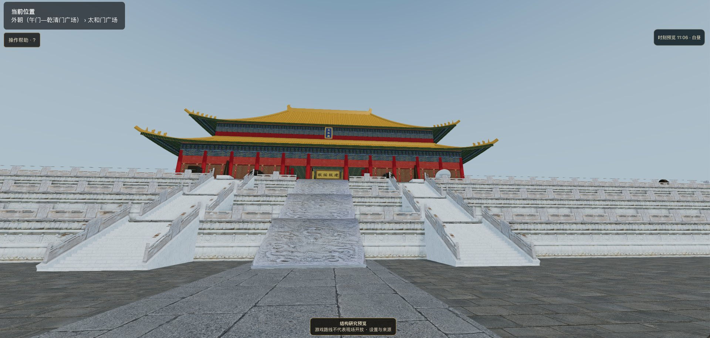
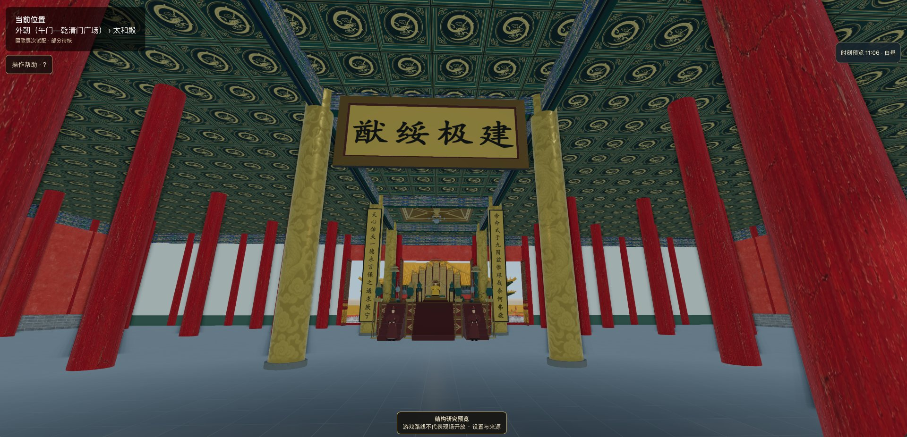
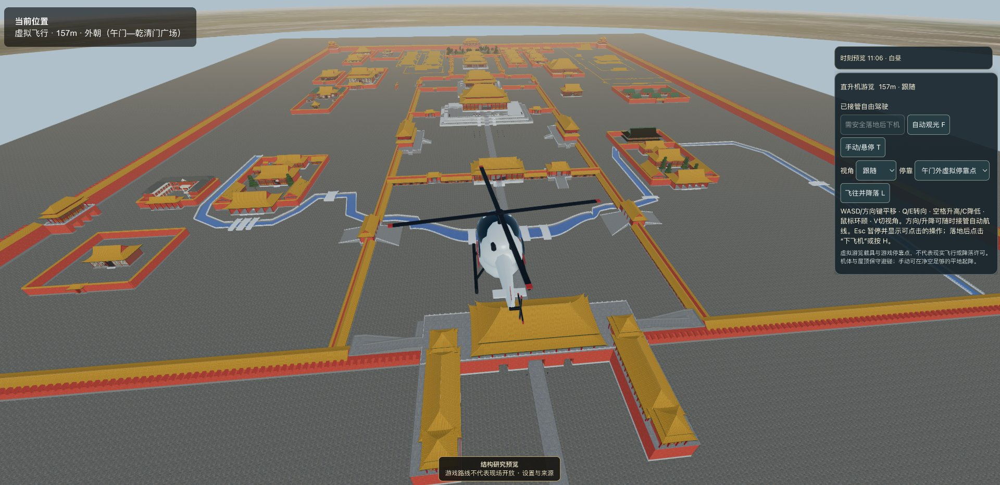
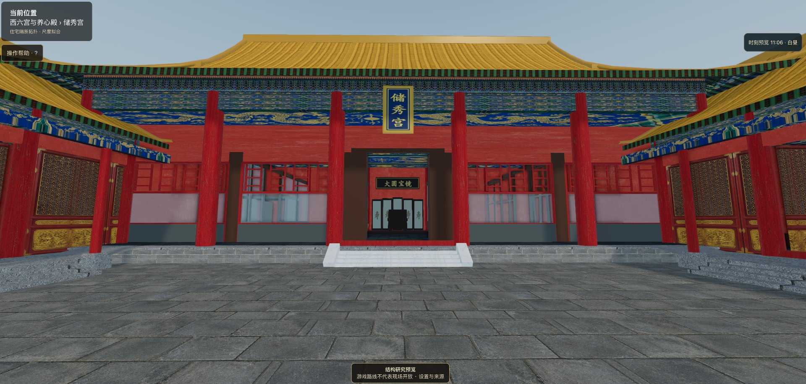
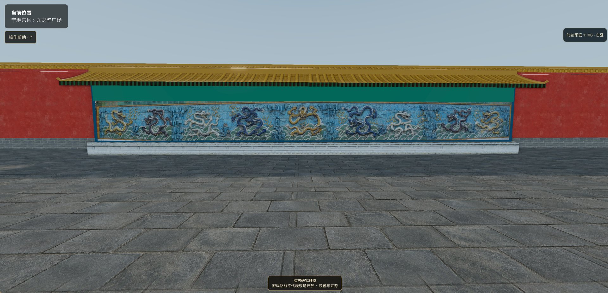
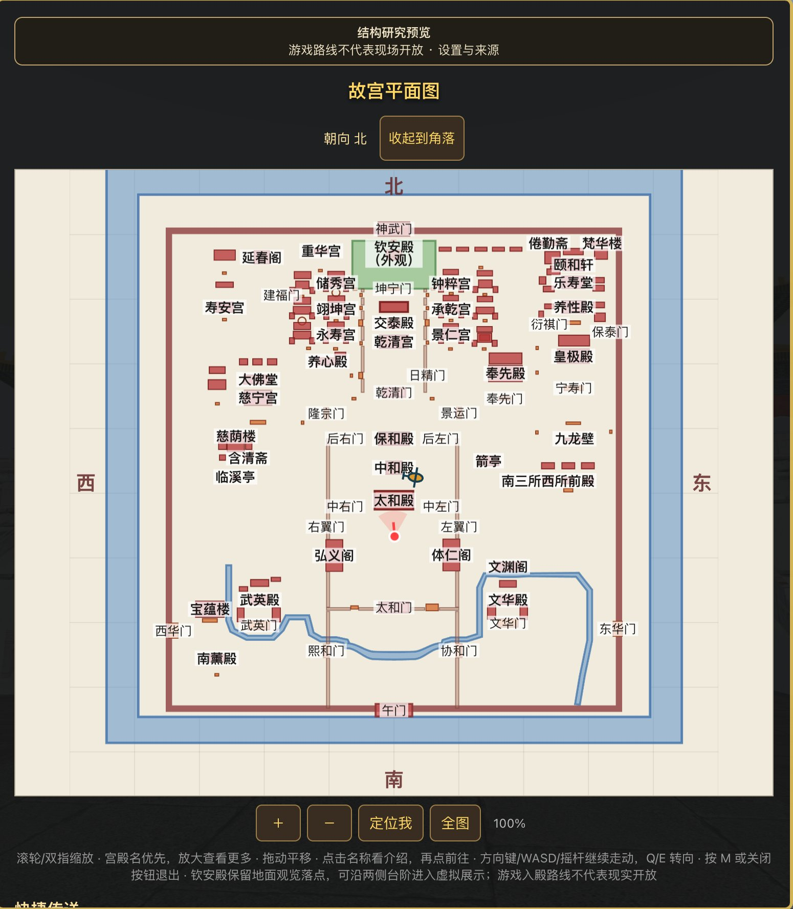

# 故宫 3D 虚拟游览

> **版本状态（2026-10-26核对）**：R103已交付开发分支（`b1013608`）；R104累计候选仅将锡庆门原单门改为三座分立随墙琉璃门及对应三真实墙洞，保中央通路。用户main已合R99（96f658fd）。候选、部署与实际GPU游玩分别核验，不把本地候选说成上线。


## R104：锡庆三座随墙门（累计开发候选）

- 仅锡庆实例由一座旧通用门改为三座独立庑殿顶门，中略高；真实三洞之间仍有实体墙，门楣至原高墙有实际头顶碰撞。原中央3.6m净口、地面及传送位置保留，两个新侧口实际双向步/跑验证；敛禧及其他42个宁寿对象保留。
- 新门垛使用独立有限域全身扫掠，三屋面采用实际生产合批Float32三角支持/阻穿，不以平盒或隐形面替代曲屋面。仅真实朝上面才落地；开放竖向檐饰上沿的压力落点可能保持空中状态，需要普通横移到真实屋面/地面再恢复跳跃，不宣称所有屋面边缘可站。
- ±7m侧门中心、18.8m主体总跨度及门宽/颜色均工程拟合，不是测绘。琉璃装饰仅主垛面内齐平色块，复杂花饰、背面和礓磋坡度/尺寸未复原；不新增未知高差或假地板。游戏门扇打开不代表博物院实际通行许可。
- 含真实屋面CPU源的门组局部warm构建+合批+释放五对中位约2.96→14.14ms，三角1258→3998；合批mesh/material仍10，属性约+257KiB。低档同样生成，有外观成本，不是提速；CPU无纹理图不代替GPU/手机验收。

见[R104限定验证](docs/current-state/r104/VALIDATION.md)与[累计台账](docs/current-state/r104/requirements.json)。分支 `feat/r104-xiqing-three-gates-20261026`，R103及前续功能/成本/负记录累计；R105再做累计验收，不等于旧欠项全清。

## R103：承乾正、后殿南窗限定形制（已交付开发分支）

- 仅现有南四加四封闭窗：正殿中宽矩格与两窄菱格，后殿高灰槛与浅色矩格；真实挤出格孔后保持opaque背板与连续窗洞侧面，不改变夜间隐私。中央门、北檐、床位/人物、碰撞/支撑/地图及其他56殿保持。
- 格数、比例、槛高是照片启发的有界工程拟合，不是测绘/逐格复原。CPU同机位图只比较实际几何底色，旧Canvas纹样均未采样，不声称原游戏窗为空白或实机GPU验收。
- 为控制成本仅做一次较稀拟合：两殿局部构建+合批+dispose五对中位约10.10→28.22ms；合批18→21、三角3968→15904、属性约增加1.093MiB。低画质同样生成，这是有成本的外观改进，不是提速版。旧高密候选负成本记录保留。

见[R103限定验证](docs/current-state/r103/VALIDATION.md)与[累计台账](docs/current-state/r103/requirements.json)。分支 `feat/r103-chengqian-south-windows-20261026`；东西六宫其他欠项、山体后墙及Garden加载回退不关闭。

## R102：交泰既有织物与台毯表面（已交付开发分支）

- 只给现有26个罩布/座背/小尖顶面与1个低台毯平面增加独立绘制的浅色细纹、蓝色边饰/内场分区；不新增陈设/宝玺，不改顶点、尺寸、碰撞、支撑或人物。未知纹样题材不补文字/龙纹/印记，明确是照片启发简化，不是文物织样复刻。
- 两张512²生产RGBA纹理及实际UV经CPU采样对照；不是GPU/手机截图，远处真实mipmap/走动效果仍未验。基础像素约2MiB，含mip估算约2.67MiB；局部构建CPU五对中位约8.18→22.01ms，接受可见材质收益的约14ms成本，不称性能优化。
- 原台毯范围、罩体数量、R54入口/台周、钟漏与其他陈设保持。细圆柱尖顶沿用原连续UV，初稿44个UV退化三角已修正并保留RED证据。

见[R102限定验证](docs/current-state/r102/VALIDATION.md)与[累计台账](docs/current-state/r102/requirements.json)。分支 `feat/r102-jiaotai-textile-surfaces-20261026`；旧山体后侧、Garden加载回退及窄栏边沿落脚欠项保留。

## R101：协和门牌框—彩梁局部接口（已交付开发分支）

仅将协和门完整牌组向外调整0.07m，消除原框体上后部与彩梁约0.06m的实体埋入，保留约0.01m间隔。数值是有界工程拟合，不是故宫安装测绘。框/字面共同移动；文字、尺寸、门头、开口、碰撞/支撑/地图、其他四门均保留，不称原先遮字或堵路。

现矩形框/字形仍是简化模型，未复刻照片曲边装饰及斜撑。见[R101限定验证](docs/current-state/r101/VALIDATION.md)与[累计台账](docs/current-state/r101/requirements.json)；分支 `feat/r101-xiehe-plaque-interface-20261026`。旧山体后侧、Garden加载成本及窄栏旧边沿落脚限制没有因版号关闭。

## R100：禊赏既有侧栏与渠长口径（已交付开发分支）

- 将现有两侧透空细栅换为实体石栏板与框柱，保持原包络和入口。真实连续压顶与可见碰撞同源；不新增前/背栏，不改亭梁柱屋顶、R83真槽/水面/支撑与通路。
- 照片中的突出柱头试验引入12条新落脚穿入，已拒绝；最终保原连续同高顶梁，独立144下降/退出无新增、加深或延长旧交叠。原96条短暂旧边沿交叠仍保留，不称全部物理无问题。详细浅雕和凸柱头未精确复原。
- 现渠401样点中心线14.424m，加密约14.426m；官方27m缺少测线/端点定义，本版不拉伸、加回环或新水网凑数。其余阶/北联系保留待核。

[R100限定验证](docs/current-state/r100/VALIDATION.md)与[需求台账](docs/current-state/r100/requirements.json)区分已交付、部分完成及未验能力；开发分支 `feat/r100-xishang-stone-rails-20261026`。R99东北局部解冲突及R96人物/家具/皇帝功能全部累计保留，R97/R98欠项不因版号关闭。

## R99：梵华楼—东北角墩局部解冲突（已交付开发分支）

梵华楼整体向南调整 2.25m，分区坐标与专用构造基准同步；建筑、碰撞、支撑、入口、地图与传送定位由同一 frame 联动。北墙、角墩及其他宁寿对象保持不动。原 9 对碰撞实体相穿归零，真实几何包络留约 0.34m 间隔；这是有界工程拟合，不是测绘坐标，也不承诺此间隔可供玩家穿行。

实际梵华入口/传送/退回与景福后阶通路已作独立差分；景福原台基过渡的身体交叠仍存在且未加深，不将可通行写成零交叠。详细检查与能力边界见 [R99验证记录](docs/current-state/r99/VALIDATION.md)。分支 `feat/r99-northeast-interface-20261026` 累计承接 R96 功能及 R97/R98 记录；R97 未采纳性能试验、R98 后侧/承托墙形体补完未达标，不能称这两项已完成。

## R96：家具落脚、附近人物与皇帝短路线（已交付开发分支）

- 养心暖阁限定家具域使用真实完整足印及静态/人物连续扫掠，修正跳上低几后普通退步落入家具；不改建筑形体、不缩小身体。域外旧控制保留，已知域外高空下降反例不冒称修复。
- 地面人物约 40m 内显示、45m 退出显示，60m 预备、70m 退出模型驻留；远处 108 人的逻辑位置/作息继续。飞行以飞机 XZ 为兴趣中心，采用更宽窗口；共享 CPU 模型按引用与缓存策略保留，并非每人下载 GLB，也不保证全部人物立即显示。
- 皇帝保持北京时间 21:00 出发、06:00 返回，夜间目的地由乾清改为中和真实座位。路线约 384.86→124.53m；新增仅皇帝使用的座姿适配，臀脚接触既有座垫/平台，不新增隐形踏板。坐下/起身仍为带占位检查的离散转换，不是连续坐姿动画。

当前专项功能证据与最后累计/性能/构建状态见 [R96 验证说明](docs/current-state/r96/VALIDATION.md)。开发分支为 `feat/r96-nearby-characters-emperor-20261026`；R97 性能试验与 R98 后侧形体试验均未采纳运行改动，原性能/形体欠项保留，后续分区按证据继续。

## R95：人物首次显示与需求对账（已交付历史范围）

R94低画质下储秀宫缺人已复现为准备队列延迟，不是人物关闭或加载报错。R95候选按相机附近优先准备，并将未使用LOD/日夜姿态改为有界按需准备；不提高每帧预算、不改角色数量/位置。实际实例提交、日夜/画质/隐藏恢复与独立功能审核已通过，最终构建/累计验收另记，不能将CPU检查说成手机实测。

[需求状态与R95–R105计划](docs/current-state/r102/requirements.json)逐项区分已交付、部分交付、真实遗留和未验能力。前面需求不是全部做完：炕沿普通退步问题已由上述R96限定修复处理；Garden加载回退及堆秀山后侧仍未解决，R97/R98实验拒绝记录保留；其余分区按证据推进，不重复已解决武英门殿问题。

R94原163失败完整保留：118身份/保留契约待迁移、7夹具、38待核是分诊不是豁免。云Chrome确认线上身份但WebGL Disabled，实际操作仍NOT_RUN；不是已通过手机/GPU验收。

## R94：已合并的五项累计更新（历史交付范围）

R94 已由用户合并 main，累计 R89 + R90 + R91 + R92 + R93。安全回滚基线为已交付 R93a；累计185项与堆秀山专项85项通过。准确冻结源码、完整回归、构建和能力边界见 [R94验证说明](docs/current-state/r94-duixiu/VALIDATION.md)。本节保留当时限定验收范围，不宣称全历史测试全部通过。

| 原计划 | 累计内容 | 本次状态边界 |
|---|---|---|
| R89 | 时分输入和焦点恢复、皇帝真实跑步与乾清路线、南部复杂水域碰撞 CPU 优化。 | R93a基线保留，R94累计专项通过。 |
| R90 | 顺贞门三座随墙门、中央北向牌匾、门墙开口及地图身份协调。 | R93a基线保留，R94累计专项通过。 |
| R91 | 堆秀山山体表面、可见实体与碰撞、洞路和登道的联合改造。 | 正面/洞顶前肩、两侧非路坡及外脚重构；洞、两路、山顶保留。后侧和部分承托墙仍为旧模型，不称全山复原。 |
| R92 | 保和殿东侧三级露台、横墙灰框小门与外墙接头联合校正。 | 已由 R93a 补齐原计划；保留西边、殿内、北阶、后左门及原长廊，不新增未定位廊内拱门。 |
| R93 | 勤政亲贤炕外两张高几，保留原炕上低几、脚踏与旧内景。 | R93a基线保留，R94累计专项通过。 |

R92 采用1941历史公尺图及同侧官方照片约束的工程拟合：东边距中轴53.6/58.71/64.26m、门洞1.6×2.6m及门位不是现状精确测绘；北向台边仍保留旧控制。R93 的0.46m方几和1.94m桌顶同样属于可逆模型拟合。详细记录见 [R93a 验证说明](docs/current-state/r93a-baohe-east/VALIDATION.md) 和 [R93 验证说明](docs/current-state/r93-qinzheng-tables/VALIDATION.md)。

已交付 R93a 的 current-state 记录为1290项、1127通过、163失败，与其R93基线失败名称多重集一致；另一次全历史扫测中止前观察到716条失败输出，未逐项穷尽分类。R94同套1290项也为1127通过/163失败，失败名称多重集无新增/消失；这不代表历史失败均可忽略。CPU几何、输入、碰撞和加载检查不等于浏览器/GPU、手机视觉或实机帧率验收。

**性能取舍**：五轮实际Garden CPU重建/登记/索引中位约374→556ms，存在约0.18s新增成本，明确保留而非称加载达标。控制器与108人物配对结果及尾峰见R94报告；不外推为GPU/手机帧率。

## 项目概况与历史指标

以下量化指标保留自 **2026-10-23 的 R62 快照**，不是后续版本的重新测量；当前版本、改动和验证边界以下方更新记录为准。

一个持续迭代的故宫第一人称漫游项目。基础建筑与场景以代码程序化生成，另有随项目提供、按需加载的可选 GLB 细化内景；存在尚未完成的复原与验证范围，不能将可运行项目等同于全宫复原验收完成。

| 指标 | 数值 |
|------|------|
| 本表统计基线 | **R62**（2026-10-23，本轮 61 个对象 / 854 条特征行） |
| 提交总数 | 255 |
| 场景分区 | 7 个 zone，共 **332** 个建筑 / 门 / 墙条目 |
| 几何门禁 | 门 **70/70** 双向通行检查通过，可进入殿 **41** 座 |
| 锚点校验 | 113 条建筑锚点比对，超差 1 条 |
| 细化内景 | **6 座 S 档**（太和殿、乾清宫、皇极殿、坤宁宫、养心殿、慈宁宫） |
| 场景人物 | **108** 个逻辑人物，**24** 条编排游览路线 |
| 构建产物 | 约 13 MB 纯静态（贴图 10 MB + JS 0.96 MB / gzip 0.28 MB + 内景 GLB 1 MB） |

**在线体验**：https://tour.bkeel.com/gugong/

以下为 R62 时点记录的核心能力与测试/性能快照，后续版本未在此逐项重测；通行数量及性能百分比不可直接作为最新版本的验收结果：

- ✅ 中轴线、东西六宫、外东路、外西路、宁寿宫区、御花园全部可第一人称行走
- ✅ 多数殿宇与宫门可走进去（41 座可进入殿，门 70/70 双向通行）
- ✅ 6 座 S 档细化内景，走近 15 m 自动加载、离开 40 m 卸载，失败自动回退
- ✅ 午门、神武门城台可沿马道登顶
- ✅ 桌面端键鼠 + 移动端虚拟摇杆双套完整操控，含跳跃与自动冲刺
- ✅ 实时阴影、SSAO、Bloom、FXAA 后期管线；同材质合批，DrawCall −66.5%、Triangles −57.1%
- ✅ 8 项自动化门禁脚本（build / zones / anchors / smoke / regression / stepwalk / stepwalk-auto / perf）

> 历史限制与失败记录见 **[docs/LIMITATIONS.md](docs/LIMITATIONS.md)**；后续版本的新变化、未验收项和拟合边界还须同时查阅下方更新记录及相应分版报告，不能只凭该历史摘要判断当前状态。
> 机器可读的项目摘要见 **[llms.txt](llms.txt)**。



## 更新记录

### R93：勤政亲贤炕外两张高几（已累计保留，2026-10-25）

按官方照片，在勤政亲贤炕外东西各补一张落地深色木方几，保留炕上原两张低几、脚踏、全部旧房间几何及 R88 S 内景。0.46m 方形、1.94m 桌顶均为可逆模型拟合，不是古物实测；不杜撰器物或雕饰。R93 当时交付的累计范围为 R89 + R90 + R93；随后 R93a 补齐 R92。当前 R94 目标还包括正在验收的 R91，不能将 R93 当时的范围说明当作当前集成范围。

实际 B/S 走跑/倒退/跳跃退出、屋顶飞行拒绝及流加载已验证；受影响回归85/85、独立审查6/6。全量raw仍为1127通过/163历史失败，无新增失败；CPU图不是浏览器/GPU验收。见 [本版变化](docs/current-state/r93-qinzheng-tables/RELEASE.md) 与 [验证及构建记录](docs/current-state/r93-qinzheng-tables/VALIDATION.md)。开发分支/本地包不代表主线合并或公开部署。

### R90：北端门墙与通路协调（已交付并累计保留，2026-10-25）

顺贞门专用三门形制、同源墙开口和单一地图身份；保持原有御花园至神武门往返通行，不整体移动北墙。保留 R89 全部修复。侧门尺寸和间距属于工程拟合，不是测绘。详情见 [本版变化与资料边界](docs/current-state/r90-north-connections/RELEASE.md) 和 [验证记录](docs/current-state/r90-north-connections/VALIDATION.md)。此记录不代表合并主线或公开部署。

本记录按累计开发顺序整理，来源为本仓库代码、分版报告及已读回的 GitHub 提交。只记录可核实的变化，不补造缺失版本、日期或验收结果。开发版本原则上包含前版功能；合并时还须保留主线独有的部署、界面与文档修改。历史编号 `R49E` 等后缀属于当时修订，不是独立于累计版本的另一套产品。

### 主线、开发与部署状态（2026-10-25 核对）

- 主线：已核对 [`main@bba88da`](https://github.com/watsonbkeel/forbidden-city-3d/commit/bba88da13cd475de9b513f80515aa85265ac8e71)，合并 **R88** 源码 `a333f2f3`（含 R73–R88 累积源码），保留主线独有的部署配置、界面与文档。此前主线为 `main@8681116`（R72 合并）。
- R73–R81 曾逐版核验上传；R82–R87 冻结源码与 R88 一并随 R88 累积快照合入主线。
- 公开体验地址为 https://tour.bkeel.com/gugong/ ，线上实际版本以 COS 上的 build-info.json 为准（保留主线更新记录所载的 R88 合并后重新构建与部署历史；本次未重新核验在线构建，R94 开发状态不等于线上版本）。

- R94：当前集成目标为 R89 + R90 + R91 + R92 + R93；R91 与最终累计验收仍在进行，尚无据此更新主线或公开部署的结论。
- R93a：已交付累计基线，含 R89 + R90 + R92 + R93；不包含当时尚未验收的 R91 原型。
- R89：已累计保留于 R93a，R94 仍须复核其功能与性能约束。具体优化、测试与限制见 [R89 变更与验收记录](docs/current-state/r89-time-emperor/RELEASE.md)。

### 最近的累计版本

| 版本 | 主要改动 | 范围与状态 |
|---|---|---|
| [R72](https://github.com/watsonbkeel/forbidden-city-3d/commit/64142982b550aed358b5b307bd96b55c202384cd) | 108 人物的夜间作息；30 张床、28 位女性角色独立床位；21:00–06:00 入睡，太监/守卫继续活动，皇帝在太和殿与乾清宫之间按路线往返；房间夜间补光、文华/武英局部树木补充；太和殿宝座台与御花园假山陷落修正。 | 已上传并被主线合并。床位、作息及路线是游戏设计，不是历史陈设清点。 |
| [R73](https://github.com/watsonbkeel/forbidden-city-3d/commit/f0f38303ee3d715135645ecc78631d87719b2531) | 养心门琉璃入口、侧屏与独立木屏的照片拟合，保留既有院落通行。 | 已合入主线。未完整复原整个养心院墙及未知连接。 |
| [R74](https://github.com/watsonbkeel/forbidden-city-3d/commit/268bbac8d237a9b74afacfeb2511d6bfc59016ca) | 昭仁殿独立三间外壳、抱厦、槛窗、低台基与开放接近路线；登记室内夜间照明。 | 已合入主线。室内留白，不增造书籍家具；完整院落与历史标高仍待核。 |
| [R75](https://github.com/watsonbkeel/forbidden-city-3d/commit/404e9d6834884cd979dd4805945dd809634bfeff) | 弘德殿独立外观与开放接近路线，不以昭仁殿镜像替代；保留乾清宫台基及凤彩门。 | 已合入主线。侧向绕行是工程通行拟合，不宣称复原历史小门。 |
| [R76](https://github.com/watsonbkeel/forbidden-city-3d/commit/7972c5012d14e449d2afe37bf1040610f75b554a) | 清理武英殿—穿廊—敬思殿两个内部接面上不适用的门槛、埋入阶石与坡面支撑，使可见地面与行走关系一致。 | 已合入主线。该路线原已可通行，本版不是新开通路线；其余 126 个殿座调用保持。 |
| [R77](https://github.com/watsonbkeel/forbidden-city-3d/commit/35c0392de77112ec76dffe488804ba2d835878a6) | 修正宫墙垛口朝向与承托关系；保留午门折返登城通道净空。 | 已合入主线。未改墙体坐标、城门、碰撞或地图；城墙总尺度的既有差异仍未解决。 |
| [R78](https://github.com/watsonbkeel/forbidden-city-3d/commit/584b47ffda66d1b8dba967806cd46a471fcb00f2) | 北京时间 19:00 起亮灯；21:00–06:00 寝室关闭强灯与发光灯体，保留环境可见性、室外及工作房间照明；后妃独立大床与宫女密集小床分区，增加必要遮挡；睡眠闭眼覆盖全部三级人物细节。 | 已合入主线。五处新增隔屏属于游戏隐私设计，非已考证清代隔断；永寿宫利用前后殿分离。 |
| [R79](https://github.com/watsonbkeel/forbidden-city-3d/commit/945ff1187f34a2f6e67a9ec5d077053c7c2a1319) | 累计保留主线部署/UI，新增双语介绍、静态说明和贡献页面、引用元数据、sitemap 与版本历史。 | 已合入主线。可抓取内容不等于已被搜索或 AI 收录、引用；不改主线或公开部署。 |
| [R80](https://github.com/watsonbkeel/forbidden-city-3d/commit/44f19144719e6890d54aebdd4e53aba5091a1b24) | 筒子河北、东、西三侧水面、河床与岸面，使用同一轮廓切开地面；地图标明南侧未建与保守禁降范围。 | 已合入主线。沿用模型范围和水位工程拟合，非测绘；不猜造南桥，不改出生点、城门、碰撞或飞行规则。 |
| [R81](https://github.com/watsonbkeel/forbidden-city-3d/commit/53cc7915fe6f305758f6ec03fb19a16484fda4ad) | 补充南侧两段水面，中央保留工程拟合陆地通道；玩家、NPC与直升机使用同一五段水域定义。 | 已合入主线。通道半宽100米并非测绘桥宽；不增造桥体、不改出生点或NPC路线。 |
| R82 | 浮碧亭实心台座改为真实石拱孔与下沉池体，同源裁切地面、草地和甬路；保留亭上构与南北通路。 | 已随 R88 合入主线。孔宽、水位和东西拱向均为模型拟合，非测绘；不增加水下通行，不替代GPU视觉验收。 |
| R83 | 禊赏亭五段直角示意槽改为连续曲水浅槽，石面孔洞、侧壁与水面共用轮廓，并补齐局部石面足高支撑。 | 已随 R88 合入主线。模型采样曲长约14.424米，不冒称官方27米已复原；宽深、回折和朝向均为拟合，GPU/手机视觉未验。 |
| R84 | 堆秀山替换为闭合实体前洞、独立双侧圆转登道和可退出的山顶外圈；御景亭南侧双门及栏口作显式游戏开放适配。 | 已随 R88 合入主线。洞室、27.2/27.4米模型登道及阶数均非测绘；保留屋顶外观但未重建可踩屋面，GPU/手机及天然叠石视觉未验。 |
| R85 | 太和殿外檐名匾采用独立云形轮廓、蓝心比例和系统字体；以完整实际网格包围体检查屋顶三角形净空，拒绝拟合时回退旧矩形匾。 | 已随 R88 合入主线。不是内殿建极绥猷匾；尺寸、雕纹和背部仍为拟合，系统字体不冒称原书法，GPU/手机视觉未验。 |
| R86 | 中和殿补入官方照片可见的近侧独立红柱对与一根浅顶枋；柱身、柱础与梁匹配实体碰撞，保留原四门及陈设；皇帝路线仅在中和柱旁作连续短段绕行。 | 已随 R88 合入主线。坐标、柱径和顶枋均为可逆摄影拟合，不臆造后排；近似投影不等于完整相机配准，GPU/手机视觉未验。 |
| R87 | 只启用内金水桥2的22个拟合侧帽，并以真实三角足盘见证、实体侧碰撞和受限侧滑替换该桥44个粗栏盒；其余四桥、桥面、水道不变。 | 已随 R88 合入主线。22帽几何落地不等于22帽全部可达：18中段帽仍受既有水域守卫限制，仅4端帽验证正常走离。摄影拟合不等于测绘；GPU/手机视觉与性能未验。 |
| R88 | 仅替换作者源明确归属的养心东暖阁旧高台椅、入口黄幔及高碰撞盒；增加低暗木椅/脚踏、椅后黄帘、南窗长炕、可通行北木界面与不提供楼层支撑的浅顶；可选内景安装失败完整回退。 | 已合入主线（2026-10-25）。全部非东部三角属性和原材质保留；几何为低细节摄影拟合。离线真实S资产图不是游戏内GPU/手机或灯光验收。 |

| R94 | 计划累计 R89–R93 五项更新，以 R93a 为安全基线继续集成。 | 进行中；R91及最终R94尚未完成验收，不据此宣称主线合并或公开部署。 |
| R93a | 补齐原计划 R92：保和东侧三级露台、横墙灰框小门与外墙接头。 | 已交付累计基线，含 R89 + R90 + R92 + R93。历史图约束的工程拟合，北向旧台边兼容保留；不是整台测绘。 |
| R91 | 堆秀山山体表面、实体碰撞与既有通路的联合改造。 | 正在开发与独立验收，计划纳入R94；未将试验原型算作已交付。 |
| R93 | 按官方照片补齐勤政亲贤炕外两张高脚方几；保留原低几、脚踏与旧内景。 | 已累计保留于R93a；尺寸为拟合，验证边界见本版记录。 |
| R90 | 顺贞三座随墙门、中央北向牌匾、墙开口和地图身份协调。 | 已累计保留于 R93a；R94需继续保留，未由此宣称主线合并或部署。 |
| R89 | 小时/分钟分别输入并显式应用时刻；修复时刻输入残留焦点导致不能移动；皇帝使用实际玩家跑步速度与逐段碰撞，修正乾清 S 地面和真实栏杆旁的入座路线；加入测量驱动的性能优化。 | 已交付并累计保留于 R93a。保留 108 人物、28 个占用床位、碰撞及夜间效果；CPU 验证不等于 GPU/手机帧率验收，结果见专项记录。 |

R89 专项：时间/实际乾清/设置联测 65/65；四个完整夜间世界通过；原始 current-state 为 1127/163（其中 161 项继承，新增 2 项为被显式乾清地面修正取代的旧 JSON 身份断言）。同一 108 人物完整世界成对 CPU 测量：60 Hz 步长夜间更新 p95 13.63→4.21 ms，p99 16.09→5.73 ms；只切换水域算法，不代表实机 FPS。完整变更、失败名称、验证边界见 [R89 专项记录](docs/current-state/r89-time-emperor/RELEASE.md)。

专项几何、路径、昼夜状态与资源检查不等于真实 GPU、手机或主观画面验收。R78 的本地完整历史测试仍保留 **151 项既有失败**，并单列两项被新睡眠设计替代的旧床型/睁眼几何约定；没有把未通过项目改写为通过。没有 GitHub CI 运行记录，也不能表述为“CI 已通过”。各版具体证据见累计源码中的 `reports/r72-*` 至 `reports/r78-*` 与对应验收记录。

### 逐区照片复核：R58–R71

下列对象数是**复核范围**，不是已精确复原数量。各区同时保留部分实现、差异待修与资料不足项；本阶段没有“全宫实景复原完成”的结论。A–M 的原计划编号在 R65 插入人物修正后顺延，因此 H–M 实际交付为 R66–R71；旧计划文件名不能替代实际版本号。

| 实际版本 / 分区 | 复核对象数 | 本轮代表性工作 |
|---|---:|---|
| R58 / A 中轴与外朝中路 | 37 | 桥梁、太和门廊与局部围护的来源核对和有限修正。 |
| R59 / B 文华、内阁、传心、南三所 | 41 | 文华窗格、文渊阁不等分上层窗组等照片支持的局部拟合。 |
| R60 / C 武英与外朝西路 | 17 | 武英端窗及栏杆、浴德堂连接、南薰殿无依据陈设撤除等。 |
| R61 / D 后三宫与内廷中路 | 32 | 坤宁北门、乾清后廊局部天花、交泰南窗格及无依据通用陈设清理。 |
| R62 / E 东六宫等 | 61 | 景阳后殿、永和抱厦、奉先殿前后殿等有界修正。 |
| R63 / F 西六宫与养心殿 | 55 | 同道堂屋顶、丽景轩窗组、局部足踏及无依据附房家具清理。 |
| R64 / G 御花园 | 29 | 钦安殿、天一门与局部桥/亭轮廓的来源约束修正。 |
| R65 / 人物体验插入版 | — | 玩家与人物互相挡路；人物全天保留；夜间补光与作者署名。 |
| R66 / H 重华、建福、西北佛堂 | 43 | 重华与延春南侧细节、英华局部窗门及无依据预设陈设清理。 |
| R67 / I 宁寿宫主体及后寝 | 29 | 宁寿前窗、景祺上窗、阅是屋面边缘、畅音栏杆色带等。 |
| R68 / J 宁寿宫花园 | 21 | 碧螺亭宝顶、遂初堂石面与局部色彩，清理无依据家具。 |
| R69 / K 慈宁、寿康、寿安及花园 | 21 | 临溪亭宝顶和目标建筑无依据活动陈设清理。 |
| R70 / L 宫城、桥水及待定位对象 | 11 | 角楼宝顶等有限拟合；未将城墙尺度、水系和待定位对象标为验收完成。 |
| R71 / M 端门 | 1 | 可切换的边界外远景外观；不新增可进入空间、人物、地图点或传送点。 |

详见[逐对象复核队列与存储说明](docs/photo-fidelity/QUEUE-STORAGE.md)、[续作记录](docs/photo-fidelity/RESUME.md)。

### 早期迭代与人物扩充

| 版本 | 可核实的更新摘要 / 来源 |
|---|---|
| R1–R30 | 早期场景、内景、地图、飞行与昼夜等连续迭代。现有证据未在本表逐版重建完整发布账，不把 V 系列验收快照直接换算成同号 R 版本。可查 [历史验收目录](docs/current-state/) 与 [v1.0.0 基线](docs/RELEASE-NOTES-v1.0.0.md)。 |
| R31 | 集成游览及飞行操作，保留 Esc 下机、地图等功能；见[飞行操作记录](docs/r31/flight-operations.md)。 |
| R32 | 汇总当时太和殿、乾清宫等陈列/表面修正，冻结源码与证据边界；后续以该累计基线继续，非当前最新版本。 |
| R33 | 乾清宫五进深/六深度站位与前后廊；太和匾联挂位；储秀竹纹、玉兰玻璃、葡萄落地罩等空间关系的可逆拟合。见 [R33](docs/current-state/r33-spatial-fit/README.md)。 |
| R34 | 连贯游览、储秀院落连接、乾清柱网统一、太和主景相对位置、明亮夜景及资源预算。见 [R34](docs/current-state/r34-integrated/README.md)。 |
| R35 | 路线材质、资源释放及专项验证；见 [R35 材质](docs/current-state/r35-materials/README.md)。 |
| R36 | 南区中轴、文华/武英展示及周边通路整合；见 [R36](docs/current-state/r36-south/README.md)。 |
| R37 | 浴德堂前后组合、武英两件代表器物的有限细化；见 [R37](docs/current-state/r37-south/README.md)。 |
| R38 | 文华/武英可定位树木与太和门南阶、御路关系；见 [R38](docs/current-state/r38-south/README.md)。 |
| R39 | 逐栋差异清单；文华、奉先、六处后殿、长春/翊坤等首批局部修正；见 [R39](docs/current-state/r39-interiors/README.md)。 |
| R40 | 景仁、钟粹、永和前后檐差异化；见 [R40](docs/current-state/r40-facades/README.md)。 |
| R41 | 储秀西侧三处炕体的有据补充；见 [R41](docs/current-state/r41-chuxiu/README.md)。 |
| R42 | 古华轩开放亭轩与通透格架；见 [R42](docs/current-state/r42-guhua/README.md)。 |
| R43 | 颐和轩主殿、前后抱厦与随安室局部关系；见 [R43](docs/current-state/r43-yihe/README.md)。 |
| R44 | 寿康正殿五间、门廊、暖阁及低木宝座/三屏风；见 [R44](docs/current-state/r44-shoukang/README.md)。 |
| R45 | 箭亭与临溪亭围护和门窗；见 [R45](docs/current-state/r45-enclosures/README.md)。 |
| R46 | 英华殿、咸若馆佛堂关系的有限更新；见 [R46](docs/current-state/r46-ritual-halls/README.md)。 |
| R47 | 累计保留 R46，补万春/千秋亭局部形制及通行；见 [R47](docs/current-state/r47-consolidated-garden/README.md)。 |
| R48 | 其余目标建筑的分批专用外壳、材质与通路修正；覆盖清单不等于全部完成，见 [R48](docs/current-state/r48-remaining/CURRENT-COVERAGE.md)。 |
| R49 / R49E | 永和等匾额遮挡、后殿识别、乾清门缺匾、宫名地图优先级及钦安殿虚拟侧入口等修正，并保留来源/开放权限说明。 |
| R50 | 初始受开关控制的人物系统候选，不能单凭存在模型便宣称默认可见。 |
| R51 | 合并 R49E 累计修正，人物默认可见及远级鞋脚修正，避免建筑与人物版本分离。 |
| R52 | 建立共享构建身份与包装检查、增加庭院角色；武英月台及侧阶的照片支持拟合。 |
| R53 | 人物扩展至 77；养心、寿康局部室内形体继续细化。 |
| R54 | 人物扩展至 85；长春东侧罩与交泰陈设的有界修正。 |
| R55 | 人物扩展至 93；坤宁低灶与中和低陈设的局部更新。 |
| R56 | 人物扩展至 101，近处人物在显示预算内优先，避免远处朝班挤占本地角色。 |
| R57 | 人物扩展至 108，并保留前述累计内容；此数是逻辑角色总数，不代表每个视角都同时绘制 108 人。 |

### 引用、复用与参与建设

- 项目名称：**故宫 3D 虚拟游览 / Forbidden City 3D Virtual Tour**；作者署名：**陈华山 & 陈诺**。
- 稳定代码入口： https://github.com/watsonbkeel/forbidden-city-3d 。引用某版实现时，请同时注明分支/固定提交、查看日期及适用范围；在线地址不能替代源码版本标识。
- 本项目是程序化、可交互的学习与展示模型，不是故宫官方产品或全宫实测数字孪生。明确区分官方文字/照片事实、可逆模型拟合与未知细节；游戏人物、作息和隐私隔屏不作为清代生活史证据。
- 报告问题或提交改进时，请附版本/提交、建筑名称、时间/昼夜状态、复现步骤和截图；建筑修正还应附官方来源及未确定的部分。不要用瞬移、取消碰撞或删除失败断言代替真实通路修复。
- 代码使用见 [MIT 许可证](LICENSE)。外部照片、文献与引用内容的权利分别归原权利人，不因代码开源而自动授权。

## 项目简介

基础建筑、天空由代码程序化生成（纹理为位图与程序化绘制）；6 座殿的可选细化内景使用随项目提供的 GLB（作者源在 `assets-src/interiors/`）。资源大小随版本变化，以该版清单为准。场景采用米制坐标组织平面格局：午门在南，神武门在北，东华门、西华门在东西两侧，可以直接走出宫城。

精度边界与未验收项见 [docs/LIMITATIONS.md](docs/LIMITATIONS.md)。

### 已具备的场景功能
- ✅ **中轴线**：午门、金水桥、太和门、太和殿、中和殿、保和殿、乾清门、乾清宫、交泰殿、坤宁宫、御花园、神武门
- ✅ **东西六宫**：景仁宫、承乾宫、钟粹宫、延禧宫、永和宫、景阳宫（东）+ 永寿宫、翊坤宫、储秀宫、太极殿、长春宫、咸福宫（西）
- ✅ **外路区域**：文华殿、文渊阁、奉先殿、箭亭（外东） + 武英殿、南薰殿、慈宁宫、寿康宫、寿安宫、英华殿（外西）
- ✅ **宁寿宫区**：皇极殿、宁寿宫、九龙壁、乾隆花园、畅音阁等 20+ 建筑
- ✅ **内景系统**：太和殿、乾清宫、皇极殿、养心殿、坤宁宫、慈宁宫 6 座 S 档可选细化内景（走近 15 m 自动加载，离开 40 m 卸载，加载失败回退简化内景）+ 其他殿座 B 档简化内景
- ✅ **性能优化历史记录**：DrawCall −66.5%、Triangles −57.1% 为 R62 历史测量，未对当前版本复测；60fps（桌面）/ 30fps（移动）仅为目标，不是实机验收结果

## 场景内容

### 中轴线（南 → 北）

午门 → 金水河与金水桥 → 太和门 → 太和殿 → 中和殿 → 保和殿 → 乾清门 → 乾清宫 → 交泰殿 → 坤宁宫 → 御花园（钦安殿、堆秀山、万春亭、千秋亭、浮碧亭、澄瑞亭）→ 神武门

- 三大殿共用三层台基，后三宫保留组团台基；各殿另有台明和阶道。台基轮廓与标高仍需独立实景核对。
- 午门、神武门的门洞有顶，门扇打开后贴在门洞两侧的墙上。
- 殿内有地面、天花和宝座，宝座在中轴上，参观路线从侧面绕过。

### 两侧宫院

| 区域 | 内容 |
|------|------|
| 中轴两侧 | 太和殿院落东西庑房、体仁阁/弘义阁、协和门/熙和门、左翼门/右翼门、昭德门/贞度门、中左门/中右门、后左门/后右门、景运门/隆宗门、内左门/内右门 |
| 内廷东西墙 | 日精门/月华门、龙光门/凤彩门、基化门/端则门，以及东西一长街 |
| 东西六宫 | 景仁宫、承乾宫、钟粹宫、延禧宫、永和宫、景阳宫；永寿宫、翊坤宫、储秀宫、太极殿、长春宫、咸福宫；另有乾东五所、养心殿 |
| 东路 | 文华殿、主敬殿、文渊阁、南三所、奉先殿、箭亭、宁寿宫区（九龙壁、皇极殿、宁寿宫、养性殿、乐寿堂、颐和轩、景祺阁、畅音阁） |
| 西路 | 武英殿、敬思殿、南薰殿、慈宁花园、慈宁宫、重华宫、建福宫/延春阁、英华殿、寿康宫、寿安宫 |
| 宫城出入口 | 东华门、西华门（城台门，可走出宫城）；午门、神武门 |
| 外围 | 城墙、四座角楼、护城河、午门外朝房 |

两侧宫殿按现有项目锚点摆放，细节比中轴简单：多数殿宇是可进入的殿座（带台基、台阶、柱网、宝座），部分宫院为外观 + 院门。

### 交互与界面

- 桌面端：WASD / 方向键移动，鼠标转向，Shift 冲刺，持续按住移动键约 2 秒自动冲刺，**空格跳跃**（可越过 1.1 m 的汉白玉栏杆）
- 移动端：左下角常驻虚拟方向盘（同方向持续推约 2 秒自动奔跑）；屏幕任意位置拖动转视角；右下角「跳」按钮和视角锁定按钮；按手机安全区留边，操作说明 8 秒后淡出
- 城台登城：午门、神武门两端有马道（斜坡踏道），可从宫内一侧走上城台顶
- **M 键小地图**：上北、右东（与真实地图方位一致），标出中轴与两侧宫院、宫门名称，红点和箭头指示自己的位置与朝向
- 左上角位置提示：在中轴和两侧宫院里都会显示当前所在建筑或街巷名
- Esc 打开设置菜单（音效、画质切换）
- 碰撞：墙柱和模型台阶登记碰撞及支撑；按模型支持高度计算移动。尺寸来源、已测路线与原控制器的高度平滑/惯性边界见当版验收记录，未测区域不能据此保证

### 渲染与性能

- 实时阴影、SSAO、Bloom、FXAA 后期处理
- 同材质网格合并（`mergeByMaterial`）、实例化渲染，控制 draw call
- 匾额统一烘焙到一张图集
- 高 / 低画质一键切换，移动端自动降低阴影分辨率和像素比

## 截图

### 太和殿内景


藻井、金柱、"建极绥猷"匾与宝座。6 座 S 档细化内景由 Blender 脚本生成 GLB，走近 15 m 自动加载。

### 全宫俯瞰


157 m 高空视角，可见中轴线、金水河与东西六宫格局。含自由飞行模式。

### 两侧宫院


西六宫储秀宫：斗拱彩画、殿内匾额与可进入的殿座。

### 宁寿宫区


宁寿宫区九龙壁。该区含皇极殿、宁寿宫、乾隆花园、畅音阁等 20+ 建筑。

### 小地图


M 键唤出，上北右东（与真实地图方位一致），标出中轴与两侧宫院、宫门名称。

## 快速开始

```bash
npm ci
npm run dev        # http://localhost:5173/gugong/
npm run build      # 产物在 dist/
npm run preview
npm run test:gate -- --keep-going  # 执行全部八项：build/zones/anchors/smoke/regression/stepwalk/stepwalk-auto/perf
```

开发模式下，浏览器控制台可通过 `window.__forbiddenCityApp` 访问应用实例（调试和自动化测试用）。

## 坐标约定

- +Z 朝北，**-X 朝东**（面朝北时的右手边）
- 每座建筑本地坐标默认朝南（-Z）
- 中轴关键位置（`src/config/constants.js` 的 `LAYOUT`）：

| 建筑 | Z |
|------|---|
| 午门 | -419.6 |
| 太和门 | -214.2 |
| 太和殿 / 中和殿 / 保和殿 | 0 / 65 / 123.2 |
| 乾清门 | 215.3 |
| 乾清宫 / 交泰殿 / 坤宁宫 | 316.8 / 354.1 / 386.1 |
| 御花园 | 470.5 |
| 神武门 | 542（与锚点 531 尚有已知差异） |

- 场景边界：x ±400，z -500 ~ 560（东华门、西华门外留出一段街面）
- 玩家：视线高 1.7 m，步行 5 m/s，冲刺 12 m/s，单步可踏上 0.6 m；方向盘走 3 m/s、奔跑 9 m/s；起跳速度 7.2 m/s，重力 14 m/s²（跳高约 1.85 m）

## 项目结构

```
forbidden-city-3d/
├── index.html / main.js / style.css     # 入口与主循环
├── public/textures/                      # 纹理（hd / sd 两档）
├── assets-src/                           # 纹理生成与处理脚本
├── data/                                 # 数据驱动配置（Phase 1）
│   ├── zones/*.json                      # 各区建筑清单（米制模型坐标，精度不一）
│   ├── interiors/*.json                  # 重点殿内景陈设清单 + GLB 引用
│   └── schema.md                         # 冻结的数据格式
├── docs/                                 # 架构文档与任务管理
│   ├── ARCHITECTURE-1to1.md              # 1:1 复刻控制文件
│   ├── D1/                               # 测绘数据（anchors.json, dimensions.md）
│   └── agent-tasks/                      # 任务板与报告
├── src/
│   ├── config/constants.js               # 尺寸、布局、玩家、性能、后期参数
│   ├── scene/
│   │   ├── zones/                        # 分区 Builder（ZoneBase, AxisZone, EastSixZone, etc.）
│   │   ├── ZoneManager.js                # 分区加载/卸载管理器
│   │   ├── interior/                     # 内景管线（InteriorLoader, InteriorFallback）
│   │   ├── palace/kit.js                 # CourtKit：宫墙、随墙门、门殿、城台门、可进入殿座、庑房、匾额
│   │   ├── palace/gate.js                # 午门
│   │   ├── palace/gateAscent.js          # 城台马道（登城踏道）与碰撞/可行走面
│   │   ├── palace/interiors.js           # 室内陈设预设（大殿/居室/库房，可复用）
│   │   ├── palace/river.js               # 金水河与金水桥
│   │   ├── palace/colliders.js
│   │   ├── PalaceBuilder.js              # 中轴主要殿宇、城门（收编至 AxisZone）
│   │   ├── Enclosure.js                  # 外城墙、角楼、午门外朝房
│   │   ├── GardenBuilder.js              # 御花园（亭、水池、堆秀山、树木，收编至 GardenZone）
│   │   ├── HallKit.js / RoofBuilder.js   # 殿身、台基、栏杆、屋顶
│   │   ├── Layout.js / Environment.js
│   │   └── sky/ garden/                  # 天空、植被与山石
│   ├── render/                           # 渲染优化（Phase 1）
│   │   ├── BatchedBuilder.js             # r162 BatchedMesh 替代 mergeByMaterial
│   │   ├── SilhouetteBuilder.js          # 远景屋面轮廓壳（无投影）
│   │   ├── ShadowSetup.js                # 阴影相机跟随玩家、半径 ≤ 120m
│   │   └── PostProcessing.js             # SSAO 深度重建法线 + Bloom + FXAA
│   ├── controls/                         # 第一人称、虚拟摇杆、传送（Phase 1 增强）
│   ├── utils/                            # 碰撞与可行走面、纹理、几何合并
│   ├── ui/                               # 小地图、设置菜单、位置提示（Phase 1 增强）
│   └── audio/Ambience.js                 # 环境音
└── tests/                                # 自动化测试脚本（Phase 1 增强）
    ├── gate.cjs                          # 门禁总控
    ├── zone-lint.cjs                     # zone JSON schema 校验
    ├── anchor-check.cjs                  # 锚点坐标对比
    ├── smoke.cjs / regression.cjs / stepwalk.cjs
    └── p1r-profile.cjs                   # 性能数据采样
```

### 碰撞与台阶

- 碰撞体是 Box3，只登记身体高度范围内（约 0 ~ 3 m）的部分。
- 可行走面有两类：`box`（平台、台面）和 `ramp`（台阶斜坡）。`getGroundHeight` 返回脚下不超过"脚高 + 单步高度"的最高面。
- 移动按子步长逐步推进，每个子步重新计算地面高度；若玩家已落入台基内部，会被托回台面。
- 跳跃/从高处走下时进入"空中"状态，按真实脚面做碰撞，落地后恢复贴地。
- 城台马道的碰撞体按 0.5 m 切片，只能从下端口走上去，不能从侧面翻上。

### 增加一座新殿

Phase 1 后，建筑由数据驱动（`data/zones/*.json`），使用 `CourtKit` API：

```js
// 在对应 zone 的 JSON 中添加：
{
  "kind": "hall",
  "name": "某某殿",
  "x": -100,
  "z": 150,
  "rot": 0,  // 0=朝南 90=朝东 180=朝北 270=朝西
  "w": 24,   // 面阔（米）
  "d": 14,   // 进深（米）
  "colH": 5, // 柱高（米）
  "ph": 1.2, // 台基高（米）
  "roof": "xieshan",  // 屋顶类型：xieshan / wudian / cuanjian / yingshan
  "enter": true,      // 是否可进入
  "throne": true,     // 是否有宝座
  "interior": "A:palace-front"  // 内景档位（S/A/B）
}
```

门殿与院墙同理：
```js
{ "kind": "gate", "name": "某某门", "x": -80, "z": 140, "rot": 90, "style": "wall" }
{ "kind": "wall", "from": [-100, 140], "to": [-60, 140], "h": 7, "gaps": [] }
```

详见 `data/schema.md` 和 `docs/ARCHITECTURE-1to1.md`。

## 部署

产物是纯静态文件（`dist/`），可部署到支持对应资源类型的静态托管。约 13 MB 是早期快照，不是当前包大小；当前大小以各版 SHA256SUMS.json 清单为准。

```bash
VITE_BASE=/ npm run build                       # 域名根路径构建（默认 base 为 /gugong/）
npx vite build --base=/forbidden-city-3d/      # 部署到子路径（如 GitHub Pages 项目页）
```

- 贴图、内景模型、解码器路径都跟随 `--base`，子路径部署无需改代码。
- 服务器需对 `.wasm` 返回 `application/wasm`（主流托管默认支持）。
- 生产包不暴露 `window.__forbiddenCityApp`（仅开发模式），自动化测试须跑在 `npm run dev` 上。

## 测试

测试脚本用 Playwright + 本机 Chrome（headless，swiftshader），需要先启动 `npm run dev`。Playwright 不在项目依赖里，自行安装；并按本机路径修改脚本里的 `executablePath`。

### 门禁测试
```bash
npm run test:gate  # 完整门禁（8 个步骤：build + zones + anchors + smoke + regression + stepwalk + stepwalk-auto + perf）
```

**历史门禁快照（R62 · 2026-10-23 实测，不是后续版本验收）**：

| 门禁项 | 结果 |
|--------|------|
| build | ✅ 构建通过 |
| zones | ⚠️ 7 个 zone，**2 错误 / 20 警告** |
| anchors | ⚠️ 113 条锚点比对，**超差 1** 条 |
| 几何通行 | ✅ 门 70/70 双向检查，可进入殿 41 座 |

该次快照的 2 个 zone 错误为武英门北侧净空不足与武英殿前门不可进入，当时属真实可复现缺陷；不能据此判断后续局部修正后的当前状态。完整说明与历史批次记录见 [docs/LIMITATIONS.md](docs/LIMITATIONS.md)。

**v1.0.0 发布基线（历史快照，已被后续迭代超越）**：
- ✅ build / zones（0 错误 23 警告）/ anchors（113 条超差 0）/ smoke（colliders 6560）
- ✅ regression 24/24、stepwalk 132/132、stepwalk-auto 152/152、perf 无劣化

> stepwalk / stepwalk-auto 会先预加载全部 6 座 S 档内景，按「内景全部在场」的最坏情况测碰撞；预加载失败即判失败。

### 单独运行测试

| 脚本 | 作用 |
|------|------|
| `npm run test:zones` | 检查 zone JSON schema、bounds 缝隙、门净空 |
| `npm run test:anchors` | 对比 anchors.json 锚点坐标，检测超差 |
| `tests/smoke.cjs` | 加载页面，检查无报错、碰撞体数量 |
| `tests/regression.cjs` | 四座城门可通行、护城河与桥、御花园碰撞等回归断言 |
| `tests/stepwalk.cjs` | 用真实控制器按固定帧率逐帧走完中轴与两侧路线，检测"掉到台下""未到达途经点"。`node tests/stepwalk.cjs 60,10 0,1 all` |
| `tests/shot.cjs` | 按给定相机位置批量截图：`node tests/shot.cjs 名称 x,y,z lx,ly,lz ...` |
| `tests/walk.cjs` `realwalk.cjs` | 简单行走验证 |

V5 及更早批次的门禁结果属历史记录，完整执行范围与失败证据保存在 [docs/LIMITATIONS.md](docs/LIMITATIONS.md)。

## 参数调整

`src/config/constants.js`：

- `DIMENSIONS`：主要建筑尺寸
- `LAYOUT`：中轴位置与场景边界
- `PLAYER`：身高、速度、可踏台阶高度、方向盘速度与奔跑判定、跳跃与重力
- `PERFORMANCE`：阴影、瓦片数等
- 后期处理参数（SSAO、Bloom）

## 开发规范

Phase 1 采用多 Agent 协作开发，遵循严格的文件所有权与接口冻结规则：

- **控制文件**：`docs/ARCHITECTURE-1to1.md`（1:1 复刻架构方案）
- **任务板**：`docs/agent-tasks/BOARD.md`（任务跟踪与分派）
- **数据格式**：`data/schema.md`（zone JSON 与 interior JSON 格式冻结）
- **坐标系**：+Z 北 / -X 东，原点 = 太和殿中心，单位米（模型坐标；不表示每项尺寸均经实测）
- **接口冻结**：`ZoneBase` / `ZoneManager` / `CourtKit` 签名冻结，只增不改
- **文件所有权**：每个任务只改任务卡列出的文件，跨文件需求通过 REQUESTS.md 协调
- **测试门禁**：合并前必须通过 `npm run test:gate`

详见 `docs/ARCHITECTURE-1to1.md` 第 4 节。

## 常见问题

- **黑屏**：看浏览器控制台；确认浏览器支持 WebGL。
- **卡顿**：设置菜单切到低画质；或降低 `constants.js` 中的性能参数。
- **点击后不能移动**：桌面端需先点击画面进入指针锁定，Esc 解锁。
- **想嵌入微信小程序**：用 web-view 加载部署后的 HTTPS 页面（需企业主体小程序、已备案域名），建议默认低画质。

## 说明

建筑为学习与展示用途的程序化还原，按真实格局与比例组织并做了简化。完整的精度边界、未验收项与历史失败记录见 [docs/LIMITATIONS.md](docs/LIMITATIONS.md)。

## 开源协议

MIT License，详见 [LICENSE](./LICENSE)。

## 致谢

- [Three.js](https://threejs.org/)
- [故宫博物院](https://www.dpm.org.cn/)（建筑参考资料）

## R58 研究队列

逐对象照片复核的唯一进度入口为 `docs/photo-fidelity/QUEUE.json`。它是透明无损 gzip 分片的版本化索引，不是运行时数据；使用 `python -B scripts/photo-fidelity/queue.py stats` 读取，勿直接解析或编辑索引作为任务对象。读写、导出及回滚说明见 [队列存储](docs/photo-fidelity/QUEUE-STORAGE.md)，当前续作入口见 [RESUME](docs/photo-fidelity/RESUME.md)。


## R97 性能验证记录：未采纳运行优化

已评估帧级相机/视锥复用、未变人物矩阵/包围盒跳更新、堆秀山外脚行缓存。虽然减少了内部调用且修后等价检查通过，实际储秀人物首显/整帧CPU没有可信收益，部分回退；Garden配对收益也小于噪声。因此恢复全部运行源码为已交付R96，运行版本仍R96，不宣称R97加速或解决Garden约+182ms重建成本。R97仅为可回滚的验证记录/测试提交，不需要重建或部署同一运行树。

完整正反证据及下一步边界见 [R97实验结论](docs/current-state/r97/EXPERIMENT-RESULT.md)。后续R98限定形体工作不继承这些未采纳运行实验。

## R98 限定山体外观验证：未采纳，残余仍未完成

后中央真实浅内折和一次限定墙面材质整理均已验证，但固定游览视点改善不足：前者偏人工凹槽，后者主要放大贴图。两项均不进入运行树；恢复精确R96运行输入，不以R98编号宣称堆秀山后侧/承托墙补完。原直墙和后阶格明确保留为欠项，接续R99已确证的局部建筑相穿问题。详见 [R98结论与残余](docs/current-state/r98/EXPERIMENT-RESULT.md)。
